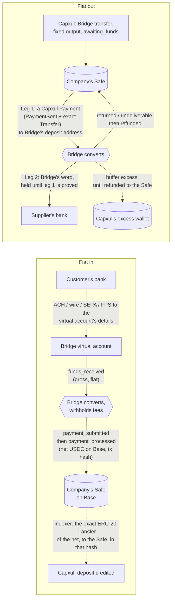

# CX-bridge-rails: how money really moves through Bridge, and what Capxul's Bridge design gets wrong

**Status: draft, 26 November 2026.** Proposed by Goal 16's 📐 designer thread, started by Goal 16's lead
(session_01S8RF7ASqmdxbN37WdpZMcB), after Aaron's words of 26 November 2026, kept as heard. On USDC: "its never in
bridge its in the safe which is self custodial". On learning that CX-bridge says otherwise: "they need updating and
thats concering because then it means they dont understand how it actually works. that being said there is a
infrastructure repo somewhere in a projects subfolder and it has an implementation that can be lifted but needs
validations still".

It corrects CX-bridge (decided 25 November 2026) and the Bridge things it built, and plans the lift of Aaron's existing
implementation in `Xelmar-tech/infrastructure`. The flow comes from Bridge's public documentation (the appendix cites
each page). The implementation was read by Goal 16's lead at `master` a5ad185 (R0, section 2), because this thread was
refused permission to attach it. Its paths are written `infrastructure:<path>`, where `B/` is `packages/backend/src/`,
`Br/` is `B/integrations/bridge/` and `I/` is the repository root. Nothing from that repository is committed here.
CX-crypto-accounting (#1144) dropped the Bridge lines its section 8 drafted, so this record owns every Bridge correction.

## In short

Bridge never keeps a Capxul company's money. It converts between the banks and the chain. Money in: a company gets real
bank details from Bridge, called a virtual account. A customer pays them by ACH, wire, SEPA or Faster Payments. Bridge
converts the money and sends USDC on chain, on Base, straight to the company's own Safe. Bridge pays whatever address
the account names, so Capxul sets it to the company's Safe itself and never takes it from a request. A deposit counts
only when the chain shows the exact USDC arrived in the Safe. Money out: Bridge quotes a payout, the Safe pays Bridge's
address for it on chain, and Bridge pays the supplier's bank. Capxul believes Bridge's "delivered" only after the chain
proves the Safe paid. Every payout is spent against a budget, and one over budget is refused. A returned payout, and
the small buffer left from each one, come back to the Safe. Capxul's design today says Bridge holds the USDC, so all of
this is missing.

## 1. How money really moves

### Who holds what, at every step

| Step | Fiat in (a customer pays the company) | Fiat out (the company pays a supplier) |
|---|---|---|
| 1 | The customer's bank holds the money | The company's **Safe** holds the USDC; only its signers can move it |
| 2 | In flight on the bank rail to Bridge's partner bank (Lead Bank for USD, Modulr for EUR, in Bridge's examples) | The Safe pays Bridge's deposit address for this transfer, on Base, through a Capxul Payment; Bridge holds it only while converting |
| 3 | Bridge's partner bank holds the fiat, credited to the company's virtual account (`funds_received`) | Bridge has the USDC (`funds_received`), converts it and pays out on the rail (`payment_submitted`) |
| 4 | Bridge converts and sends USDC on chain (`payment_submitted`, a preliminary hash) | The supplier's bank holds the fixed output (`payment_processed`, with an IMAD or ACH trace number); the buffer's unused part stays in **Capxul's** "Fixed Outputs Excess Funds" wallet until refunded to the Safe |
| 5 | The USDC is in the company's **Safe**, confirmed on chain (`payment_processed`, the final hash) | If the bank returns it: Bridge holds it again (`returned`), then refunds USDC to the return address, which must be the Safe (`refunded`) |

Bridge holds the money only in transit, between the bank leg and the chain leg. There is no balance at Bridge. Two
amounts are not the company's Safe's, and the books must say whose they are:

- **Capxul's developer fee**, if one is set, is withheld by Bridge and paid to Capxul's fee account monthly. It is
  Capxul's income and the company's expense. None is set in the implementation (V16); Aaron, 26 November 2026: "yes
  configurable", so it is a setting per company, zero by default.
- **The fixed-output buffer.** A payout fixes what the supplier receives, so the Safe sends the quoted input plus a
  slippage buffer of about 1%. What the buffer doesn't use is the company's money, held by Capxul in its "Fixed Outputs
  Excess Funds" wallet (`infrastructure:B/banking/payouts/README.md`, ADR-0025 R4 amended). Aaron, 26 November 2026,
  on refunding it to the Safe when each payout settles: "agreed". Until the refund happens, the excess is recorded with
  its owner, the company. The implementation doesn't build the refund; R6 does.

### Fiat in

1. **A customer at Bridge.** A company is a Bridge customer of type `business`, a person one of type `individual`, under
   Capxul's developer account, with terms accepted, KYC or KYB approved, and the endorsement for the rail (below).
   Bridge: "Customers must be onboarded and KYC/KYB-approved before creating virtual accounts" (`virtualaccounts`).
2. **A virtual account.** `POST /v0/customers/{customerID}/virtual_accounts` with `source.currency` and a `destination`
   of `{ payment_rail: "base", currency, address }`. USD, EUR and GBP (Faster Payments) all settle to USDC: the Safe
   holds only USDC, ETH and cbBTC (CX-crypto-accounting). Bridge supports EUR to USDC, and the implementation funds EUR
   payouts from USDC (recording va10, and its payout route); its EURC default is not lifted. The
   answer's `source_deposit_instructions` are the bank details the company shows its customers. They are permanent; the
   implementation keeps one per party and currency, its creation key stored before the POST. **The destination is the
   company's Safe address, derived from the stored company, never from the caller.** Bridge accepts any string there, so
   the address and chain are validated before the call, and the stored destination is read back against the Safe. An
   `account_update` event says the destination changed; one Capxul didn't make is an alarm.
3. **A deposit.** Each incoming payment has a `deposit_id` and a run of `virtual_account.activity` events, each with
   its own `id`: `funds_scheduled` (ACH only), `funds_received` (gross, before fees, in the source currency),
   sometimes `in_review`, then `payment_submitted` (its hash "may be preliminary") and `payment_processed` ("Payment
   confirmed on-chain. Final state."; `amount` is now the net sent, with `developer_fee_amount`,
   `exchange_fee_amount`, `subtotal_amount`, `gas_fee` and the final `destination_tx_hash`) (`virtual-account-events`).
   The implementation keeps the gross (`initial_amount`) and the net (`final_amount`), not the fees.
4. **Bridge converts.** Below the route's minimum (1 USDC, after fees) a deposit is dust: Bridge holds microdeposits
   until they pass it (`mins`). The implementation marks one `below_minimum` and never credits it.
5. **On chain to the Safe, on Base.** Bridge's rail is `base`. Production on Base mainnet is ADR-0025's release gate (its
   Bridge amendment R10); staging is Base Sepolia (84532) with Capxul's own test USDC
   (`infrastructure:B/banking/payouts/rules.ts:13-19`). A Safe has the same address on every EVM chain (R9).
6. **Credited.** A deposit counts when **both** hold: Bridge has said `payment_processed` for that `deposit_id`, and the
   chain shows the exact ERC-20 `Transfer` of the net amount, of that token, to the company's Safe, in that
   `destination_tx_hash` (the implementation's `exactDepositTransfer`, through its Ponder indexer:
   `infrastructure:B/banking/deposits/rules.ts:210-226`, `deposits/operations/credit.ts:77-93`). It confirms by
   inclusion in a block and corrects for a reorg (ADR-0018's chain-head correction) rather than waiting a fixed depth.
   Bridge's sandbox doesn't move real tokens ("Do not assume that a blockchain testnet is used"), so staging credits
   against Capxul's own mint of its test token, and Capxul's prove must use a chain stand-in.
7. **Refunds of a deposit.** If Bridge can't deliver, it refunds the sender: `refund_in_flight`, then `refunded` or
   `refund_failed`, sometimes **without a `deposit_id`**. None puts money in the Safe; the implementation refuses a
   refund with no `deposit_id` once and raises an alert. A company can also send a deposit back within 90 days, by a
   transfer whose source is its Safe and whose `payment_rail` is `fiat_deposit_return` (`returns`). That is not built.

### Fiat out

**One Bridge transfer per payout, with a fixed output.** Liquidation addresses were considered and rejected
(ADR-0025 R3, R4). First the payee is an external account (`POST /v0/customers/{customerID}/external_accounts`). Then
`POST /v0/transfers` with:

- `on_behalf_of`: the company's customer;
- `source`: `{ payment_rail: "base", currency: "usdc", from_address: <the Safe> }`;
- `destination`: `{ payment_rail: "ach" | "sepa" | "faster_payments", currency, external_account_id, amount }`, a
  **fixed output**: the supplier receives exactly `destination.amount`, and Bridge quotes the input;
- `return_instructions.return_address`: the Safe (not sent by the implementation today; Bridge question 14 is open in
  `infrastructure:I/docs/planning/banking/bridge-questions.md:98-103`);
- `Idempotency-Key` and `client_reference_id`: the payout's id, minted once per request key, with a digest of the body
  checked on a retry (`infrastructure:B/banking/payouts/operations/prepare.ts:110-116`).

The answer is checked field by field (`infrastructure:Br/internal/answer-checks.ts:77-112`): `awaiting_funds`, with
`source_deposit_instructions` naming Bridge's `to_address` and the input `amount`.

- **Leg 1, the Safe pays.** It is an ordinary Capxul Payment of kind Payout, to Bridge's deposit address: a sponsored
  ERC-4337 UserOperation through the CapxulPayments settlement contract, carrying a `settlementId`, proved by its
  `PaymentSent` event and the exact ERC-20 `Transfer`. **M1:** the Safe pays only a live quote, exactly its amount, to
  the saved deposit address, before its deadline, once
  (`infrastructure:B/banking/payouts/rules/funding.ts:32-56`, `claimSend`).
- **Leg 2, Bridge pays the bank.** `funds_received`, `payment_submitted`, `payment_processed`. **M3:** Bridge's word
  that it delivered is held until leg 1 is proved on chain, because Bridge's sandbox completes an unfunded
  crypto-source transfer by itself after about 30 seconds (recording va12).

**M5, delivered as locked:** the bank amount delivered equals the amount Bridge locked, in the same currency and
quantity; a deal that only estimated its output accepts whatever Bridge delivered in the same currency; anything else
goes to a person (`infrastructure:B/banking/payouts/rules/delivery.ts`).
**M6, one live timer:** no payout waits without exactly one live timer. The door refuses to save a waiting row with no
timer, and a lost timer hands the payout to a person with `timer_lost` and one alert (`rules/transition.ts`,
`payoutInvariantBroken`; `operations/watchdog.ts`).

**The payout machine** has twelve states (`infrastructure:B/banking/payouts/rules/vocabulary.ts:8-21`): one door, one
pure transition, one live timer per waiting state, a watchdog, and each Bridge call saved before it is sent, with a
dispatch token and a lease, retried with the same key and body.

**Bridge's states** (`transfer-states`): `awaiting_funds` → `funds_received` → `payment_submitted` →
`payment_processed`, which "can never go backwards". Off the path: `in_review`, `underfunded` (the Safe sent less than
the quote: `funding_short`, for a person), `undeliverable`, `returned`, `refund_in_flight` → `refunded` or
`refund_failed`, `missing_return_policy`, `canceled` (only from `awaiting_funds`, by `DELETE`) and `error`. The
implementation sends `returned`, `undeliverable`, `error`, the refunds and `canceled` to Returning, and marks Refunded
only when the refund is seen on chain. Webhooks also carry `payment_validated`, `kyc_required` and `kyc_in_review`.

**M2: never cancel while the send's outcome is unknown.** If leg 1 might have gone out, a canceled transfer could
strand the money; after 24 hours a person looks (`funding.ts:149-158`; the person's cancel
at `rules/attention.ts:44-50`, the 24 hours at `rules/timers.ts:38`). A `not_awaiting_funds` answer to a cancel is an
answer, not an error. A `transferConflict` (the same key, a different body) stops the payout.

**Where a return goes** (`returns`): the Bridge wallet it came from; else a liquidation address's `return_address`;
else the transfer's `return_instructions.return_address`; else the developer's crypto return policy; else
`missing_return_policy`. So **every payout names the Safe as its return address**. The implementation doesn't yet, and
treats `missing_return_policy` as still working until a 7-day `delivery_stalled` (`rules/news.ts:15`).

**Failures before anything moves.** Creating the transfer can fail with `has_not_accepted_tos`,
`requires_active_kyc_status`, `deactivated_external_account`, `missing_required_endorsements`,
`developer_limits_exceeded`, `not_truly_idempotent` and others (`transfer-errors-and-recovery`). The implementation
doesn't check payout minimums first: Bridge's refusal becomes `INVALID_INPUT`, and the payout is Refused.

### Who signs: every payout is on a budget

Aaron, 26 November 2026: "everything is on a budget. safe can do anything but typical is budget". So:

- **A payout is spent against an Org Budget.** On chain this is the implementation's shape, lifted: a Zodiac Roles 2.1.1
  role the company's Safe grants, used by a member through `execTransactionWithRole` from the member's own Safe, and
  scoped to CapxulPayments V3's `send`. This is the normal path. Leg 1 stays a CapxulPayments `send`, so its proof stays
  `PaymentSent` with the payout's `settlementId` plus the exact `Transfer` (M1, V8).
- **The Safe's owners can do anything directly.** That is the exception path, signed by the owners' own keys (a
  person's Safe: the key that claiming installs as its only owner, approved on Capxul's page).
- **Over budget is refused, not queued.** Capxul declares its own refusal, `PayoutOverBudget { remaining }`, in the
  piece that prepares a payout (`bridge-accounts`) (Superseded by CX-features, 26 November 2026: "the piece that prepares a payout" → "the feature that prepares a payout"), with `remaining` in USDC base units. It is not held for an owner.

**What limits the role.** The Org Budget scopes V3 `send`'s tuple, not a bare ERC-20 transfer. For a finite budget with
an allowance key, the amount is `and(lteUint256(limit), withinAllowance(allowanceKey))`: `withinAllowance` caps the
budget's total and `lteUint256` caps each send at the budget's limit. The token is `equalAddress(policy.tokenAddress)`, the recipient
`recipientCondition(policy.recipients)`, and the token's approval goes only to the V3 router
(`resolvedBudgetApprovalPermission`) (`infrastructure:packages/protocol/src/evm/budget-permissions.ts:117-155`; the
conditions in `zodiac-conditions.ts:86-136`). Payroll's role is similar, with `withinAllowance` but no `lteUint256`,
and a `passStatic` recipient (`payroll-payout-role.ts:96-108`). Checked by Goal 16's lead in the implementation.

**Where it is charged.** The implementation's money canon refuses delegated fiat funding until the owner sets a cap,
because the roles module can't limit a debit in dollars at a bank (`infrastructure:I/docs/canon/money.md:88-89,139`;
ADR-0017 M00); that is accepted there and not built, and payouts sit behind the flag `bank-payouts`. But leg 1 is a
USDC `send` out of the Safe, which the role does limit. So the budget is charged at funding time, in USDC, for the
transfer's quoted input plus its buffer, exactly what leaves the Safe. The fiat amount needs no limit of its own: the
quote the USDC pays for fixes it. **The budget is not credited back automatically**: nothing raises an allowance but an
owner-signed `setAllowance`. When the payout settles, the buffer's excess is refunded to the Safe; the budget's report
shows the excess beside each payout, and the owner can top the allowance up (`design/later.md` has the automatic
credit-back). R3 still proves that nothing else in ADR-0017 M00 rests on the fiat side.

**Decided where.** At prepare, before Bridge is called, Capxul reads the role's remaining allowance from the chain (for
an allowance with a refill period, the balance accrued so far) and compares it with an estimate: the fixed output in
USDC, through the lifted route table and `rates`, plus the buffer. If the estimate is over, it refuses
`PayoutOverBudget` (with `remaining: 0` when the budget is spent), so no transfer is made that the budget can't fund. A
quote that comes back above the remaining allowance takes the same safe cancel as a race: if the chain still refuses
leg 1, the outcome is known, not unknown, so it is not M2's case; the Bridge transfer is canceled while it is
`awaiting_funds`, and nothing is sent.

**Recipients "anyone" widens what a member can do.** `recipientCondition` passes anything when the recipients are
"anyone" or empty; otherwise it is an OR of fixed addresses, which `zodiac-conditions.ts:118-124` calls "the
treasury-drain boundary". Bridge's deposit address can differ from one transfer to the next, so a budget that funds bank
payouts has recipients "anyone", and a member holding it could call `execTransactionWithRole` directly and send its USDC
anywhere. So:

- on chain, only the amount bounds such a budget;
- a bank-payout budget is used only for bank payouts;
- every `PaymentSent` from that role is matched to a Capxul payout by its `settlementId`, and an unmatched send raises
  one alarm and goes to a person (V21, new in Capxul).

**Separately, the accounting budget.** Slice 12's budgets are ERPNext's Budget against accounts and cost centres, kept in
the database (CX-composable-pieces, item 22). That is a different check, made when the payout's Payment Entry posts
(the ledger's check before a posting, which `budgets` fills). It is optional: with no `budgets` piece there is no check (Superseded by CX-features, 26 November 2026: "no `budgets` piece" → "no `budgets` feature").

**Lifted and new.** Lifted: the Org Budget's role shape and its conditions, Zodiac Roles 2.1.1 as the delegation, leg 1
as a CapxulPayments `send`, and the flag's intent (payouts off until this works). New: charging it in USDC at funding,
`PayoutOverBudget` at prepare, the safe cancel on a race, and matching every send from a bank-payout role (V21).
`examples/budgets` (Goal 4's chain contract, proved by `AllowanceSpent`) is not used.

### KYC and KYB

A KYC link (`POST /v0/kyc_links`, `type` individual or business) answers a hosted `kyc_link` and a `tos_link`. The KYC
status runs `not_started`, `incomplete`, `awaiting_questionnaire`, `awaiting_ubo`, `under_review`, then `approved` or
`rejected` (with `rejection_reasons`), and later `paused`, `offboarded`, `deposits_restricted`. A rejection can come
straight from `not_started`. Every rail needs an **endorsement**: `base` for USD, `sepa` for EUR, `faster_payments` for
GBP (`kyclinks`, `endorsements`, `api`). The implementation refuses in a fixed order
(`infrastructure:B/banking/bank-details/rules.ts:61-95`) and treats `paused`, `offboarded` and `deposits_restricted`
alike as restricted (`infrastructure:B/parties/verifications/rules/snapshot.ts:71-76,94-106`). It doesn't keep
`rejection_reasons`. Bridge's docs call an approved customer's status `approved`; the implementation's Customer schema
reads `active` (`infrastructure:Br/customer-answers.ts:43-55`). R5 decodes both.

### Webhooks

- **Delivery.** At least once; an endpoint starts `disabled`; Bridge retries a delivery without a 200 "with exponential
  backoff for up to two days" (`webhooks/overview`). The implementation stores the event encrypted before the 200, works
  it with back-off from 1 to 60 minutes, and parks it after 10 tries.
- **Dedupe.** `event_id` is "Useful as an idempotency key". The record is keyed on the movement (`deposit_id`, the
  transfer's `id`), the journal on `event_id` (`infrastructure:B/banking/webhooks/writes.ts:25-34`).
- **Ordering.** Bridge promises none, but a transfer "can never go backwards". The implementation orders by
  `updated_at`, then `event_sequence`, and ranks states so a late, earlier one never moves a record back.
- **Signatures.** `X-Webhook-Signature: t=<ms>,v0=<base64>`, RSA PKCS#1 v1.5 over SHA256(SHA256("<t>.<raw body>")),
  strict base64, about ten minutes' tolerance (`webhooks/signature`). The implementation's verifier
  (`infrastructure:Br/internal/signature.ts:11-44`) was checked on 39 real deliveries.
- **Catch-up.** Two days of retries can still end in silence. The implementation runs a scheduled catch-up over
  `GET /v0/webhook_events` with a cursor and a lease, plus per-payout reads and virtual-account history read with
  `limit=1`. CAP-818's `readsFrom` stops a fresh DevNet's catch-up from reading events created before it started
  (`infrastructure:B/banking/reconcile/README.md:7`). Ignoring another environment's later events, on a sandbox they
  share, is new in R4, not lifted.

### Fees

- **Developer fee.** Capxul's own: a fixed `developer_fee` in US dollars and cents on fixed-amount transfers;
  `developer_fee_percent` on virtual accounts. Withheld from the customer's amount and "paid out monthly on the 5th of
  each month" in USD to Capxul's fee account (`devfees`, `mins`). **Not set anywhere in the implementation.** Aaron, 26
  November 2026: "yes configurable". So it is a setting per company, defaulting to zero: on payouts a fixed
  `developer_fee` in US dollars and cents, and on virtual accounts a `developer_fee_percent`, the only form Bridge takes
  there. R6 builds it.
- **Bridge's own:** `exchange_fee_amount` and `gas_fee`, on each event and receipt.
- **For the books:** a deposit's Bank Transaction is the **net that reached the Safe**, with the gross and each fee
  beside it, so the receivable it settles (the gross) and the bank line (the net) reconcile, and the fee is the
  company's expense. A payout's is the input the Safe paid, with the fixed output and the buffer beside it.

## 2. Validating the implementation (R0)

Read by Goal 16's lead at `infrastructure` `master` a5ad185. **Where:** *prove* is Capxul's `prove` against the Bridge
stand-in; *chain* needs a chain stand-in (an EVM with the token and a Safe); *sandbox* needs Bridge's sandbox key,
Aaron's to give. **Evidence:** *validated* means the implementation's recordings or proofs show it (recordings
`va01`–`va12`, `b0`–`b5`, `q01`–`q21`); *assumed* means only its code says so.

"Needs validations still" means, concretely, the gaps marked below, and that each row must pass again in Capxul's own
prove, in Orthograph's terms, before the lift counts.

| # | Check | Where | The implementation |
|---|---|---|---|
| V1 | A virtual account's `destination` is the company's Safe, derived from the stored company; the open's input is only who and which currency; the address and chain are validated before Bridge is called; the stored destination is read back against the Safe; **and Bridge's answered `destination.address` is checked too** | prove | **matches**, validated (`B/banking/bank-details/reads.ts:42-77,127-134`, `writes.ts:48-64,84-88`, `operations/open.ts:28-36`). Gap: Bridge's answered destination isn't decoded or checked (`Br/answers.ts:82-92`) |
| V2 | An `account_update` that changes a destination Capxul didn't change raises an alarm and credits nothing after it | prove | **absent**: it only refreshes the token (`writes/lifecycle.ts:95-97`); assumed |
| V3 | A deposit is credited only on `payment_processed` and the exact ERC-20 `Transfer` (chain, hash, Safe, token, raw net); confirmed by inclusion, corrected on a reorg | chain | **matches**, validated (b4) (`deposits/rules.ts:210-226`, `deposits/operations/credit.ts:77-93`). Differs from this record's first draft: inclusion plus reorg correction, not a depth; staging credits on Capxul's own mint |
| V4 | A deposit keeps the net, the gross and each fee; net equals the chain's amount | prove | **partial**: gross and net kept, fees not (`B/banking/tables.ts:84-127`) |
| V5 | One deposit is one row, keyed on `deposit_id`, however many events and polls report it | prove | **matches**, validated (a `by_ref` index, a rank machine) |
| V6 | `funds_scheduled`, `in_review`, the refunds and `microdeposit` credit nothing; a refund without `deposit_id` credits nothing and goes to a person | prove | **matches**, validated (`deposits/rules.ts:49-56,155-194`) |
| V7 | A payout is one transfer: source `{base, usdc, from_address: Safe}`, destination `{ach, sepa or faster_payments, currency, external_account_id, amount}` as a fixed output, `return_instructions.return_address` the Safe, `Idempotency-Key` and `client_reference_id` the payout's id, minted once per request key with a body digest; the answer checked field by field | prove | **differs**, validated (b5, live staging payouts): no `return_instructions`, no developer fee; otherwise as written (`payouts/operations/prepare.ts:110-116`, `Br/internal/answer-checks.ts:77-112`) |
| V8 | M1: the Safe pays only a live quote, exactly, to the saved deposit address, before the deadline, once; leg 1 proved by `PaymentSent` and the exact `Transfer` | chain | **matches**, validated (`payouts/rules/funding.ts:32-56`) |
| V9 | M2: never cancel while leg 1's outcome is unknown; a person looks after 24 hours; a cancel answered `not_awaiting_funds` is an answer | prove | **matches**, validated (`funding.ts:149-158`, `rules/attention.ts:44-50`, `rules/timers.ts:38`) |
| V10 | `returned`, `undeliverable`, `error`, the refunds and `canceled` go to Returning; Refunded only when the refund is seen on chain; `underfunded` is `funding_short` for a person; **`missing_return_policy` is an alarm at once** | prove, chain | **matches**, validated, with a gap: `missing_return_policy` counts as working until the 7-day `delivery_stalled` (`rules/news.ts:15`) |
| V11 | Webhook signatures: double SHA-256, RSA PKCS#1 v1.5, strict base64, ten minutes; a bad one is a 400 and writes nothing | prove | **matches**, validated (`Br/internal/signature.ts:11-44`; 39 real deliveries, b0) |
| V12 | The same `event_id` twice is one journal entry | prove | **matches**, validated (`webhooks/writes.ts:25-34`) |
| V13 | A late event never moves a record back (`updated_at`, then `event_sequence`, then rank) | prove | **matches**, validated |
| V14 | Stored before the 200; back-off 1 to 60 minutes, parked after 10; catch-up over `/v0/webhook_events` with a cursor and a lease; per-movement reads | prove | **matches**, validated |
| V15 | Eligibility refused in order; endorsement per currency (`base` USD, `sepa` EUR, `faster_payments` GBP); `paused`, `offboarded`, `deposits_restricted` restricted; **`rejection_reasons` kept** | prove, sandbox | **matches**, validated (q01–q21; `bank-details/rules.ts:61-95`, `parties/verifications/rules/snapshot.ts:71-76,94-106`), with a gap: rejection reasons aren't kept |
| V16 | The developer fee and the fixed-output buffer's excess are recorded per movement, each with its owner, and the excess refunded to the Safe when the payout settles (Aaron, 26 November 2026: "agreed") | prove | **absent**, assumed: no developer fee set; the excess stays in Capxul's wallet, with no refund (ADR-0025 R4 amended) |
| V17 | Payout minimums: refused before Bridge is called, or Bridge's refusal answered as Refused; a dust deposit never credited | prove | **differs**, defensibly: no pre-check (Bridge's refusal becomes `INVALID_INPUT`, then Refused); dust is `below_minimum` |
| V18 | An event for one company's customer never touches another's | prove | **matches** (deposits routed by `railAccountRef`; payout news must name the same transfer, customer, account and rail), but no isolation test for deposits |
| V19 | Every recording Capxul relies on loads straight into its tests under the strict generated client | prove | **partial**: many recordings, but CI loads only b2 directly; the rest through hand-made copies |
| V20 | Against the sandbox: customers, `simulate_kyc_approval`, USD, EUR and GBP virtual accounts, `simulate_deposit`, payouts, each compared with the stand-in | sandbox | **largely done** (va01–va12; staging b4, b5). Quirks: the sandbox completes unfunded crypto-source transfers by itself after about 30 seconds (va12); EUR and GBP deposits answer 500 (`I/docs/planning/banking/virtual-accounts-spike.md`) |
| V21 | Every `PaymentSent` from a bank-payout budget's role is matched to a Capxul payout by `settlementId`; a send that no payout prepared raises one alarm and goes to a person | chain | **new in Capxul**, not in the implementation |

## 3. Compared with Capxul's CX-bridge and its things

### Wrong

1. **Custody.** CX-bridge says Bridge "lands a deposit as USDC in Capxul's custody and sends a transfer from it", and
   five comments repeated it. Bridge holds nothing; the company's Safe does.
2. **The virtual account's destination.** CX-bridge lists `destination` among the fields `bank-account.open` sends but
   never says what it is, and the stand-in takes any address. It must be the company's Safe on Base, derived, checked
   before the call and read back after (V1).
3. **A payout's source and shape.** `bank-transaction.send` said the transfer goes "from Capxul's USDC", with an
   amount in. It is a fixed output, funded by a Capxul Payment from the company's Safe to Bridge's deposit address,
   with a twelve-state machine around it. Capxul has one move, `send`, to `pending`.
4. **Credited on Bridge's word.** `land` records a deposit as `settled` on `payment_processed`, with no look at the
   chain (V3); and `settle` takes Bridge's "delivered" for a payout without proof that the Safe paid (M3).
5. **One amount.** `land` and `send` take one `Dollars`; the gross, the fees, the net, the fixed output and the buffer
   are not kept (V4, V16).
6. **Returns go nowhere.** `TransferFailure` treats `returned` and `refunded` as a failure only. A refunded payout is
   USDC back in the Safe, and without a return address it may not come back at all (V7, V10).
7. **Deposit refunds and holds** have no place (V6), and a deposit return (`fiat_deposit_return`) isn't modelled.
8. **Currencies.** `AccountCurrency` is USD and EUR; the implementation runs GBP too. Every currency settles to USDC in
   the Safe, as CX-bridge says; the implementation's EURC default for EUR is not lifted.
9. **KYB and KYC.** Three states; no endorsements; the `base` endorsement for USD is missing.
10. **The stand-in.** A crypto-source transfer answers no `source_deposit_instructions`; no fixed output; no chain
    behind it; a destination is never checked.
11. **The order of the slices.** Slice 10 (Bridge) came before slice 2 (the Safe), but a virtual account can't be
    opened without the Safe's address, and a payout can't be funded without the Safe and Capxul's Payment. Aaron,
    26 November 2026, on the Safe before Bridge: "yes". Bridge's slices come after the Safe's.
12. **Bridge and the Safe as two rails.** CX-composable-pieces calls them alternative rails. Every Bridge payout is
    funded by the Safe, so `bridge-accounts` depends on the Safe's piece (`onchain-pay`) (Superseded by CX-features, 26 November 2026: "the Safe's piece" → "the Safe's feature"). Applied in section 4.

### Right, and kept

Keying a Bank Transaction on Bridge's id for the movement and the door's journal on `event_id`; the signature rule;
the ABA and IBAN checksums; the transfer's `Idempotency-Key` derived from the request key; the strict client; USDC in
base units; Bridge's reports spoken by the system until the door lands.

### What is lifted, and what is not

Nothing is copied: the implementation is Convex and TypeScript, and Orthograph is Effect everywhere with declared
names. (Superseded by CX-safe, 26 November 2026: "Nothing is copied, except CapxulPayments V3's Solidity
source, copied unchanged so it deploys byte for byte".) The design and the rules are lifted, from Aaron's own code, so licence and ownership allow it. Each slice names
the `infrastructure:` file it lifts from.

| Lifted (as design and rules) | In Orthograph |
|---|---|
| The payout state machine: its twelve states, refusals, attention reasons and timers (`payouts/rules/vocabulary.ts`) | `bank-transaction`'s payout machine (or a `payout` thing), its moves and refusals; each waiting state's timer through `Timers`; the watchdog as a keeper |
| Money rules M1, M2, M3, M5 and M6 | invariants and refusals on the payout's moves, each with a journey |
| Save before dispatch, with a dispatch token and a lease, retried with the same key and body; `transferConflict`; `not_awaiting_funds` on cancel as an answer | the adapter call as a step whose request is committed first; a retry replays it; the conflict a refusal |
| The fixed-output arithmetic (`lockedOutput`, slippage) and the route table | a pure function in `bridge-accounts`, with its own tests |
| The deposit rank machine and `exactDepositTransfer` | `bank-transaction`'s deposit moves; the chain's report through M6's chain door matched on the hash |
| One virtual account per party and currency, its creation key stored before the POST; history reads with `limit=1` | `bank-account`'s rule and its open step |
| Refuse once, back off, park; the signature verifier; the catch-up over `webhook_events` | the framework's webhook door (K40, #995 gaps 4 and 5), its journal and a keeper for the catch-up |
| The endorsement mapping and the refusal order | `bridge-business`, `bridge-individual` and `bank-account.open`'s refusals, in that order |
| The sandbox quirks (`I/docs/planning/banking/virtual-accounts-spike.md`) | lines in the stand-in's README and its behaviour |
| The devnet's programmable Bridge, which moves test tokens on chain, and its seeded script language (`I/packages/devnet/src/modules/bridge/README.md`, `chain.ts`) | Capxul's stand-in gains chain moves and a script, beside a chain stand-in |

**Not lifted** (Convex's, the host's, or not used): `examples/budgets` as the payout's budget, since K44 call 8 puts the
on-chain module outside the framework when it is wanted; Convex operations, its scheduler, `runId` holds, 10-minute
leases and the `railSyncState` row; the convert migrations, the hard-coded staging mint fence and the give-up divisor;
the PostHog fields, the feature flag and the Ponder helpers; the AES secret helper (encryption at rest is the host's,
K40); the EURC default for EUR virtual accounts (`bank-details/rules.ts:26-27`), because the Safe holds only USDC, ETH
and cbBTC and CX-crypto-accounting covers only those three.

**On the ADRs.** ADR-0017's only Bridge rule is that fiat custody needs its own spend authorization (delegated fiat
caps, above). ADR-0018 adds no Bridge rule here, and no router contract is used. ADR-0025 holds the payout
model (one front door, two legs, rail-scoped settlement, no liquidation addresses).

## 4. What changes in CX-bridge and the Capxul things

Applied in this pull request (comments and dated notes only; no handler, journey or check changes):

- CX-bridge keeps its words and gains a note beside the custody sentence; CX-money-global-payroll gains three notes.
- Five comments are rewritten: `bank-account/verbs/open.ts`, `bank-transaction/thing.ts`, `bank-transaction/verbs/land.ts`,
  `bank-transaction/verbs/send.ts` and `plugins/bridge/src/stand-in/webhooks.ts`.
- `assets/usdc.ts`'s comment says USDC is held in the company's Safe.

Proposed, for the slices below and their authors and builders:

- `bank-account`: no `destination` input; the handler reads the company's Safe; GBP joins USD and EUR, all settling to
  USDC.
- `bank-transaction`: deposits `received`, `settled` (on the chain's proof), `refunded`; payouts follow the lifted
  twelve-state machine; fields for the gross, its currency, each fee, the fixed output, the buffer and the chain hash; a
  refunded payout's USDC recorded back into the Safe.
- `TransferFailure` gives way to the machine's states.
- `bridge-business` and `bridge-individual`: `paused`, `offboarded` and `deposits_restricted`; terms, endorsements and
  rejection reasons kept.
- The stand-in: `source_deposit_instructions` on a crypto-source transfer; fixed outputs; `return_instructions`; the
  sandbox's quirks; chain moves, after the devnet's Bridge.
- CX-composable-pieces: `bridge-accounts` depends on the Safe's piece (`onchain-pay`) (Superseded by CX-features, 26 November 2026: "the Safe's piece" → "the Safe's feature") and on Capxul's Payments. Its two
  rails lines, a dated record's, keep their words and gain a note in this pull request (Supersedes, below) now that
  Aaron has said the Safe comes first; its dependency table and the goal brief's slice order are the pieces designer's (Superseded by CX-features, 26 November 2026: "the pieces designer" → "the features designer")
  and the lead's to change.

## 5. The lift plan

Each slice is one branch and ends green with its check. Authors write the journeys first (the `author` skill).

| Slice | What | Done when |
|---|---|---|
| R0 | Read the implementation and fill section 2 | **Done**, 26 November 2026, by Goal 16's lead (a5ad185) |
| R1 | The company's Safe address as a fact Capxul holds (the smallest part of slice 2), and `bank-account.open` deriving the destination from it, with GBP | V1 passes in `prove`, including the check of Bridge's answered destination; an open that tries to set a destination fails |
| R2 | Deposits in two steps: Bridge's word (`received`, gross and fees) then the chain's (`settled`, net, the exact `Transfer`, reorg-corrected); refunds | V3 to V6 pass against the stand-in and a chain stand-in; `bridge-a-deposit-lands` lands only after the chain |
| R3 | Payouts as the lifted machine: fixed output, return address the Safe, leg 1 a CapxulPayments `send` under the Org Budget's role, M1, M2, M3, M5, M6, save before dispatch, `transferConflict`; `PayoutOverBudget` at prepare; the safe cancel on a race; V21's matching | V7 to V10 pass against the stand-in and a chain stand-in, including `missing_return_policy` as an alarm at once and a returned payout's USDC back in the Safe; a payout over its budget is refused `PayoutOverBudget` before Bridge is called; a leg 1 the chain refuses ends in a safe cancel with nothing sent; a send from the role that no payout prepared raises the alarm; an owner's direct payout needs no budget |
| R4 | Bridge's webhook door: RSA signature, journal on `event_id`, states only forward, catch-up over `webhook_events`, events for other environments ignored (#995 gaps 4 and 5) | V11 to V14 pass, with events from the stand-in signed as Bridge signs |
| R5 | KYB and KYC states, terms, endorsements, rejection reasons | V15 passes in `prove` |
| R6 | Fees (the developer fee as a setting per company, zero by default), the buffer's refund to the Safe on settlement, and minimums | V16 and V17 pass; the books show the fee as the company's expense, the buffer's excess recorded with its owner until it is refunded, the refund back in the Safe when the payout settles, and the net in the Safe |
| R7 | Recordings straight into the tests; the stand-in gains the devnet's chain moves and the sandbox's quirks | V18 to V20 pass in `prove`; most of V20 is recorded already, and anything the sandbox shows later is recorded here |

R1 comes after the Safe's address (Aaron: "yes"). R2 and R3 need M6's chain door and Capxul's Payments on a Safe (slice
2). R4 waits on #995.

## 6. Aaron's answers

Settled by the implementation: the chain is Base; payouts are one Bridge transfer each with a fixed output, not
liquidation addresses.

Answered by Aaron, 26 November 2026:

- **The Safe before Bridge:** "yes". Bridge's slices come after the Safe's.
- **Who approves a payout:** "everything is on a budget. safe can do anything but typical is budget". Every payout is
  spent against an Org Budget's role, charged in USDC at funding; the owners can act directly; over budget is refused
  `PayoutOverBudget` at prepare ("Who signs", above).
- **The buffer's excess:** "agreed". It is refunded to the company's Safe when each payout settles.
- **The developer fee:** "yes configurable". A setting per company, zero by default (Fees, above).

No question is left open for Aaron.

## Supersedes

- design/decisions/CX-bridge.md: "Bridge lands a deposit as USDC in Capxul's custody and sends a transfer from it" → "Bridge lands a deposit as USDC in the company's Safe, and a transfer is paid from the Safe"
- examples/capxul/blueprint/things/bank-account/verbs/open.ts: "landing as USDC in Capxul's custody" → "landing as USDC in the company's Safe"
- examples/capxul/blueprint/things/bank-transaction/verbs/land.ts: "reached Capxul's custody as USDC" → "reached the company's Safe as USDC"
- examples/capxul/plugins/bridge/src/stand-in/webhooks.ts: "to Capxul's custody as USDC" → "to the company's Safe as USDC"
- examples/capxul/blueprint/things/bank-transaction/thing.ts: "Bridge lands a deposit as USDC and sends a transfer from it" → "Bridge lands a deposit in the company's Safe as USDC, and a transfer out is paid from the Safe"
- examples/capxul/blueprint/things/bank-transaction/verbs/send.ts: "Bridge makes the transfer (`POST /v0/transfers`, from Capxul's" → "Bridge makes the transfer (`POST /v0/transfers`) from the company's Safe"
- examples/capxul/blueprint/assets/usdc.ts: "USDC, held in a Safe or at Bridge" → "USDC, held in the company's Safe (never at Bridge: CX-bridge-rails)"
- design/decisions/CX-money-global-payroll.md: "the Bridge account is what Bridge holds" → "Bridge holds nothing; there is no Bridge account balance"
- design/decisions/CX-money-global-payroll.md: "Bridge lands deposits as USDC in custody and sends from it, so the company's Bridge account is a USDC account too" → "Bridge lands deposits in the company's Safe and payouts are paid from it, so there is no Bridge USDC account"
- design/decisions/CX-money-global-payroll.md: "whose asset is the balance at Bridge, the customer's or Capxul's" → "answered by Aaron, \"its never in bridge its in the safe which is self custodial\""
- design/decisions/CX-composable-pieces.md: "`bridge-accounts` for payouts, later the Safe" → "the Safe, and `bridge-accounts` for the bank payouts the Safe funds"
- design/decisions/CX-composable-pieces.md: "`bridge-accounts` and later the Safe; without one" → "the Safe, and `bridge-accounts` for the bank payouts the Safe funds; without one"

## Appendix: sources

Bridge's documentation, read 26 November 2026 (each page's Markdown, from `https://apidocs.bridge.xyz/llms.txt`):

- `virtualaccounts`: https://apidocs.bridge.xyz/get-started/guides/move-money/virtualaccounts.md
- `virtual-account`: https://apidocs.bridge.xyz/platform/orchestration/virtual_accounts/virtual-account.md
- `virtual-account-events`: https://apidocs.bridge.xyz/platform/orchestration/virtual_accounts/virtual-account-events.md
- `transfer`: https://apidocs.bridge.xyz/platform/orchestration/transfers/transfer.md
- `transfer-states`: https://apidocs.bridge.xyz/platform/orchestration/transfers/transfer-states.md
- `transfer-features`: https://apidocs.bridge.xyz/platform/orchestration/transfers/transfer-features.md
- `transfer-updates`: https://apidocs.bridge.xyz/platform/orchestration/transfers/transfer-updates.md
- `transfer-errors-and-recovery`: https://apidocs.bridge.xyz/platform/orchestration/transfers/transfer-errors-and-recovery.md
- `liquidation_address`: https://apidocs.bridge.xyz/platform/orchestration/liquidation_address/liquidation_address.md
- `drains`: https://apidocs.bridge.xyz/platform/orchestration/liquidation_address/drains.md
- `offramp_liquidation`: https://apidocs.bridge.xyz/get-started/guides/move-money/offramp_liquidation.md
- `external-accounts-api`: https://apidocs.bridge.xyz/platform/orchestration/external-accounts/external-accounts-api.md
- `returns`: https://apidocs.bridge.xyz/platform/orchestration/more/returns.md
- `devfees`: https://apidocs.bridge.xyz/platform/orchestration/fees-and-mins/devfees.md
- `mins`: https://apidocs.bridge.xyz/platform/orchestration/fees-and-mins/mins.md
- `payment-routes`: https://apidocs.bridge.xyz/get-started/introduction/what-we-support/payment-routes.md
- `webhooks/overview`: https://apidocs.bridge.xyz/platform/additional-information/webhooks/overview.md
- `webhooks/signature`: https://apidocs.bridge.xyz/platform/additional-information/webhooks/signature.md
- `webhooks/structure`: https://apidocs.bridge.xyz/platform/additional-information/webhooks/structure.md
- `kyclinks`: https://apidocs.bridge.xyz/platform/customers/customers/kyclinks.md
- `endorsements`: https://apidocs.bridge.xyz/platform/customers/customers/endorsements.md
- `api` (customers): https://apidocs.bridge.xyz/platform/customers/customers/api.md
- `setting-up-sandbox`: https://apidocs.bridge.xyz/get-started/introduction/quick-start/setting-up-sandbox.md

In this repository: `design/decisions/CX-bridge.md`; CX-crypto-accounting (#1144, `goal-16/crypto-accounting-design`,
section 8); `design/decisions/CX-money-global-payroll.md` (#1121, items 2 and 9, question 7);
`design/decisions/CX-composable-pieces.md` (items 7, 10 and 11); `design/goals/16-capxul.md` (slices 2 and 10);
`examples/capxul/blueprint/things/{bank-account,bank-transaction,bridge-business,bridge-individual}/`;
`examples/capxul/blueprint/values/bridge.ts`; `examples/capxul/plugins/bridge/src/stand-in/`.

In `Xelmar-tech/infrastructure` at `master` a5ad185, read by Goal 16's lead (R0): `packages/backend/src/banking/` (bank-details, deposits, payouts, webhooks), `packages/backend/src/integrations/bridge/`, ADRs 0017, 0018 and 0025 with their amendments, `docs/canon/money.md`, `docs/planning/banking/` (bridge-questions, virtual-accounts-spike, the recordings va01–va12, b0–b5, q01–q21) and `packages/devnet/src/modules/bridge/`.
