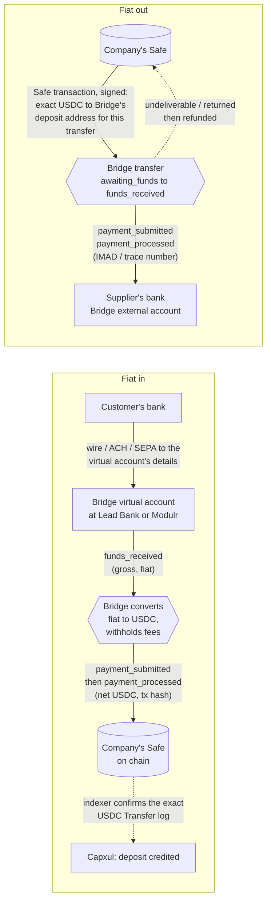

# CX-bridge-rails: how money really moves through Bridge, and what Capxul's Bridge design gets wrong

**Status: draft, 26 November 2026.** Proposed by Goal 16's 📐 designer thread, started by Goal 16's lead
(session_01S8RF7ASqmdxbN37WdpZMcB), after Aaron's words of 26 November 2026, kept as heard. On USDC: "its never in
bridge its in the safe which is self custodial". On learning that CX-bridge says otherwise: "they need updating and
thats concering because then it means they dont understand how it actually works. that being said there is a
infrastructure repo somewhere in a projects subfolder and it has an implementation that can be lifted but needs
validations still".

It corrects CX-bridge (decided 25 November 2026) and the Bridge things it built, and plans the lift of Aaron's existing
implementation in `Xelmar-tech/infrastructure`. **That repository was not read in this pass** (section 2): this session
was refused permission to attach it. So everything said here about how money moves comes from Bridge's public
documentation (the appendix cites each page), and section 2 turns the implementation's claims, as the brief states them,
into checks the implementation must pass before anything is lifted. It coordinates with CX-crypto-accounting (#1144):
#1144 dropped the Bridge lines its section 8 drafted, so this record owns every Bridge correction.

## In short

Bridge never holds a Capxul company's money. It is a converter between the banks and the chain. Money in: a company
gets real bank details from Bridge, called a virtual account. A customer pays them by wire, ACH or SEPA. Bridge converts
the dollars or euros to USDC and sends the USDC on chain, straight to the company's own Safe. Bridge pays to whatever
address the virtual account names, so Capxul must set that address to the company's Safe itself and never take it from
a request. A deposit counts only once the chain shows the USDC arrived in the Safe. Money out: the Safe sends USDC on
chain to an address Bridge gives for that one payout, and Bridge pays the supplier's bank. If the bank sends it back,
the USDC must come back to the Safe. Capxul's design today says Bridge holds USDC and sends from it, so it has no Safe
step, no check on chain, and no way back for a returned payout. Bridge's slice needs the company's Safe first.

## 1. How money really moves

### Who holds what, at every step

| Step | Fiat in (a customer pays the company) | Fiat out (the company pays a supplier) |
|---|---|---|
| 1 | The customer's bank holds the dollars | The company's **Safe** holds the USDC; only its signers can move it |
| 2 | In flight on the bank rail to Bridge's partner bank (Lead Bank for USD, Modulr for EUR, in Bridge's examples) | The Safe sends USDC on chain to the deposit address Bridge issued for this transfer; Bridge holds it only while converting |
| 3 | Bridge's partner bank holds the fiat, credited to the company's virtual account (`funds_received`) | Bridge has the USDC (`funds_received`), converts it and pays out on the rail (`payment_submitted`) |
| 4 | Bridge converts and sends USDC on chain (`payment_submitted`, a preliminary hash) | The supplier's bank holds it (`payment_processed`, with an IMAD or ACH trace number) |
| 5 | The USDC is in the company's **Safe**, confirmed on chain (`payment_processed`, the final hash) | If the bank returns it: Bridge holds it again (`returned`), then refunds USDC to the return address, which must be the Safe (`refunded`) |

Bridge holds the money only in transit, between the bank leg and the chain leg, in either direction. There is no
balance at Bridge. Capxul's own developer fee, if any, is withheld by Bridge from each movement and paid to Capxul's
fee account monthly (below). That fee is Capxul's money, never the company's.

### Fiat in

1. **A customer at Bridge.** The company is a Bridge customer of type `business` under Capxul's developer account, with
   its terms of service accepted and its KYB approved (below). Bridge: "Customers must be onboarded and KYC/KYB-approved
   before creating virtual accounts" (`virtualaccounts`).
2. **A virtual account.** `POST /v0/customers/{customerID}/virtual_accounts` with `source.currency` (`usd`, `eur`, and
   later `mxn`, `brl`, `gbp`, `cop`) and a `destination` of `{ payment_rail: <chain>, currency: "usdc", address }`. The
   answer's `source_deposit_instructions` are the bank details the company shows its customers (USD: bank name, routing
   and account number, rails `ach_push` and `wire`; EUR: IBAN and BIC, rail `sepa`). They are permanent and reusable.
   **The destination is the company's Safe address, derived by Capxul from the stored company, never from the caller.**
   Bridge sends to whatever address it is given, so a destination taken from a request is a way to steal every future
   deposit. An `account_update` event says the destination changed; Capxul must treat one it did not make as an alarm.
3. **A deposit.** Each incoming payment has a `deposit_id`, and a run of `virtual_account.activity` events, each with its
   own event `id`: `funds_scheduled` (ACH only, in transit), `funds_received` (Bridge matched it; `amount` is the gross,
   before fees, in the source currency), sometimes `in_review`, then `payment_submitted` (Bridge sent the USDC; its hash
   "may be preliminary") and `payment_processed` ("Payment confirmed on-chain. Final state."; `amount` is now the net sent
   to the destination, in USDC, with `developer_fee_amount`, `exchange_fee_amount`, `subtotal_amount`, `gas_fee` and the
   final `destination_tx_hash`) (`virtual-account-events`).
4. **Bridge converts.** `exchange_fee_amount` and `developer_fee_amount` are taken in the source currency;
   `subtotal_amount` is what is left. Below the route's minimum (1 USDC on the USDC chains, after fees), a deposit is dust:
   Bridge accumulates microdeposits and onramps them once they pass the minimum (`mins`).
5. **USDC on chain to the Safe.** Bridge supports USDC on Base, Ethereum, Arbitrum, Optimism, Polygon, Solana and others
   (`payment-routes`). **Which chain the Safe is on is not settled here:** Capxul's earlier plans name USDC on Base, and
   K17's example uses Base Sepolia, but the implementation that says which was not read. Question 4.
6. **Credited.** The brief says the implementation credits a deposit only when an indexer confirms the exact transfer.
   Bridge's own word for it is `payment_processed` with the final `destination_tx_hash`. The safe rule, and the one to
   lift: a deposit is credited when **both** hold: Bridge has said `payment_processed` for that `deposit_id`, **and** the
   chain shows a USDC `Transfer` log in that transaction, to the company's Safe, of exactly the net amount, at the
   confirmation depth the chain needs. Bridge's word alone is a claim; the chain is the fact. Bridge's sandbox moves no
   real funds and promises no testnet ("Do not assume that a blockchain testnet is used"), so this rule can only be
   proved against a chain stand-in, never against Bridge's sandbox.
7. **Refunds of a deposit.** If Bridge can't deliver, it refunds the sender: `refund_in_flight`, then `refunded` or
   `refund_failed`, each with a `refund` object and sometimes **no `deposit_id`** ("This may be omitted in cases where
   the refund occurred before a deposit completed"). None of these put money in the Safe. A company can also send a
   deposit back itself, within 90 days, by a transfer whose crypto source is its Safe (`returns`).

### Fiat out

There are two ways out of the Safe, and both need a signed Safe transaction.

1. **A transfer per payout (recommended, question 2).** First the payee is an external account:
   `POST /v0/customers/{customerID}/external_accounts` (US account and routing, or IBAN and BIC, owner name and address).
   Then `POST /v0/transfers` with `on_behalf_of` the company's customer, `amount`, `source` `{ payment_rail: <chain>,
   currency: "usdc", from_address: <the Safe> }`, `destination` `{ payment_rail: "ach" | "wire" | "sepa", currency,
   external_account_id }`, a `developer_fee` if any, and `return_instructions.return_address` set to the Safe. The
   answer is `awaiting_funds` with `source_deposit_instructions` naming Bridge's `to_address` and the exact `amount`
   (`transfer`). Then the Safe sends exactly that amount of USDC to that address. Bridge matches it (on the
   `from_address`, unless `allow_any_from_address` is set) and runs `funds_received`, `payment_submitted`,
   `payment_processed`. The transfer is one record, with one id, one amount and one idempotency key, which is what a
   payment in the books wants.
2. **A liquidation address per payee.** `POST /v0/customers/{customerID}/liquidation_addresses` with `chain`,
   `currency: "usdc"`, `external_account_id`, `destination_payment_rail` and `destination_currency`, and a
   `return_address`. Any USDC sent to that address is paid out, as a **drain** with the same states. It is a standing
   route, simpler to fund, but a payout is then only "USDC sent to an address", with no amount agreed in advance; ACH
   drains are batched daily (`liquidation_address`, `drains`, `offramp_liquidation`).

**States** (`transfer-states`): `awaiting_funds` → `funds_received` → `payment_submitted` → `payment_processed`, and
"It can never go backwards". Off the path: `in_review` (rare, temporary), `undeliverable` (bad account details),
`returned` (sent, then bounced back to Bridge), `refund_in_flight` → `refunded` (Bridge no longer has the funds: for a
crypto-funded transfer, returned to the return address) or `refund_failed`, `missing_return_policy` (Bridge has no
address to return crypto to), `canceled` (only from `awaiting_funds`, by `DELETE /v0/transfers/{id}`) and `error`
(needs a person).

**Where a return goes** (`returns`): to the Bridge wallet it came from; else a liquidation address's `return_address`;
else the transfer's `return_instructions.return_address`; else the developer's crypto return policy; else
`missing_return_policy`. So **every payout names the Safe as its return address**, or a bounced payment lands
somewhere Capxul didn't choose.

**Failures before Bridge holds anything.** Creating the transfer can fail with `has_not_accepted_tos`,
`requires_active_kyc_status`, `deactivated_external_account`, `missing_required_endorsements`,
`developer_limits_exceeded`, `not_truly_idempotent` (same key, different body) and others (`transfer-errors-and-recovery`).
None moves money. The dangerous window is after the transfer exists and before the Safe has paid: a transfer left in
`awaiting_funds` should be canceled, and the Safe must never pay a transfer that isn't `awaiting_funds`, or pay twice.

### KYC and KYB

A KYC link (`POST /v0/kyc_links`, `type` individual or business) answers a hosted `kyc_link` and a `tos_link`. The
customer's KYC status runs `not_started`, `incomplete`, `awaiting_questionnaire`, `awaiting_ubo` (KYB: the ultimate
beneficial owners each do KYC), `under_review`, then `approved` or `rejected` (with `rejection_reasons`), and later
`paused`, `offboarded`, `deposits_restricted`. A rejection can come straight from `not_started` (a bad tax number).
Rails beyond US dollars need an **endorsement** (`sepa`, `spei`, `pix`, `faster_payments`), each with its own status,
collected through the same link with `endorsement` (`kyclinks`, `endorsements`, `api`). In the sandbox,
`POST /v0/customers/{id}/simulate_kyc_approval` approves a customer and its pending endorsements.

### Webhooks

- **Delivery.** At least once. An endpoint is created `disabled`, tested, then made `active`. Bridge retries a delivery
  that doesn't get a 200 "with exponential backoff for up to two days" (`webhooks/overview`). So the receiver answers 200
  fast, after storing the event, and works it later.
- **Dedupe.** `event_id` is "Globally unique ... Useful as an idempotency key", the same on every retry. But a deposit or
  a transfer is several events, so the record is keyed on the movement (`deposit_id`, the transfer's `id`), as CX-bridge
  already says, and the journal on `event_id`.
- **Ordering.** Bridge promises none. Each envelope has an `event_sequence`, which Bridge's examples show rising per
  object (1 to 6 for one transfer), but no page says it is gap-free or global. What is promised is that a transfer and a
  drain "can never go backwards". So a receiver applies a state only if it is further along the path, and ignores an
  older one that arrives late. That rule is exact for the happy path; for the exception states, read the object fresh
  (`GET /v0/transfers/{id}`, virtual account history) rather than trust arrival order.
- **Signatures.** `X-Webhook-Signature: t=<ms>,v0=<base64>`, RSA PKCS#1 v1.5 with the endpoint's public key over
  SHA256(SHA256("<t>.<raw body>")), strict base64; refuse one older than about ten minutes with a 400, and Bridge retries
  with a fresh timestamp (`webhooks/signature`). CX-bridge has this right.
- **Missing events.** Two days of retries can still end in silence. So a movement that hasn't reached a final state by a
  deadline is read from Bridge directly (a catch-up poll), and the poll goes through the same rule as an event.

### Fees

- **Developer fee.** Capxul's own. Fixed `developer_fee` in USD with at most two places on fixed-amount transfers;
  `developer_fee_percent` (at most five significant places) on virtual accounts, flexible-amount transfers and
  liquidation addresses (`custom_developer_fee_percent`). Withheld from the customer's amount, "set aside in a ledger
  reserved for you", and "paid out monthly on the 5th of each month" in USD to the fee external account Capxul
  configures. The net must still clear the route minimum (`devfees`, `mins`).
- **Bridge's own:** `exchange_fee_amount` and `gas_fee`, reported on each event and receipt.
- **For the books:** a deposit's Bank Transaction is the **net USDC that reached the Safe**, with the gross fiat and each
  fee beside it, so the receivable it settles (the gross) and the bank line (the net) reconcile, and the fee is an
  expense of the company. CX-bridge's `land` takes one amount and drops the fees.

## 2. Validating the implementation

**Not read in this pass.** The brief describes the implementation as: virtual accounts in `banking/bank-details/` whose
destination is derived from the stored Account or Organization Safe and never taken from the caller; `deposits/`,
`payouts/`, `reconcile/`; webhooks with an encrypted inbox and back-off; ADRs 0017, 0018 and 0025; recorded fixtures
under `docs/planning/banking/fixtures/`; proof scripts in `packages/backend/scripts/bridge/`; and a programmable Bridge
on its devnet. Every one of those is a claim until read. Attaching `Xelmar-tech/infrastructure` was refused by this
session's permission check, so the next pass (slice R0 below) reads it and fills in the column "the implementation".

"Needs validations still" means, concretely, the checks below. Each says what it proves, where it can run today, and
what Bridge's docs say. **Where:** *prove* is Capxul's `prove` against the Bridge stand-in; *chain* needs a chain
stand-in (a local EVM with USDC and a Safe); *sandbox* needs Bridge's sandbox key, which is Aaron's to give later.

| # | Check | Where | Bridge's docs | The implementation |
|---|---|---|---|---|
| V1 | A virtual account's `destination` is the company's Safe (chain, `usdc`, address), derived from the stored company; a request carrying a destination is refused or ignored, and the stand-in records the Safe's address | prove | the destination is whatever is sent | claimed; not read |
| V2 | An `account_update` event that changes a destination Capxul didn't change raises an alarm and credits nothing after it | prove | `account_update` exists | not read |
| V3 | A deposit is credited only when `payment_processed` names it **and** the chain shows a USDC `Transfer` to the Safe of exactly the net amount in that `destination_tx_hash`; a `payment_submitted` hash, a wrong amount, a wrong recipient or a missing log credits nothing | chain | `payment_submitted`'s hash "may be preliminary" | claimed (indexer); not read |
| V4 | A deposit's row holds the net USDC, the gross and currency from `funds_received`, and each fee; net equals the on-chain amount | prove | gross on `funds_received`, net on `payment_processed` | not read |
| V5 | One deposit is one row, keyed on `deposit_id`, however many events and polls report it; replayed events change nothing | prove | `deposit_id` links the events | CX-bridge has the key |
| V6 | `funds_scheduled`, `in_review`, `refund_in_flight`, `refunded`, `refund_failed` and `microdeposit` credit nothing; a refund event without a `deposit_id` is matched or logged, never credited | prove | events listed; `deposit_id` may be absent | not read |
| V7 | A payout creates one Bridge transfer with source `{chain, usdc, from_address: Safe}`, destination an external account, `return_instructions.return_address` the Safe, and an `Idempotency-Key` derived from the request key; a retry makes no second transfer | prove | `transfer`, `returns` | not read |
| V8 | The Safe pays only a transfer in `awaiting_funds`, exactly its `source_deposit_instructions.amount`, to its `to_address`, once; a second attempt for the same transfer is refused | chain | `transfer` | not read |
| V9 | A transfer left in `awaiting_funds` past a deadline is canceled (`DELETE`) and its payment fails; a canceled transfer is never funded | prove | `canceled` only from `awaiting_funds` | not read |
| V10 | `undeliverable`, `returned`, `refunded`, `refund_failed`, `missing_return_policy` and `error` each end or hold the payout as designed; `refunded` records the USDC back in the Safe as money in, confirmed on chain like a deposit | prove, chain | `transfer-states`, `returns` | not read |
| V11 | Webhook signatures: double SHA-256, RSA PKCS#1 v1.5, strict base64, ten-minute window; unsigned, wrongly signed or stale is a 400 and writes nothing | prove | `webhooks/signature` | claimed (inbox); not read |
| V12 | Dedupe: the same `event_id` twice is one journal entry | prove | `webhooks/structure` | claimed; not read |
| V13 | Order: a late event with an earlier state never moves a record back; an exception state is read fresh from Bridge | prove | "can never go backwards" | not read |
| V14 | The inbox: an event is stored (encrypted, by the brief) before the 200, worked with back-off, and survives a restart; a movement with no final event by its deadline is polled | prove | retries for two days | claimed; not read |
| V15 | KYB and KYC: no virtual account before `approved` and terms accepted; an EUR account needs the `sepa` endorsement; `paused`, `offboarded` and `deposits_restricted` stop new accounts and payouts; rejection reasons kept | prove, sandbox | `kyclinks`, `endorsements` | not read |
| V16 | Developer fee: the percent set on each virtual account and the fee on each transfer are Capxul's settings, recorded per movement, and never booked as the company's income | prove | `devfees` | not read |
| V17 | Minimums: a payout below the route minimum after fees is refused before Bridge is called; a dust deposit is not credited until Bridge onramps it | prove | `mins` | not read |
| V18 | Isolation: an event for one company's customer never touches another company's records | prove | — | CX-bridge has a journey |
| V19 | The recorded fixtures pass Bridge's current schemas under the strict generated client, as CX-bridge did for Bridge's examples, and agree with Bridge's examples on every field Capxul reads | prove | `latest.json` | fixtures not read |
| V20 | Against the sandbox, once: create a customer, `simulate_kyc_approval`, open USD and EUR virtual accounts, `simulate_deposit`, and compare every event and answer with the stand-in's; a liquidation address `simulate_deposit` the same. (The sandbox can't fund a crypto-source transfer or move chain funds, so V3 and V8 stay on the chain stand-in.) | sandbox | `setting-up-sandbox` | not read |

## 3. Compared with Capxul's CX-bridge and its things

### Wrong

1. **Custody.** CX-bridge says Bridge "lands a deposit as USDC in Capxul's custody and sends a transfer from it", and
   four comments repeat it. Bridge holds nothing; the company's Safe does.
2. **The virtual account's destination.** CX-bridge lists `destination` among the fields `bank-account.open` sends, but
   never says what it is. The stand-in takes any address. It must be the company's Safe, derived, never supplied (V1).
3. **A payout's source.** `bank-transaction.send`'s comment says the transfer goes "from Capxul's USDC". It goes from the
   company's Safe, and only after a signed Safe transaction pays Bridge's deposit address. Capxul has no step for that
   and no state for "Bridge is waiting for the Safe" (`awaiting_funds`).
4. **Credited on Bridge's word.** `land` records a deposit as `settled` when Bridge reports `payment_processed`, with no
   look at the chain (V3).
5. **One amount.** `land` and `send` take one `Dollars`; the gross, the fees and the net are not kept (V4, V16).
6. **Returns go nowhere.** `TransferFailure` treats `returned` and `refunded` as a failure only. For a payout from the
   Safe, `refunded` means USDC came back to the Safe, which is money in; and without a return address it may not come
   back at all (V7, V10). `error` and `missing_return_policy` are not handled.
7. **Deposit refunds and holds.** A deposit Bridge refunds to its sender, or holds `in_review`, has no place (V6).
8. **The stand-in.** A transfer from a crypto source answers no `source_deposit_instructions`; there is no chain behind
   it; and a destination is never checked.
9. **The order of the slices.** Slice 10 (Bridge) comes before slice 2 (the Safe), but a virtual account cannot be opened
   without the Safe's address, and a payout cannot be funded without the Safe. Question 1.
10. **Bridge and the Safe as two rails.** CX-composable-pieces calls them alternative rails (`bridge-accounts` for
    payouts, later the Safe). Every Bridge payout is funded by the Safe, so `bridge-accounts` depends on the Safe's
    piece. Proposed in section 4, not applied.

### Right, and kept

Keying a Bank Transaction on Bridge's id for the movement (`deposit_id`, the transfer's `id`) and the door's journal on
`event_id`; the signature rule; the ABA and IBAN checksums; the transfer's `Idempotency-Key` derived from the request
key; the strict client and the corrected EUR description; USDC in base units; Bridge's reports spoken by the system until
the door lands.

### Lift as-is, or re-express

Nothing is copied: the implementation is Convex and TypeScript, and Orthograph is Effect everywhere with declared names.
What is lifted is design and rules, from Aaron's own code, so licence and ownership allow it; each slice that lifts names
the file it lifted from, once read.

| From the implementation (as the brief describes it) | In Orthograph |
|---|---|
| Destination derived from the stored Safe (`bank-details/`) | a rule in `bank-account.open`'s handler and a field it reads from the company's Safe; no `destination` in the payload; a journey that tries one |
| Deposit credited on an indexer's confirmation (`deposits/`) | `bank-transaction` gains `received` (Bridge's word) before `settled` (the chain's); the move to `settled` is the chain's report through the chain door (M6), matched on `destination_tx_hash` |
| Payouts (`payouts/`, ADR 0025's "one front door, legs, rail-scoped settlement") | `send` keeps the front door; a payout's legs are the Bridge transfer and the Safe transaction, each a step; settlement is per rail; the states follow Bridge's |
| Reconcile (`reconcile/`) | the catch-up poll and the books' reconciliation (slice 7), as a keeper on the deadline |
| Encrypted inbox with back-off (`webhooks/`) | the framework's webhook door (K40, #995 gaps 4 and 5) with its journal on `event_id`; encryption at rest is the host's, asked of Goal 18 if missing |
| Recorded fixtures | the stand-in's answers and events, re-checked under the strict client (V19) |
| The devnet's programmable Bridge | compared with Capxul's stand-in, and anything it does that ours doesn't becomes a stand-in change |
| ADRs 0017 (chain custody, mirrors, computed visibility) and 0018 (payouts router, chain-verifiable ledger) | read for their rules; any that hold become lines in this record |

## 4. What changes in CX-bridge and the Capxul things

Applied in this pull request (comments and dated notes only; no handler, journey or check changes):

- CX-bridge keeps its words and gains a note beside the custody sentence; CX-money-global-payroll gains three notes.
- `assets/usdc.ts`'s comment says USDC is held in the company's Safe.
- Five comments are rewritten: `bank-account/verbs/open.ts`, `bank-transaction/thing.ts`, `bank-transaction/verbs/land.ts`,
  `bank-transaction/verbs/send.ts` and `plugins/bridge/src/stand-in/webhooks.ts`.

Proposed, for the slices below and their authors and builders:

- `bank-account`: no `destination` input; the handler reads the company's Safe; the stand-in records the destination,
  and a check compares it (V1).
- `bank-transaction`: states `received`, `settled`, `refunded` for deposits; `awaiting-funds`, `funded`, `submitted`,
  `settled`, `returned`, `failed` for payouts; fields for the gross, its currency, each fee and the chain hash; a
  `returned` payout's USDC recorded back into the Safe.
- `TransferFailure`: `undeliverable`, `canceled`, `error`; `returned` and `refunded` become their own moves.
- `bridge-business` and `bridge-individual`: `paused`, `offboarded` and `deposits_restricted` as states; terms accepted
  and endorsements as fields.
- The stand-in: `source_deposit_instructions` on a crypto-source transfer; `return_instructions`; liquidation addresses
  if question 2 goes that way; a link to a chain stand-in that emits the USDC `Transfer` logs.
- CX-composable-pieces: `bridge-accounts` depends on the Safe's piece (`onchain-pay`); the rails line reads "Bridge's
  payouts are funded by the Safe". Not applied here: it is the pieces designer's live file, and its words wait on
  question 1.
- CX-money-global-payroll (#1121, now on `goal/capxul`), a dated record, keeps its words and gains notes beside item 2's
  "the Bridge account is what Bridge holds", item 9 and question 7, which Aaron's words answer. Its `usdc.ts` comment,
  "USDC, held in a Safe or at Bridge", is rewritten to the company's Safe.

## 5. The lift plan

Each slice is one branch and ends green with its check. Authors write the journeys first (the `author` skill).

| Slice | What | Done when |
|---|---|---|
| R0 | Read `Xelmar-tech/infrastructure` (bank-details, deposits, payouts, reconcile, webhooks, the three ADRs, fixtures, proof scripts, the devnet's Bridge) and fill section 2's last column and section 3's lift table with file paths | every V row says "matches", "differs: …" or "absent", with a path, in this record |
| R1 | The company's Safe address as a fact Capxul holds (the smallest part of slice 2), and `bank-account.open` deriving the destination from it | V1 passes in `prove`: the stand-in's issued virtual account names the company's Safe, and an open that tries to set a destination fails |
| R2 | Deposits in two steps: Bridge's word (`received`, gross and fees) then the chain's (`settled`, net, matched on the hash) | V3 to V6 pass against the stand-in and a chain stand-in; `bridge-a-deposit-lands` lands only after the chain |
| R3 | Payouts funded by the Safe: the Bridge transfer, the Safe transaction for its exact amount, the return address, cancel on deadline | V7 to V10 pass against the stand-in and a chain stand-in; a returned payout's USDC is back in the Safe |
| R4 | Bridge's webhook door: RSA signature, journal on `event_id`, states only forward, catch-up poll (#995 gaps 4 and 5) | V11 to V14 pass, with events from the stand-in signed as Bridge signs |
| R5 | KYB and KYC states, terms and endorsements | V15 passes in `prove` |
| R6 | Fees and minimums | V16 and V17 pass; the books show the fee as the company's expense and the net in the Safe |
| R7 | Fixtures and the sandbox | V19 passes in `prove`; V20 runs once against Bridge's sandbox when Aaron gives a key, and its differences are recorded here |

R1 waits on question 1. R2 and R3 need the chain door (M6) and a Safe that can propose and execute (slice 2). R4 waits
on #995.

## 6. Questions for Aaron

1. **Should the company's Safe come before Bridge?** Recommendation: yes. Bridge pays deposits to the Safe and payouts
   are paid from it, so slice 10 can't be real without at least the company's Safe address. Move that part of slice 2
   ahead of slice 10, and keep getting paid by a link for later.
2. **How should payouts leave the Safe?** Recommendation: one Bridge transfer per payout, funded by one Safe
   transaction of the exact amount. Each payout then has its own id, amount and return address, which the books need.
   The other way is a standing liquidation address per payee: simpler to fund, and easier to test in Bridge's sandbox,
   but the amount isn't agreed in advance. Tell us which the implementation uses if you remember.
3. **Who signs the Safe transaction that funds a payout?** Recommendation: the company's owner approves each payout in
   Capxul, and the Safe's signers sign it, until budgets and allowances (slice 12) let a rule approve small ones.
4. **Which chain is the Safe on?** Recommendation: Base, as Capxul's earlier plans say, unless the implementation uses
   another. Bridge supports USDC on Base.
5. **Capxul's developer fee?** Recommendation: build the setting now, at zero, and decide the price with the paid
   services.
6. **Can this thread read the infrastructure repository?** Recommendation: allow attaching `Xelmar-tech/infrastructure`
   read-only for Goal 16's sessions. This pass was refused it, so the implementation is not yet validated.

## Supersedes

- design/decisions/CX-bridge.md: "Bridge lands a deposit as USDC in Capxul's custody and sends a transfer from it" → "Bridge lands a deposit as USDC in the company's Safe, and a transfer is paid from the Safe"
- examples/capxul/blueprint/things/bank-account/verbs/open.ts: "landing as USDC in Capxul's custody" → "landing as USDC in the company's Safe"
- examples/capxul/blueprint/things/bank-transaction/verbs/land.ts: "reached Capxul's custody as USDC" → "reached the company's Safe as USDC"
- examples/capxul/plugins/bridge/src/stand-in/webhooks.ts: "to Capxul's custody as USDC" → "to the company's Safe as USDC"
- examples/capxul/blueprint/things/bank-transaction/thing.ts: "Bridge lands a deposit as USDC and sends a transfer from it" → "Bridge lands a deposit in the company's Safe as USDC, and a transfer out is paid from the Safe"
- examples/capxul/blueprint/things/bank-transaction/verbs/send.ts: "Bridge makes the transfer (`POST /v0/transfers`, from Capxul's" → "Bridge makes the transfer (`POST /v0/transfers`) from the company's Safe"
- examples/capxul/blueprint/assets/usdc.ts: "USDC, held in a Safe or at Bridge" → "USDC, held in the company's Safe (never at Bridge: CX-bridge-rails)"
- design/decisions/CX-money-global-payroll.md: "the Bridge account is what Bridge holds" → "Bridge holds nothing; there is no Bridge account balance"

## Appendix: sources

Bridge's documentation, read 26 November 2026 (each page's Markdown, from `https://apidocs.bridge.xyz/llms.txt`):

- `virtualaccounts`: https://apidocs.bridge.xyz/get-started/guides/move-money/virtualaccounts.md
- `virtual-account`: https://apidocs.bridge.xyz/platform/orchestration/virtual_accounts/virtual-account.md
- `virtual-account-events`: https://apidocs.bridge.xyz/platform/orchestration/virtual_accounts/virtual-account-events.md
- `transfer`: https://apidocs.bridge.xyz/platform/orchestration/transfers/transfer.md
- `transfer-states`: https://apidocs.bridge.xyz/platform/orchestration/transfers/transfer-states.md
- `transfer-features`: https://apidocs.bridge.xyz/platform/orchestration/transfers/transfer-features.md
- `transfer-updates`: https://apidocs.bridge.xyz/platform/orchestration/transfers/transfer-updates.md
- `transfer-errors-and-recovery`: https://apidocs.bridge.xyz/platform/orchestration/transfers/transfer-errors-and-recovery.md
- `liquidation_address`: https://apidocs.bridge.xyz/platform/orchestration/liquidation_address/liquidation_address.md
- `drains`: https://apidocs.bridge.xyz/platform/orchestration/liquidation_address/drains.md
- `offramp_liquidation`: https://apidocs.bridge.xyz/get-started/guides/move-money/offramp_liquidation.md
- `external-accounts-api`: https://apidocs.bridge.xyz/platform/orchestration/external-accounts/external-accounts-api.md
- `returns`: https://apidocs.bridge.xyz/platform/orchestration/more/returns.md
- `devfees`: https://apidocs.bridge.xyz/platform/orchestration/fees-and-mins/devfees.md
- `mins`: https://apidocs.bridge.xyz/platform/orchestration/fees-and-mins/mins.md
- `payment-routes`: https://apidocs.bridge.xyz/get-started/introduction/what-we-support/payment-routes.md
- `webhooks/overview`: https://apidocs.bridge.xyz/platform/additional-information/webhooks/overview.md
- `webhooks/signature`: https://apidocs.bridge.xyz/platform/additional-information/webhooks/signature.md
- `webhooks/structure`: https://apidocs.bridge.xyz/platform/additional-information/webhooks/structure.md
- `kyclinks`: https://apidocs.bridge.xyz/platform/customers/customers/kyclinks.md
- `endorsements`: https://apidocs.bridge.xyz/platform/customers/customers/endorsements.md
- `api` (customers): https://apidocs.bridge.xyz/platform/customers/customers/api.md
- `setting-up-sandbox`: https://apidocs.bridge.xyz/get-started/introduction/quick-start/setting-up-sandbox.md

In this repository: `design/decisions/CX-bridge.md`; CX-crypto-accounting (#1144, `goal-16/crypto-accounting-design`,
section 8); CX-money-global-payroll (#1121, `goal-16/money-global-payroll-design`, items 5 and 9, question 7);
`design/decisions/CX-composable-pieces.md` (items 7, 10 and 11); `design/goals/16-capxul.md` (slices 2 and 10);
`examples/capxul/blueprint/things/{bank-account,bank-transaction,bridge-business,bridge-individual}/`;
`examples/capxul/blueprint/values/bridge.ts`; `examples/capxul/plugins/bridge/src/stand-in/`.

Not read: `Xelmar-tech/infrastructure` (section 2).
