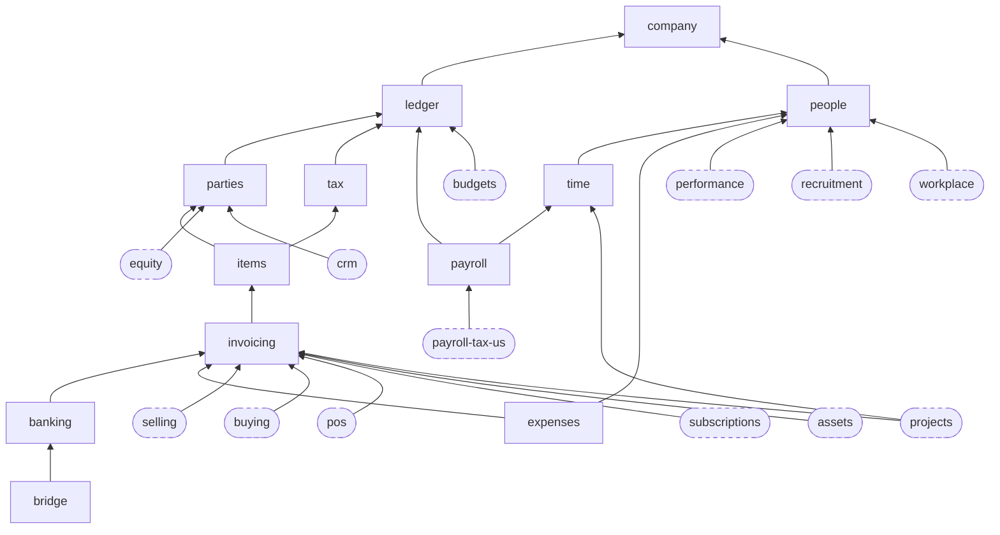

# CX-composable-pieces: Capxul as pieces a business picks when its app is built

**Drafted 26 November 2026** by Goal 16's 📐 composable-pieces designer (session `session_01S8RF7CccTeLkaVUQpKSExm`),
started by Goal 16's lead, with Aaron in the loop. Grounded at `goal/capxul` `9596fb2a`. The architecture calls are the
building agent's (`AGENTS.md`, "Who decides"); section 8 holds the two calls that are Aaron's. Inputs read: K22, K27,
K42, K43, K44, CX-grill, CX-ledger, CX-payroll-tax, GOAL17-plugin-scope, `docs/canon/{plugins,stores,data}.mdx`,
`packages/compiler/src/modules/mounts`, the superagent's plugins, the gaps #742, #879, #972, #1001, #1044 and #1079, the
parties-and-payments checks (#1116), the developer-experience pages "How Orthograph Works" and "Composition Worked
Example", and ERPNext `a6f54f9c` and Frappe HRMS `46b38904` (outside data, read, never copied).

## Aaron's constraints (26 November 2026)

1. Keep it simple. Composition happens **when an app is built**: pick pieces, compile. Nothing is switched on, swapped or
   mounted inside a running app.
2. Find the natural boundaries, as ERPNext's modules suggest, but cut **by ownership of data and of rules**, not by its
   menu.
3. Say, for each piece, where something is an actor and where it isn't, and why.

## The call in one paragraph

A Capxul piece is an ordinary **feature plugin** (`M1-plugins.md`, `docs/canon/plugins.mdx`): a package in
`examples/capxul/plugins/<piece>/`, tagged `scope:plugin`, mounted by one file, `examples/capxul/blueprint/features/<piece>.ts`.
A business's Capxul is the set of mount files it has; `ortho check` refuses a set with an unmet need; `ortho generate`
makes the app. No new framework word is needed: "piece" in this record is plain English for "a Capxul feature plugin".
The superagent already works this way on `goal/superagent` (five plugins, a dependency order, cross-plugin links by
import, cross-plugin events wired in the app's mount files with `on`), so Capxul follows a proved path. Every piece's
things live in the app's one default database, because the books need a document and its ledger lines in one commit and
reports that read across pieces. So a boundary is a rule about **who may write what**, not a store edge. Pieces connect
in four ways: a link (a field holding another piece's id), an in-commit call (the owner's operation run inside the
caller's commit, for posting to the books), an event (a piece reacting to another's fact, wired by the app), and an
adapter call (Bridge). No Capxul thing is an actor today; three narrow places will be (section 3).

## 1. The pieces

24 pieces take all 485 record types in `examples/capxul/doctypes.md`; a 25th comes later with the chain. Twelve are
**core** (every Capxul has them: the books, HR and payroll Aaron named as the offering, plus Bridge, K43) and twelve
are **optional** (a business leaves them out and its app has none of their tables, screens, commands or tools).
Counts are record types from the catalogue, with child tables (`line`) in brackets. "Today" names the things already
built in `examples/capxul/blueprint/things/`.

### Core

1. **`company`** (core). Who keeps the books and employs people: the company and its company-wide settings.
   19 (7): Company, Global Defaults, Authorization Rule and Control, Terms and Conditions, Print Heading, Email Digest,
   SMS Center, Transaction Deletion Record, Portal User, and the deferred currency records (Currency Exchange and its
   settings, Pegged Currencies). Today: `company`. Also owns the USDC asset (`blueprint/assets/usdc.ts`) and the shared
   values every piece uses (`Day`, `Amount`, `Name`).
2. **`ledger`** (core). The double-entry books: what an account is, what a balanced posting is, which periods are open.
   45 (17): Account, Cost Center (and Allocation), Fiscal Year, Accounting Period, Accounting Dimension (and Filter),
   Finance Book, Journal Entry (and Template, and their account lines), GL Entry, Payment Ledger Entry, Advance Payment
   Ledger Entry, Period Closing Voucher, Account Closing Balance, Accounts Settings, Exchange Rate Revaluation (deferred),
   Process Deferred Accounting, and the repost, ledger-health, ledger-merge, bisect and chart-importer jobs. Today:
   `account`, `cost-center`, `fiscal-year`, `journal-entry`, `journal-entry-account`, `gl-entry`.
3. **`parties`** (core). Who a company trades with, and which receivable or payable account each uses. 15 (7): Customer,
   Supplier, Customer Group, Supplier Group, Party Type, Party Link, Party Account, Territory, Industry Type, Customer
   Credit Limit, Allowed To Transact With, and the group and territory item lines. Today: none (#1116 writes Customer,
   Supplier and their groups).
4. **`tax`** (core). The tax rules a document's lines are taxed by. 12 (6): Sales and Purchase Taxes and Charges
   Templates and their lines, Item Tax Template (and Detail), Item Tax, Tax Category, Tax Rule, Tax Withholding Category
   (and Account, Rate).
5. **`items`** (core). What a company sells or buys, and at what price. 27 (15): Item and its lines, Item Group, Brand,
   UOM, UOM Category and conversions, Price List (and Country), Item Price, Pricing Rule and Promotional Scheme with their
   lines, Product Bundle, Party Specific Item. Capxul takes no stock ledger, so ERPNext's Stock module shrinks to this
   catalogue.
6. **`invoicing`** (core). Receivables and payables: invoices, the payments that settle them, and what is still owed.
   43 (25): Sales Invoice, Purchase Invoice, Payment Entry, Payment Request, Payment Order, Payment Term and Terms
   Template, Payment Schedule, Mode of Payment, Dunning (and Type), Invoice Discounting, Payment Reconciliation and its
   jobs, Unreconcile Payment, Opening Invoice Creation Tool, Process Statement Of Accounts, Payment Gateway Account, and
   their lines. One piece, because a payment changes what an invoice still owes: one rule, one owner.
7. **`banking`** (core). A company's bank accounts and what moved through them, matched to the books. 13 (3): Bank,
   Bank Account (and Type, Subtype), Bank Transaction (and Mapping, Payments), Bank Statement Import, Bank Clearance,
   Bank Reconciliation Tool, Bank Guarantee, Cheque Print Template. Today: `bank-account`, `bank-transaction`.
8. **`bridge`** (core, gated later). Capxul's own Bridge account serving its customers: KYC, KYB, real bank details,
   and deposits and transfers fed to `banking`. No ERPNext record types: Capxul's own, with no translated code, as K43
   requires of a paid service. Today: `bridge-business`, `bridge-individual`, and the adapter `@orthograph/bridge` in
   `examples/capxul/plugins/bridge/`.
9. **`people`** (core). Who works for a company and how it is organised. 34 (14): Employee and its history lines,
   Department (and Approver), Designation, Branch, Employee Grade, Employment Type, Employee Group, Holiday List and
   Holiday, onboarding, promotion, transfer and separation (with templates and boarding activities), Exit Interview, Full
   and Final Statement, skills, Identification Document Type, HR Settings. Today: `branch`, `department`,
   `designation`, `employee`, `employee-grade`, `employment-type`, `employee-promotion`, `employee-transfer`,
   `employee-separation`, `holiday-list`, `holiday`.
10. **`time`** (core). When people work and when they are away. 28 (4): Attendance (and Request, Upload, Tool),
    Employee Checkin, Shift Type, Assignment, Request, Location and Schedule, Leave Type, Allocation, Application, Policy
    (and Assignment), Period, Block List, Encashment, Leave Ledger Entry, Leave Control Panel, Compensatory Leave
    Request, Timesheet (and Detail). Today: `attendance`, `attendance-request`, `shift-type`, `leave-type`,
    `leave-allocation`, `leave-application`.
11. **`expenses`** (core). What employees spend for the company and get back. 11 (6): Expense Claim (and Type,
    Account, Advance, Detail, Taxes), Employee Advance, Travel Request (and Itinerary, Costing), Purpose of Travel.
    Today: `expense-claim`, `expense-claim-type`, `expense`.
12. **`payroll`** (core). Paying people: components, structures, pay runs and slips, holding no tax rule
    (CX-payroll-tax). 28 (11): Salary Component (and Account), Salary Structure (and Assignment, bulk), Payroll Period,
    Payroll Entry, Salary Slip and its lines, Additional Salary, Employee Benefit Application and Claim, Employee
    Incentive, Employee Other Income, Retention Bonus, Gratuity (and Rule), Salary Withholding, Payroll Settings,
    Employee Cost Center. Today: `salary-component`, `salary-structure`, `salary-structure-assignment`, `salary-detail`,
    `payroll-period`, `payroll-entry`, `payroll-employee-detail`, `salary-slip`, `salary-slip-detail`.

### Optional

13. **`payroll-tax-us`** (optional, one per jurisdiction; a Capxul that runs payroll mounts at least one). United States
    payroll tax as dated rows (CX-payroll-tax). 9 (4): Income Tax Slab (and Other Charges, Taxable Salary Slab),
    Employee Tax Exemption Category, Sub Category, Declaration and Proof Submission, with their lines.
14. **`selling`**. Quotes and orders before an invoice. 26 (13): Quotation, Sales Order, Sales Person, Sales Partner,
    Sales Team, targets, Installation Note, Shipping Rule, Coupon Code, Loyalty Program, Incoterm, Selling Settings.
15. **`buying`**. Orders and quotes from suppliers. 19 (10): Purchase Order, Request for Quotation, Supplier Quotation,
    Supplier Scorecard and its parts, Buying Settings.
16. **`pos`**. A till. 19 (12): POS Invoice, Profile, Opening and Closing Entries, Settings, Cashier Closing.
17. **`subscriptions`**. Recurring invoices. 5 (1): Subscription, Plan, Settings, Process Subscription.
18. **`assets`**. What a company owns and how it depreciates. 24 (10): Asset and its capitalisation, depreciation,
    maintenance, movement, repair and value adjustment, Asset Category, Location.
19. **`budgets`**. Limits on spending by account and cost centre, checked as money is spent (slice 12). 4 (2): Budget,
    Monthly Distribution.
20. **`equity`**. Who owns the company. 4 (1): Shareholder, Share Type, Share Transfer, Share Balance.
21. **`projects`**. Work tracked against a project and billed from timesheets. 7 (3): Project, Task, Activity Type,
    Activity Cost, and Sales Invoice Timesheet (the join that bills a timesheet, owned here so `invoicing` never points
    at HR).
22. **`performance`**. Appraisals and goals. 12 (5): Appraisal, Cycle, Template, KRA, Goal, Employee Performance
    Feedback and Criteria. Today: `appraisal`, `appraisal-cycle`, `appraisal-template`, `kra`, `goal`,
    `employee-feedback-criteria`, `employee-performance-feedback`.
23. **`recruitment`**. Hiring. 21 (5): Job Requisition, Staffing Plan, Job Opening, Job Applicant, Interview (Round,
    Type, Feedback), Job Offer, Appointment Letter, Employee Referral. Today: `job-opening`, `job-applicant`,
    `interview`, `interview-round`, `interview-feedback`, `job-offer`.
24. **`workplace`**. The rest of HR, each a leaf: training, grievances, the vehicle log, daily work summaries, health
    insurance. 20 (6).
25. **`crm`**. Frappe CRM's leads, deals and organisations (slice 11). 40 (10). Its won deal becomes a `parties`
    customer.

Later, with the chain (K44): **`onchain-pay`**, each person's and company's Safe and getting paid by a link (slice 2),
on the framework's wallets and chain. It is listed so nothing else takes its records.

**Presets, not pieces.** People don't pick from 25 names. `ortho new app` (status row `ortho-new`) offers presets that are
lists of mounts: *Books* (the eight books pieces), *People* (`people`, `time`, `expenses`), *Payroll* (`payroll`, one tax
piece), *Capxul core* (all twelve core pieces), and *Everything*. A preset writes mount files; afterwards a person adds or
removes a mount file and rebuilds.

## 2. Each piece's contract

### The four ways pieces connect

1. **A link.** A field typed by another piece's id (`Employee.fields.id`), by importing the thing from that piece's
   package, as `tickets` imports `Superagent` today. A link only points from a later piece to an earlier one; the order
   is section 4's picture, and no two pieces depend on each other (GOAL17-plugin-scope, call 5). A link is a reference
   only: a piece never writes the thing it links to.
2. **An in-commit call.** The owner's operation runs inside the caller's commit, with the owner's rules, and lands or
   fails with the caller's writes. Posting to the books is the case: ERPNext's own seam is one function,
   `general_ledger.make_gl_entries`, which every module calls in its own transaction, and payroll posts by making and
   submitting a Journal Entry (`payroll_entry.py:557`). In Capxul a voucher's submit calls `ledger.post`; the GL lines
   are the ledger's to write. This is gap 1 (#1079): until it lands, a poster declares `writes: [GLEntry, …]` as payroll
   does today, and the ledger's rules are checked at commit where they can be (G5).
3. **An event.** A piece's fact another piece reacts to, after its own commit: a job offer accepted, a leave approved, a
   deal won. When the reacting piece depends on the emitter, its operation says `on:` itself. When neither needs the
   other, the **app** wires it in a mount file (`m.on(Event, operation, map, { onRefused })`), as
   `examples/superagent/blueprint/features/intake.ts` does, so dropping either piece drops the wiring and nothing else.
   A reaction that can be refused leaves the emitter in a named waiting state with a way out on yes, no and silence (the
   developer-experience thread's "three ways things cross", and its proposed check on waiting states).
4. **An adapter call.** Out of Capxul to Bridge: `Blueprint.step.call(bridge.calls.…)` and Bridge's webhooks in by
   `on:`.

Two **contracts filled at build time** (gap 3) complete them: a piece declares a slot in its own rules that another
piece may fill. `payroll` declares *the tax on a slip*, filled by `payroll-tax-us`; `ledger` declares *a check before a
posting*, filled by `budgets`. With no filler, `check` either refuses (payroll needs a tax piece) or the slot is empty
(no budgets, no budget check).

### Per piece

Offers are operations (O), events (E), reads (R) and contracts (C). Needs name the piece and how it connects:
link (L), in-commit call (I), event (E), adapter (A).

| Piece | Offers others | Needs |
|---|---|---|
| `company` | R the company and its settings; the `owner.of("company")` role every piece checks; the shared values | none |
| `ledger` | I `post` and `reverse` (balanced lines, ledger accounts only, an open fiscal year and period, one company); R balance, trial balance, profit and loss, balance sheet, a party's balance; C a check before a posting; the open sets *voucher type* and *party type* (gap 2) | `company` L |
| `parties` | R customers, suppliers and their accounts; adds Customer and Supplier to *party type*; E PartyCreated, PartyDisabled | `company` L, `ledger` L (party accounts) |
| `tax` | I `taxesFor(lines)`, a computation run in the caller's commit; R templates | `company` L, `ledger` L (tax accounts) |
| `items` | R items, prices, the price for a party; I `priceFor` | `company`, `ledger`, `tax`, `parties` L |
| `invoicing` | O raise, submit and cancel invoices and payments; I `allocate` (a payment against what is owed); E InvoiceSubmitted, PaymentSubmitted, InvoicePaid; R outstanding, statements; adds its vouchers to *voucher type* | `ledger` I `post`, `parties` L, `items` L, `tax` I |
| `banking` | O record a bank transaction, reconcile it; E TransactionLanded, TransactionSettled; R balances by bank account | `ledger` I, `parties` L, `invoicing` L (a transaction matched to a payment) |
| `bridge` | O start KYC and KYB, open a bank account; E KybApproved, KycApproved, deposits and transfers | `company` L, `banking` I (record a transaction), `@orthograph/bridge` A |
| `people` | R employees, departments, holidays; E EmployeeHired, EmployeeRelieved, EmployeeMoved; adds Employee to *party type* | `company` L |
| `time` | R attendance, leave balances, days worked in a period; E LeaveApproved, AttendanceMarked | `people` L |
| `expenses` | O claim, approve, pay; E ClaimApproved, ClaimPaid | `people` L, `ledger` I `post`, `invoicing` L (paid by a payment; reacts to PaymentSubmitted) |
| `payroll` | O assign structures, run payroll, submit slips; E PayRunSubmitted; C the tax on a slip; adds its vouchers to *voucher type* | `people` L, `time` R (days, leave without pay), `ledger` I `post`, a tax piece C |
| `payroll-tax-us` | fills payroll's tax contract from dated rows | `payroll` L, C |
| `selling` | O quote, order, make the invoice | `invoicing` I (make an invoice), `items`, `parties`, `tax` L |
| `buying` | O request, quote, order, make the purchase invoice | the same as `selling` |
| `pos` | O open, sell, close a till | `invoicing` I, `items`, `parties` L |
| `subscriptions` | O subscribe, invoice each period (on a timer) | `invoicing` I, `items`, `parties` L |
| `assets` | O capitalise, depreciate, dispose | `ledger` I, `items` L, `invoicing` L |
| `budgets` | fills the ledger's check before a posting | `ledger` L, C |
| `equity` | O issue and transfer shares; adds Shareholder to *party type* | `ledger` I, `parties` L |
| `projects` | O bill a timesheet onto an invoice | `time` L, `invoicing` I, `ledger` L (a project is a dimension value, not a new column) |
| `performance` | O appraise, set goals | `people` L |
| `recruitment` | E OfferAccepted | `people` L; the app wires OfferAccepted to `people`'s hire |
| `workplace` | its leaves | `people` L |
| `crm` | E DealWon | `parties` L; the app wires DealWon to `parties`' create customer |

**Rules every contract keeps.** A piece writes only its own things, except through an in-commit call its owner offers
(gap 4 makes `check` say so). A core piece never links to an optional one: when a core record must know about an
optional piece's record, the optional piece owns the join (Sales Invoice Timesheet in `projects`). A value set that
later pieces extend (voucher type, party type) is open, not a list the earlier piece keeps.

## 3. Actors

An actor (the `actor` store kind, one Durable Object per instance, `packages/host-cloudflare/src/modules/actors`) is a
single writer for one key. It suits one hot instance that many calls change at once and nobody lists. It can't be
listed, can't hold a rule across rows, and can't commit with another store (`docs/canon/stores.mdx`).

**No Capxul record is an actor, now or at the move.** Every piece's records live in the database, for three reasons the
books can't give up:

- A voucher and its ledger lines commit together (section 2, way 2). An actor commits alone, so a posting would become a
  workflow with a waiting state, and the books could show a submitted invoice with no lines.
- Reports, balances, statements and every list read across many rows: a trial balance sums GL lines, a budget check sums
  what was spent. An actor has no list.
- The rules are across rows: one fiscal year per day, a unique account name in a company, debits equal credits across a
  voucher's lines (G5 rules live on tables).

**Rejected: each company's ledger as an actor.** It would give each company its own single writer and spread the load,
but it breaks all three reasons above. If one database ever becomes the limit, the answer is a database per company (a
store binding), not an actor.

**Where actors will be:**

| Where | Why an actor | When |
|---|---|---|
| A company's numbering series (`SINV-2026-00001`), one per company and series | Gapless numbers need one writer, the counter is hot on every submit, and nobody lists a counter. The voucher keeps its id and takes the number from the actor | When human document numbers are asked for; not scheduled |
| Bridge's inbound stream, one per Capxul Bridge account | Webhooks arrive out of order and repeat; one writer holds the catch-up cursor and the order. It is the framework's webhook door (`webhook-doors` row), not Capxul code | Slice 10, built on `goal/superagent` |
| The chain relayer, one per signer | One nonce sequence per signer (M6.07) | Slice 2, with the chain |

The developer-experience thread's worked example makes its Budget an actor, with its spends inside. Capxul's budgets
stay in the database, because ERPNext's budget is checked against the sum of posted GL lines, which an actor can't read.
The example's shape is right where the limit is the only truth; Capxul's limit is a report over the books.

## 4. The dependency picture

An arrow points from a piece to the piece it needs. Core pieces are solid, optional ones dashed.

Two roots, `company` and, under it, `ledger` and `people`. The books and HR meet in three places only: `expenses` and
`payroll` post to the ledger, and `expenses` is paid by `invoicing`'s payments. That matches ERPNext, where HR has 5
inbound links and Payroll 4, against Setup's 603 (the research behind this record).

A page to look at: https://claude.ai/artifact/FPWu4Xyw5bEMZ5htkU7HTD (section 4's picture, the pieces, and how they connect).

## 5. Framework gaps

Ranked by what they block. Each is drafted as a board item for the lead to file (the `github` skill's Gap form,
milestone Goal 16, `lane:goal-16` unless a running goal has it).

1. **One operation runs another's inside its commit** (#1079, with #972's second move). *Blocks* the books' contract:
   without it every poster writes the ledger's things itself and the ledger's rules are duplicated in payroll, expenses,
   invoicing and banking. Draft: "A step may run an operation of a piece it depends on, in the same store, inside the
   caller's commit: the callee's `allowed` is the system, its rules and refusals apply, its writes join the commit, and
   its refusal refuses the caller. Checks: payroll's submit posts through `ledger.post` and lands its slips and GL lines
   together; a posting to a closed period refuses the submit and writes nothing; a call into another store is a compile
   error naming both." Before invoices (slice 7b).
2. **Open sets and references to one of several kinds.** *Blocks* splitting `ledger` from the pieces that post:
   `values/ledger.ts:31` lists `VoucherType` as `["Journal Entry"]`, #1116 adds Payment Entry, and each new voucher
   would make the ledger name a later piece. The same holds for party type (Customer, Supplier, Employee, Shareholder).
   Draft: "A value declared open (`Blueprint.oneOf.open`) that a piece depending on its owner adds members to; the
   compiled model holds the union of the mounted pieces' members. A reference (`voucher`, `party`) holds a kind from that
   set and an id. Checks: a member added by an unmounted piece is absent from the API, CLI and MCP; a reference to a kind
   not in the set is refused." Interim: the ledger keeps a closed list as plain names, no import.
3. **Contracts one piece declares and another fills at build time.** *Blocks* `payroll-tax-us` as its own piece and
   `budgets`' stop (slice 12). M1.08's needs name a plugin, not a contract several plugins can meet. Draft: "A feature
   declares a contract (an input and output schema, run in the caller's commit); another feature fills it; `check`
   refuses a required contract with no filler or two fillers, and an optional one with none is skipped. Checks: payroll
   with no tax piece is refused; with `payroll-tax-us` a slip carries its tax lines; with no budgets a posting is not
   checked." Interim: payroll depends on the one United States module directly.
4. **`check` enforces that a piece writes only its own things.** *Doesn't block*; makes section 2's rule real. Draft:
   "A step's `writes` may name only things of its own plugin or the app's; another plugin's thing is a compile error
   naming the owner's in-commit operation to call." After gap 1.
5. **A deployed app adds or drops a piece by rebuilding, with a forward migration.** This replaces "mount into a running
   app" (K43, section 2). Today the model renders one `0001_things.sql`, regenerated. *Doesn't block* until a Capxul is
   deployed with data and then adds a piece (the CRM, slice 11). Draft: "Migrations are a sequence: `generate` diffs the
   locked model against the last applied one and writes the next file, additive by default; dropping a piece's tables
   needs an explicit `ortho migrate --drop <mount>`. Checks: a world with data gains a new piece's tables and keeps its
   rows; dropping a piece without the flag is refused."
6. **Two compositions proved in CI.** *Doesn't block*; proves optional pieces are optional. Draft: "Slice 13's job also
   builds a Capxul with only the *Books* preset and runs the journeys whose pieces it mounts; a journey that needs an
   unmounted piece is skipped by name." Needs the journeys tagged by piece; journeys stay in `examples/capxul/journeys/`
   (the superagent keeps its own in `e2e/superagent/`).

Not gaps, already there: features with things and stores fold into the model (`packages/compiler/src/modules/mounts`),
a mount named as its plugin keeps its things' names (so tables, wire and commands don't change when a thing moves into
a piece), cross-plugin imports, `owner.of(...)` roles across things, and the `on` verb in a mount
(`packages/orthograph/src/modules/plugins/service.ts:51`). Also not a gap but a step of the move:
`pnpm-workspace.yaml` lists `examples/superagent/plugins/*` and not yet `examples/capxul/plugins/*`.

## 6. Moving today's 53 things

The brief counted 44; there are 53 thing folders today. Each goes to the piece section 1 names:

| Piece | Things today |
|---|---|
| `company` | company |
| `ledger` | account, cost-center, fiscal-year, journal-entry, journal-entry-account, gl-entry |
| `banking` | bank-account, bank-transaction |
| `bridge` | bridge-business, bridge-individual |
| `people` | branch, department, designation, employee, employee-grade, employment-type, employee-promotion, employee-transfer, employee-separation, holiday-list, holiday |
| `time` | attendance, attendance-request, shift-type, leave-type, leave-allocation, leave-application |
| `expenses` | expense-claim, expense-claim-type, expense |
| `performance` | appraisal, appraisal-cycle, appraisal-template, kra, goal, employee-feedback-criteria, employee-performance-feedback |
| `recruitment` | job-opening, job-applicant, interview, interview-round, interview-feedback, job-offer |
| `payroll` | salary-component, salary-structure, salary-structure-assignment, salary-detail, payroll-period, payroll-entry, payroll-employee-detail, salary-slip, salary-slip-detail |

The shared `blueprint/values/*.ts` files split with them: `Day`, `Amount` and `Name` (today in `values/employee.ts`,
`values/expenses.ts` and `values/company.ts`) go to `company`, and every other value file goes to the one piece that
uses it.

**What keeps every journey green.** A plugin may import only plugins, never the app, so the move goes from the roots
out. A thing moved into a piece mounted under its own name keeps its name, so its table, its wire, its commands and
its trace don't change, and no journey's assertions change. What changes in a journey is its import paths
(`../blueprint/things/company/roles.ts` is imported by 74 journey files), and a builder never edits a journey. So each
move lands as a pair under G12: `goal-16/pieces-<piece>-check`, where an author changes only import paths and proves
the journeys unchanged otherwise, and `goal-16/pieces-<piece>-build`, which moves the things, handlers and values,
writes the mount file, and ends with `prove` passing everything that passed before.

1. **`company`** first, alone: everything links to it. This move also adds `examples/capxul/plugins/*` to the workspace
   and proves the mechanics (names kept, the generated wire byte-identical).
2. **`ledger`** and **`people`**, in parallel.
3. **`time`**, **`performance`**, **`recruitment`** (after `people`) and **`banking`** with **`bridge`** (after
   `ledger`), in parallel. `bank-account` links to `bridge-business` today; a core piece mustn't need Bridge, so the
   link flips: Bridge's thing points at the bank account it opened. That changes the wire, so its check half is real
   work, not only paths.
4. **`expenses`** (after `people` and `ledger`; `invoicing` doesn't exist yet, so the payment link waits for it).
5. **`payroll`** last of today's, after `time` and `ledger`. Its submit keeps `writes: [JournalEntry,
   JournalEntryAccount, GLEntry]` across the boundary until gap 1 lands, then calls `ledger.post`.

New pieces (`parties`, `tax`, `items`, `invoicing` and the optional ones) are born as plugins: #1116's things go into
`parties` and `invoicing` when it is built, not into `blueprint/things/`.

## 7. What it changes in the plan

**Lanes.** A lane owns one or more piece folders, so two lanes never touch the same paths (K42's collision rule works on
paths). Today every slice edits `examples/capxul/blueprint/` and the shared value files; after the move, a slice edits
its piece's folder and, at most, one mount file.

| Lane | Pieces | Starts after |
|---|---|---|
| Books core | `ledger`, then `parties`, `tax`, `items`, `invoicing` | the move's step 2; gaps 1 and 2 |
| Banking | `banking`, `bridge` | `ledger` moved |
| HR | `people`, `time`, `expenses` | the move's step 2 |
| Payroll | `payroll`, `payroll-tax-us` | `time` moved; gap 3 for the tax split |
| Optional books | `selling`, `buying`, `pos`, `subscriptions`, `assets`, `equity`, `projects`, `budgets` | `invoicing` built |
| Optional HR | `performance`, `recruitment`, `workplace` | `people` moved |
| CRM | `crm` | `parties` built |

**What that buys.** Today Goal 16 runs one slice at a time, because each touches the shared blueprint. After the move,
up to five lanes can run at once (books core, banking, HR, payroll, optional HR), and seven once invoicing exists. Each
lane's journeys and checks are about its own pieces, so authors and builders don't wait on each other across lanes. The
critical path (K44) is unchanged in order: books, HR, payroll, money in and out, budgets, Bridge.

**Slice changes.** Slice 11 (the CRM) needs no runtime mounting: it is an optional piece a business picks when its
Capxul is built, and adding it to a deployed Capxul is a rebuild with gap 5's forward migration. The status row
`adopt-mounted-thing` goes back to what K22 decided it for, an app calling a mounted thing by its own word, and the
`crm` row no longer needs it. A new slice, "Capxul as pieces" (the move, section 6), goes before slice 7b's invoices.

## 8. Decisions for Aaron

Two, and nothing else here waits on him.

1. **Is a business allowed to leave out selling, buying, the till, subscriptions, assets, equity, projects and the rest
   of section 1's optional list?** I recommend yes: the core is the books, HR, payroll and Bridge, and the rest are
   optional pieces offered through presets. The other choice is one fixed Capxul with everything, which is simpler to
   test but makes every company carry tables and screens it never uses.
2. **Adding a piece to a running Capxul means rebuilding and redeploying it, with its data kept.** I recommend yes, as
   you asked: no switch inside the running app. For the hosted Capxul that is a redeploy we run for the customer; for a
   self-hoster it is `ortho add`, then deploy. The other choice is a switch in the running app, which needs every
   piece's code shipped to every company and turned on or off at run time: the hot-swapping you ruled out.

Inputs, not decided here: the money and global payroll thread (multi-currency books, who Capxul's customers pay) and
#1116. #1116 fits as written: its Customer, Supplier and groups go to `parties`, Payment Entry to `invoicing`, and its
fixed party types become gap 2's open set when Employee and Shareholder join. No decision from the money thread was
found on 26 November 2026; whatever it decides lands inside these boundaries: a company's currency in `company`,
revaluation in `ledger`, each new country's payroll tax as another `payroll-tax-<country>` piece.

**Agreement with the developer-experience thread.** Its pages and this record use the same crossings: one store and one
commit, an event with a waiting state, and an outside call. This record adds one for the books, the in-commit call to
another piece's operation in the same store. Its worked example dropped a `step.operation` with an undo across two
stores; this call has no undo because it never leaves the commit. The one difference is the actor for budgets
(section 3).

## 9. Supersedes

- `design/decisions/K43-capxul-core.md`: "each a plugin a running Capxul mounts when someone switches it on" → "each an optional piece a business picks when its Capxul is built (CX-composable-pieces)"
- `design/decisions/K43-capxul-core.md`: "Orthograph hasn't proved it can mount a plugin into an app that already holds data. Capxul pulls that" → "Adding a piece to a deployed Capxul is a rebuild with a forward migration (CX-composable-pieces, gap 5)"
- `design/decisions/CX-payroll-tax.md`: "mounting a module into a Capxul that already holds data waits on slice 11" → "adding a module to a deployed Capxul is a rebuild with a forward migration (CX-composable-pieces, gap 5)"
- `design/goals/16-capxul.md`: "11 · The CRM, a module switched on later, off the path (after 9)" → "11 · The CRM, an optional piece picked when a Capxul is built, off the path (after 9)"
- `design/goals/16-capxul.md`: "as a module a running Capxul mounts; off the critical path (K44). Pulls mounting a plugin into an app that already holds data (K43, section 2)" → "as an optional piece a business picks when its Capxul is built; off the critical path (K44). Adding it to a deployed Capxul is a rebuild with a forward migration (CX-composable-pieces)"
- `design/goals/16-capxul.md`: "a module someone switches on later" → "an optional piece a business picks when its Capxul is built"
- `docs/canon/status.md`: "so a running app can switch a plugin on after the fact (Capxul's modules, K43)" → "an app calls a mounted thing by its own word (K22)"
- `docs/canon/status.md`: "CRM: Frappe CRM's 40 doctypes, a module switched on later" → "CRM: Frappe CRM's 40 doctypes, an optional piece picked when a Capxul is built"
- `examples/capxul/doctypes.md`: "Frappe CRM, the module switched on later. Slice 11." → "Frappe CRM, an optional piece picked when a Capxul is built (CX-composable-pieces). Slice 11."
- `examples/capxul/doctypes.md`: "a stock module can be switched on later" → "a stock piece can be added later"
