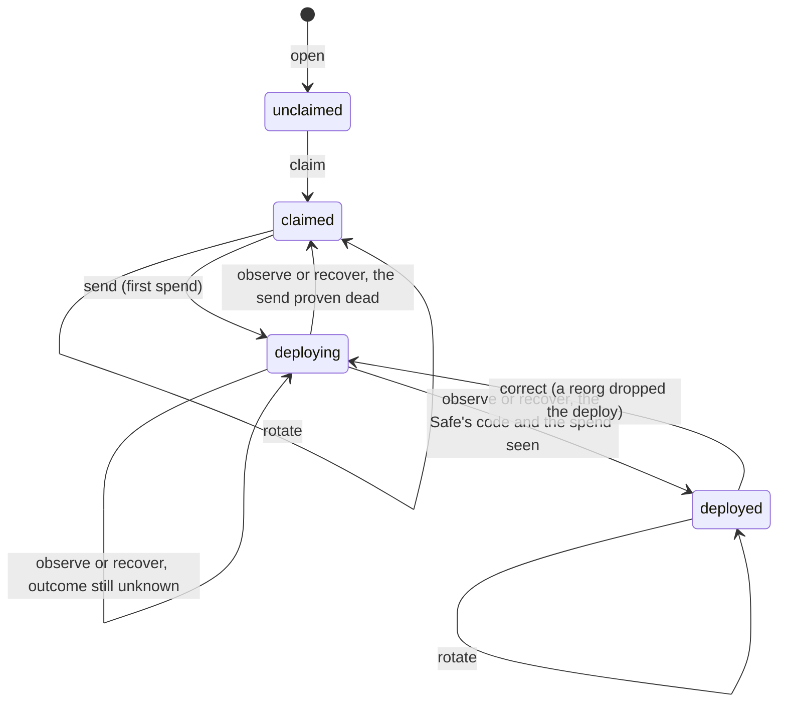

# CX-safe-machines: the Safe as two state machines, with no bootstrap owner

**Status: decided, 26 November 2026,** by Goal 16's 📐 designer thread, started by the money lane's 🧭 lead (issue
#1158), under AGENTS.md "Who decides". It follows `CX-safe.md` (#1159) and changes it where Aaron's steer of the same day
says to. One question goes to Aaron, at the end; the decision goes ahead on its default without him.

**Aaron's steer,** 26 November 2026, through the conductor, in his words: "there is a whole mechanism with a salt and
startup ceremony. We don't need that, but we do need the same system, and it's its own state machine that's kinda
complex." Read as three calls:

1. **No byte-compatibility with the earlier implementation.** Capxul keeps its own salt namespace and fixtures. It does
   not reproduce the implementation's `capxul:staging:email:v2` namespace, its addresses, or its startup ceremony.
2. **The system stays, as its own machines.** A person's Safe and a company's Safe setup are each an Orthograph thing
   with a machine, lifted from the implementation's states and moves, with a send fence and moves that settle a send
   whose outcome is unknown.
3. **No bootstrap owner unless Aaron says yes.** CX-safe's bootstrap key was its answer to its own For Aaron 2; that
   answer is withdrawn here, and the question is put again with the evidence (section 2).

**The prior art.** This thread cannot read `Xelmar-tech/infrastructure`. The conductor read it from its clone and
answered; its answers are cited `infrastructure:<path>:<lines>`, `P/` for `packages/protocol/src/evm/` and `B/` for
`packages/backend/src/`. Safe's own contracts are cited from `@safe-global/safe-contracts` 1.4.1, as published on npm
(`contracts/base/OwnerManager.sol`, `contracts/proxies/SafeProxyFactory.sol`, `contracts/Safe.sol`).

## In short

A person's Safe and a company's Safe are two things now, `personal-safe` and `company-safe`, each with its own machine.

A **person's Safe** is opened for them before they have a signer, and has no address yet: a Safe must have a real owner
from its first moment, and its address is bound to that owner, so there is no honest address until the person brings
one. When they **claim** it, their signer becomes its one owner and the address is fixed, still with nothing on chain.
Money can be paid to it from then on. It is **deployed on its first spend**, in the same transaction, and its signer can
be **rotated** afterwards. Money a Capxul company owes a person who has not claimed waits in Capxul, as a waiting
payout, and goes out the moment they claim.

A **company's Safe** is set up by a machine lifted from the implementation's setup: its address is worked out from the
founder's personal Safe, the founder authorizes the deploy, Capxul sends it once behind a send fence, and observe and
recover settle a send whose outcome is unknown, until the Safe is active or the setup has failed with a named issue.

No key of Capxul's ever owns anyone's Safe. If Aaron wants people paid on chain before they have any signer, that needs
a bootstrap owner, and it is his call (For Aaron).

## 1. What CX-safe already says, checked against the steer

- **The address shape: Safe 1.4.1 L2, the 4337 module, CREATE2 from the initializer and a salt nonce.** CX-safe says
  this (`CX-safe.md:105-131`), with one gap: it says the initializer "enables the Safe 4337 module" without saying how.
  The setup call's `to` is **MultiSend `0x38869bf66a61cF6bDB996A6aE40D5853Fd43B526`**, which the Safe delegatecalls from
  `setupModules` (`Safe.sol`, `setup`; `ModuleManager.sol:32-38`), and MultiSend's one entry is a delegatecall into
  **`SafeModuleSetup.enableModules([Safe4337Module])`**. The initializer, whole:
  `setup(owners = [firstOwner], threshold = 1, to = MultiSend, data = multiSend(delegatecall SafeModuleSetup.enableModules([Safe4337Module])), fallbackHandler = Safe4337Module, paymentToken = 0, payment = 0, paymentReceiver = 0)`.
  The address is `create2(SafeProxyFactory, keccak256(abi.encodePacked(keccak256(initializer), saltNonce)), keccak256(proxyCreationCode ++ uint256(SafeL2)))`
  (`SafeProxyFactory.sol:54`).
- **Byte-compatibility.** CX-safe calls the initializer "the implementation's, byte for byte" (`:109`) and has S1 and A3
  check against "the implementation's formula" (`:293,344-345`). The formula is Safe's factory's, not the
  implementation's, and matching the implementation's bytes is no longer a goal: the checks use Capxul's own fixed
  vector (a fixed owner and salt nonce, its expected address worked out with the factory's formula and checked on Anvil
  against the factory). Under Supersedes.
- **The salt namespace.** CX-safe already keys it by Capxul's id, `capxul:<environment>:safe:v1:<id>` (`:93-103`), not
  the implementation's email namespace. It stands.
- **The bootstrap owner, and the claim that swaps it out** (`:29-37,57,82-91,394-397`). Withdrawn; section 2.
- **One `safe` thing for both kinds** (`:47-70`). Split in two; section 3. S1's author found the reason: one personal
  Safe per person is a unique rule on `person`, and on a field that is empty for every company Safe the runtime keys
  every empty value alike, so every company Safe would clash (`packages/orthograph` records, `internal/unique.ts`,
  `keyOf`). And the two lifecycles share no states.
- **A company's Safe deployed on its first spend** (`:298,355`). Changed: its setup deploys it (section 4), as the
  implementation's setup does.

## 2. Who owns a person's Safe before they have a signer

**The constraint, plainly.** A Safe 1.4.1 cannot exist without a real owner. `setupOwners` refuses a threshold of 0
(`GS202`) and refuses `0x0`, the sentinel `0x1` and the Safe itself as owners (`GS203`)
(`OwnerManager.sol:31-41`), and `setup` runs once, at deploy, inside the factory's call. The factory's CREATE2 salt is
the hash of the whole initializer with the salt nonce (`SafeProxyFactory.sol:54`), so the address commits to the owners
named in it. Money at a counterfactual address can only ever be reached by deploying that exact initializer, and then
it belongs to those owners.

So **an owner-less derivation cannot give a usable address before a signer exists.** Every way of having one names
some owner in the initializer who can later hand the Safe over, and whoever controls that owner holds the money until
then:

| Initializer owner before the person has a signer | Who holds the money until claim | Verdict |
|---|---|---|
| Capxul's bootstrap key (the implementation's way, CX-safe) | Capxul | custody; needs Aaron's yes |
| a claim contract Capxul's server drives (it releases the Safe on Capxul's word) | Capxul, through a contract | the same custody, more code |
| the paying company's Safe | the employer | worse: the employer holds the employee's own account |
| a commit-reveal contract (the person later reveals a secret Capxul made) | whoever saw the secret first, Capxul included | custody with extra risk |
| an address nobody controls | nobody, for ever | money lost |

That makes a bootstrap owner a real need **for one feature only: paying a person on chain before they have any signer.**
It is Aaron's call (For Aaron).

**The default, without it: the address is fixed at claim.** The person's Safe is opened with no owner and no address.
At claim the person proves a signer, and the initializer's one owner is that signer: `firstOwner = signer`, the salt
nonce from their id, the address worked out then, nothing on chain. From that moment the address is stable for good:
rotating the signer later is a `swapOwner` on the deployed Safe and never moves it.

**How money reaches a person before claim.** Not on chain. A Capxul company paying a person who has not claimed (a
payroll run, an expense, a contractor's invoice) makes a **waiting payout**: the company's money stays in the company's
Safe, and the payout is a row that names the person and waits. When the person claims, the `PersonalSafeClaimed` event
advances every waiting payout for them to sendable, and each goes out through the company's Safe as an ordinary
payment. This is the implementation's own mechanism, "a claimed Safe advances waiting rows" (`infrastructure:B/members/advances.ts`;
section 3 has its rule). An outside payer with no Capxul account (an invoice's pay link, `M7-capxul.md` section 4) is paid
only to a claimed person, who has an address by then: a person raises an invoice only after signing in, and claiming
is part of their first sign-in.

**The bootstrap variant, ready if Aaron says yes.** The machine is the same; three things change. `open` sets
`firstOwner` to the environment's bootstrap key and works out the address then, so money can arrive in `unclaimed`;
`claim` records the person's proven signer but does not change the address; and the first spend's transaction is
`createProxyWithNonce`, then `swapOwner(bootstrap → signer)` signed by the bootstrap key, then the spend signed by the
signer, one transaction. The bootstrap key signs only that `swapOwner`, and a journey proves no other operation uses it.
Waiting payouts are then unneeded for people with a Capxul Safe, but stay for people paid before they are invited.

## 3. A person's Safe

**`personal-safe`** (`Blueprint.id("saf")`, CX-safe's prefix, kept): one per person.

| Field | Value | Set |
|---|---|---|
| `id` | `saf_…` | at open |
| `person` | `per_…`, **required** | at open |
| `saltNonce` | uint256 digit string: `uint256(keccak256("capxul:<environment>:safe:v1:<per_…>"))` | at open |
| `signer` | `Blueprint.account()`: today's one owner | at claim; changed by `rotate` |
| `firstOwner` | `Blueprint.account()`: the owner in the initializer, which the address commits to; never changes | at claim (the bootstrap key at open, in the bootstrap variant) |
| `account` | `Blueprint.account()`, CAIP-10: the Safe's address on the environment's chain | at claim (at open, in the variant) |
| `fenceAttempt`, `fenceTransaction`, `fenceSigned`, `fenceSentAt` | all optional: the send fence (below): an attempt id, the transaction's hash, its signed bytes, an instant | by `send`; cleared by `observe` and `recover` |

Rule: `Blueprint.invariant.unique([PersonalSafe.fields.person], { refuse: SafeAlreadyOpen })`. A person's Safe has one
owner and threshold 1, always: Capxul never adds an owner to it. So `owners` and `threshold` are not fields here, and
`ThresholdOutOfRange` and `OwnersNotUnique` move to `company-safe`.

**Its machine.**



```ts
export const machine = Blueprint.machine(PersonalSafe, {
  states: ["unclaimed", "claimed", "deploying", "deployed"],
  moves: {
    open: { from: [], to: "unclaimed", emits: Events.PersonalSafeOpened },
    claim: { from: ["unclaimed"], to: "claimed", emits: Events.PersonalSafeClaimed },
    send: { from: ["claimed"], to: "deploying", emits: Events.PersonalSafeDeploySent },
    observe: { from: ["deploying"], to: ["deploying", "deployed", "claimed"], emits: Events.PersonalSafeObserved },
    recover: { from: ["deploying"], to: ["deploying", "deployed", "claimed"], emits: Events.PersonalSafeObserved,
      by: Blueprint.time.after("fenceSentAt", "2 minutes"), late: "1 hour" },
    rotate: { from: ["claimed", "deployed"], to: ["claimed", "deployed"], emits: Events.PersonalSafeSignerRotated },
    correct: { from: ["deployed"], to: "deploying", emits: Events.PersonalSafeDeployUndone },
  },
  notFrom: { exit: 40 }, // generates PersonalSafeNotUnclaimed, carrying the state it found
});
```

**The moves.**

- **`open`**, by a signed-in person, for themselves: its payload is empty and the person is the caller, so nobody opens
  a Safe for someone else (S1's author: a role cannot judge a `per_…` in the payload, since there is no person thing to
  walk to, `packages/language-effect/src/modules/access/service.ts`). A second operation, **`openFor { person }`**,
  system only, makes the same move for a person a Capxul company owes money before they have one (S3). Sets the salt
  nonce. Emits `PersonalSafeOpened { safe, person }`.
- **`claim`**, by the person only. Payload: the Safe, the signer's address, and a proof: an EIP-191 `personal_sign` by
  the signer of the exact text `Capxul: claim Safe <saf_…> for <per_…>`, recovered on the server (`viem`'s
  `recoverMessageAddress`; `packages/chain-evm` already depends on `viem`). A journey cannot sign today: its payload is
  literal data or refs resolved to recorded values (`packages/orthograph/src/modules/journeys/internal/refs.ts`), and an
  actor has no `sign`. So unit **J1** adds one: `s.<actor>.signs(template)`, answering `{ signature, signer }`, the
  template's refs resolved, then signed EIP-191 by the world key that cast member holds (a world key's `signMessage`,
  `packages/chain-evm/src/modules/keys/types.ts:9-10`). The claim step reads
  `{ safe, signer: s.last.signer, proof: s.last.signature }`. A fixed text with no ids was refused: a proof could then be
  replayed onto another person's Safe. Taking the signer without a proof until the first spend was refused too: the
  address would commit to a key nobody had shown they hold. The proof is what stops money going to an address
  nobody holds, from a typo or a guess. Sets `signer` and `firstOwner` to the recovered address and `account` to the
  prediction. No chain. Emits `PersonalSafeClaimed { safe, person, signer, account }`, which advances the person's
  waiting payouts.
- **`send`**, by the system, when the first spend's Safe transaction (S3's `safe-transaction`) is ready to submit. The
  first spend deploys: one transaction carries `createProxyWithNonce(SafeL2, initializer, saltNonce)` and the Safe's
  `execTransaction` of the spend, signed by the signer (through `MultiSendCallOnly` from a world key in a world; as a
  UserOperation's `initCode` and `callData` in production, P1). Writes the fence first (below). Emits
  `PersonalSafeDeploySent { safe, attempt, transaction }`.
- **`observe`**, by the system, when the follower hands on the factory's `ProxyCreation` for this address, the spend's
  `ExecutionSuccess` or `ExecutionFailure`, or the transaction's receipt. It reads the code at the address and the
  receipt by the fence's transaction hash, and chooses: code there with `getOwners() = [firstOwner]` → `deployed`, the
  fence cleared; a reverted receipt or a nonce the signer has used for another transaction, and no code → `claimed`,
  the fence cleared, the spend refused to its caller with `DeployFailed { reason }`; nothing known yet → `deploying`.
  Emits `PersonalSafeObserved { safe, attempt, outcome }`. Someone else deploying the same initializer first is fine:
  the code is the same Safe with the same owner, so `observe` sees `deployed`, and the spend, if it did not run, is sent
  again as an ordinary Safe transaction.
- **`recover`**, made by time: the keeper fires it two minutes after the fence was written, and again on each run while
  the Safe stays `deploying`. It does what `observe` does, and if nothing is known and the node no longer holds the
  transaction, it **rebroadcasts the same signed bytes**, never a new signature (`M6-relayer-rebroadcast.md`: the same
  bytes are safe to send at any moment; CREATE2 and the Safe's nonce make a second landing impossible). A fence older
  than an hour with no outcome raises the issue `DeployStuck` on the person's Safe, for an operator to see; it is not a
  refusal, and the Safe stays `deploying`.
- **`rotate`**, by the person, proving the new signer as `claim` does and signed by today's signer. From `deployed` it
  is the Safe transaction `swapOwner(SENTINEL, signer, newSigner)`, and the move is made when that transaction is
  executed (S3); from `claimed` the rotation is the first spend, so it deploys (the initializer still names the first
  signer, who signs). `firstOwner` and `account` never change. Emits `PersonalSafeSignerRotated { safe, from, to }`.
- **`correct`**, by the system, when the follower's correction drops the `ProxyCreation` (a reorg). The same signed
  transaction is usually included again, so the Safe goes back to `deploying` with its fence, and `observe` or
  `recover` settles it. Emits `PersonalSafeDeployUndone { safe }`.

**The send fence.** One Safe can never have two deploy transactions in flight. `send` writes, in the same commit as the
move, the four fence fields: a fresh attempt id, the transaction's hash, its signed bytes, and the time. It is written **before** the transaction is broadcast, and the broadcast is a step after the commit, so a
crash between the two leaves a fence whose bytes were never sent, which `recover` sends. The machine is the fence's
first half: `send` starts only from `claimed`, so a second `send` on a `deploying` Safe is refused by the machine before
anything is signed. The second half is the rule that the fence is only ever cleared by `observe` or `recover` proving
an outcome on chain, never by a timeout or an error from the node; an unknown outcome stays unknown, and the same bytes
are sent again. The exact rule is the implementation's (section 4, `checkSendFence`).

**Refusals, from every state.** `—` is the machine's own refusal, generated, `PersonalSafeNotUnclaimed { state }`
(exit 40, the machine's code 900): it is named after the first state and covers every move from a wrong state.

| Move \ state | (none) | `unclaimed` | `claimed` | `deploying` | `deployed` |
|---|---|---|---|---|---|
| `open` | `SafeAlreadyOpen` if the person has one | — | — | — | — |
| `claim` | `PersonalSafeNotFound` | `SignerNotProven`, `NotAllowed` | — (already claimed) | — | — |
| `send` | not found | — (`NotClaimed` to the spend's caller) | `NotAllowed` unless the system | — (the fence: already sending) | — (a deployed Safe spends without a deploy) |
| `observe`, `recover` | not found | — | — | moves | — |
| `rotate` | not found | — (`NotClaimed`) | `SignerNotProven`, `NotAnOwner` | — (wait for the deploy) | `SignerNotProven`, `NotAnOwner` |
| `correct` | not found | — | — | — | moves |

Errors declared with the thing (`errors.ts`, exits from 41): `SafeAlreadyOpen { person }`, `SignerNotProven { signer }`,
`NotClaimed { safe }` (a spend on a Safe with no signer; S3's `safe-transaction` refuses it at propose),
`NotAnOwner { signer }` (the rotation is not signed by today's signer), `DeployFailed { reason }`. `NotAllowed` and
`PersonalSafeNotFound` are the runtime's (K16).

**Waiting payouts.** (Filled from the conductor's answer on `infrastructure:B/members/advances.ts`.)

## 4. A company's Safe setup

(Filled from the conductor's answers on `infrastructure:B/organizations/setups/`.)

## 5. What changes in the units

(Filled with sections 3 and 4.)

## For Aaron

1. **May Capxul's own key own a person's Safe until they bring their key?** I recommend no, which is what Capxul now
   does. Without it, nobody can be paid on chain before they have claimed their Safe; a Capxul company paying them
   instead holds the payout as waiting, in its own Safe, and it goes out the moment they claim. With it, money could
   reach a person's address before they have any key, as your earlier implementation did, but Capxul would hold that
   money until they claim. No Safe can be made without an owner, and its address is fixed by that owner, so there is
   no third way that keeps both.

## Supersedes

(Filled at the end.)
