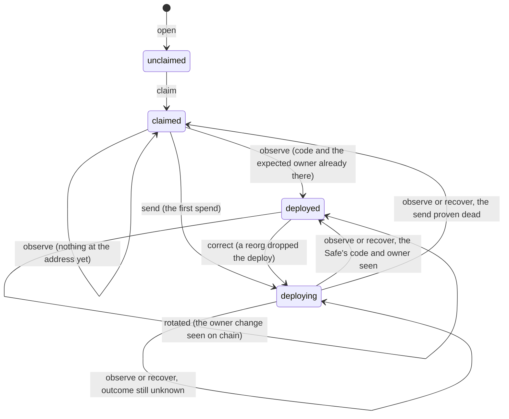
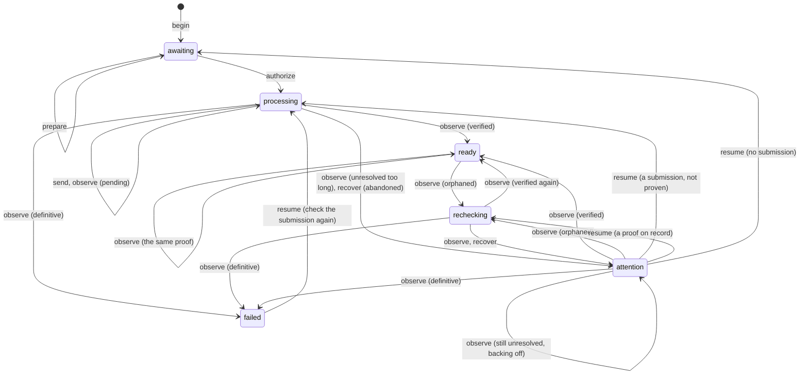
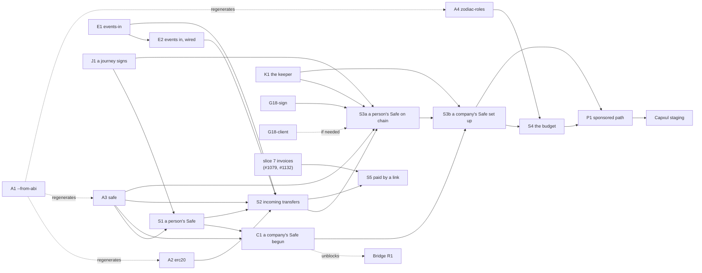

# CX-safe-machines: the Safe as two state machines, with no bootstrap owner

**Status: decided, 26 November 2026,** by Goal 16's 📐 designer thread, started by the money lane's 🧭 lead (issue
#1158), under AGENTS.md "Who decides". It follows `CX-safe.md` (#1159) and changes it where Aaron's steer of the same day
says to. One question goes to Aaron, at the end; the decision goes ahead on its default without him.

**Aaron's steer,** 26 November 2026, through the conductor, in his words: "there is a whole mechanism with a salt and
startup ceremony. We don't need that, but we do need the same system, and it's its own state machine that's kinda
complex." Read as three calls:

1. **No byte-compatibility with the earlier implementation.** Capxul keeps its own salt namespace and fixtures. It does
   not reproduce the implementation's `capxul:staging:email:v2` namespace, its addresses, or its startup ceremony.
2. **The system stays, as its own machines.** A person's Safe and a company's Safe setup are each an Orthograph thing
   with a machine, lifted from the implementation's states and moves, with a send fence and moves that settle a send
   whose outcome is unknown.
3. **No bootstrap owner unless Aaron says yes.** CX-safe's bootstrap key was its own answer to its For Aaron 2; that
   answer is withdrawn here, and the question is put again with the evidence (section 2).

**The prior art.** This thread cannot read `Xelmar-tech/infrastructure`. The conductor read it from its clone and
answered on 26 November 2026; its answers are cited `infrastructure:<path>:<lines>`, with `P/` for
`packages/protocol/src/evm/`, `B/` for `packages/backend/src/` and `S/` for `B/organizations/setups/`. Safe's own contracts
are cited from `@safe-global/safe-contracts` 1.4.1 as published on npm (`contracts/base/OwnerManager.sol`,
`contracts/base/ModuleManager.sol`, `contracts/proxies/SafeProxyFactory.sol`, `contracts/Safe.sol`).

## In short

A person's Safe and a company's Safe are two things now, `personal-safe` and `company-safe`, each with its own machine.

A **person's Safe** is opened before they have a signer, and has no address yet: a Safe must have a real owner from its
first moment, and its address is bound to that owner, so there is no honest address until the person brings one. When
they **claim** it, proving their signer, that signer becomes its one owner and the address is fixed, with nothing on
chain. Money can be paid to it from then on. It is **deployed on its first spend**, in the same transaction, behind a
send fence, and **observe** and **recover** settle a send whose outcome is unknown. Its signer can be **rotated** without
moving the address.

A **company's Safe** is set up by a machine lifted from the implementation's setup (`orgLifecycles`): it is **begun**
with its address worked out from the founder's personal Safe, the founder **prepares** and **authorizes** the one
bootstrap transaction, Capxul **sends** it once behind a send fence, and **observe**, **recover** and **resume** carry it
to `ready`, or to `failed` with a named issue, through `attention` and `rechecking` when the chain is slow or reorgs.

No key of Capxul's owns anyone's Safe. Paying a person on chain before they have any signer needs one, and that is
Aaron's call (For Aaron).

## 1. What CX-safe already says, checked against the steer

- **The address shape: Safe 1.4.1 L2, the 4337 module, CREATE2 from the initializer and a salt nonce.** CX-safe says
  this (`CX-safe.md:105-131`), with one gap: it says the initializer "enables the Safe 4337 module" without saying how.
  The setup call's `to` is **MultiSend `0x38869bf66a61cF6bDB996A6aE40D5853Fd43B526`**, which the Safe delegatecalls from
  `setupModules` (`Safe.sol`, `setup`; `ModuleManager.sol:32-38`), and MultiSend's one entry is a delegatecall into
  **`SafeModuleSetup.enableModules([Safe4337Module])`**, as the implementation does
  (`infrastructure:P/safe-address.ts:108-141`, `P/organization-safe.ts:43-72`). The initializer, whole:
  `setup([firstOwner], 1, MultiSend, multiSend(delegatecall SafeModuleSetup.enableModules([Safe4337Module])), Safe4337Module, 0, 0, 0)`.
  The address is `create2(SafeProxyFactory, keccak256(abi.encodePacked(keccak256(initializer), saltNonce)), keccak256(proxyCreationCode ++ uint256(SafeL2)))`
  (`SafeProxyFactory.sol:54`).
- **Byte-compatibility.** CX-safe calls the initializer "the implementation's, byte for byte" (`:109`), and has A3 and S1
  check against "the implementation's formula" (`:293,344-345`). The formula is Safe's factory's, and matching the
  implementation's bytes is no longer a goal: the checks use Capxul's own fixed vector (a fixed owner and salt nonce,
  the expected address worked out with the factory's formula and confirmed by `eth_call` on the canonical factory on
  Anvil). S1's author and A3's corrected vectors already agree on one. Under Supersedes.
- **The salt namespace.** CX-safe already keys it by Capxul's id, `capxul:<environment>:safe:v1:<id>` (`:93-103`), not
  the implementation's email (`infrastructure:P/safe-address.ts:38-63`) or its company namespace
  `capxul:org:v1:<email>:<handle>` (`P/organization-safe.ts:10-41`). It stands.
- **The bootstrap owner, and a claim that swaps it out** (`:29-37,57,82-91,394-397`). Withdrawn; section 2.
- **One `safe` thing for both kinds** (`:47-70`). Split in two (sections 3 and 4). S1's author found the reason: one
  personal Safe per person is a unique rule on `person`, and on a field empty for every company Safe the runtime keys
  every empty value alike (`packages/orthograph`, records `internal/unique.ts`, `keyOf`), so every company Safe would
  clash. And the two lifecycles share no states.
- **A company's Safe deployed on its first spend** (`:298,355`). Changed: its setup deploys it, as the implementation's
  does (section 4).
- **How an owner Safe executes a company Safe's transaction** (`:150-155`, marked "(conductor: confirm)"). Confirmed: the
  founder's personal Safe sends the bootstrap, and in it calls the company Safe's `execTransaction` with a pre-validated
  (`v = 1`) signature, which counts because the owner Safe is the sender
  (`infrastructure:P/bootstrap.ts:62-134`, `P/safe-transactions.ts:188-214`). A note beside CX-safe's words says so.

## 2. Who owns a person's Safe before they have a signer

**The constraint, plainly.** A Safe 1.4.1 cannot exist without a real owner. `setupOwners` refuses a threshold of 0
(`GS202`) and refuses `0x0`, the sentinel `0x1` and the Safe itself as owners (`GS203`) (`OwnerManager.sol:31-41`), and
`setup` runs once, at deploy, inside the factory's call. The factory's CREATE2 salt is the hash of the whole initializer
with the salt nonce (`SafeProxyFactory.sol:54`), so the address commits to the owners named in it. Money at a
counterfactual address can only be reached by deploying that exact initializer, and then it belongs to those owners.

So **an owner-less derivation cannot give a usable address before a signer exists.** Every way of having one names
some owner in the initializer who can later hand the Safe over, and whoever controls that owner holds the money until
then:

| The initializer's owner before the person has a signer | Who holds the money until claim | Verdict |
|---|---|---|
| Capxul's bootstrap key (the implementation's way, and CX-safe's) | Capxul | custody; needs Aaron's yes |
| a claim contract Capxul's server drives (the implementation's closed "ClaimGuard", `infrastructure:P/safe-contracts.ts:43-54`) | Capxul, through a contract | the same custody, more code |
| the paying company's Safe | the employer | worse: the employer holds the employee's own account |
| a commit-reveal contract (the person reveals a secret Capxul made) | whoever saw the secret first, Capxul included | custody with more risk |
| an address nobody controls | nobody, for ever | money lost |

The implementation reached the same place. Its v1 put the person's signer in the derivation; its v2 moved to the
bootstrap owner precisely so "the address exists before any user signer does" (`infrastructure:P/safe-contracts.ts:18-41`,
`P/safe-address.ts:176-184`), and its ADR-0015 accepts "the bootstrap-key pre-claim exposure" and defers the fix to
"TEE/KMS custody" (`infrastructure:docs/adr/0015-org-membership-decomposition-per-person-capability-grants.md:37-43`).
It uses that pre-claim address on purpose: paying an unknown email (`infrastructure:B/parties/reads/recipients.ts:82-97`),
payroll payees "which their email names before they sign up" (`B/payroll/agreements/reads/context.ts:66-71`),
invitations and grants (`B/organizations/invitations/reads/grantees.ts:51-61`) and staging's welcome grants
(`B/accounts/safes/operations/provision.ts:13-15`).

So a bootstrap owner is a real need **for one feature: paying a person on chain before they have any signer.** It goes
back to Aaron (For Aaron).

**The default, without it: the address is fixed at claim.** A person's Safe is opened with no owner and no address. At
claim the person proves a signer, and the initializer's one owner is that signer: `firstOwner = signer`, the salt nonce
from their id, the address worked out then, nothing on chain. From that moment the address is stable for good: a later
signer rotation is a `swapOwner` on the deployed Safe and never moves it. This is the implementation's retired v1,
whose flaw ("per-user owners in the derivation", `P/safe-address.ts:176-184`) is the one this section names: no address
before a signer. It has no other cost.

**How money reaches a person before claim.** Not on chain. A Capxul company paying a person who has not claimed (a
payroll run, an expense, a contractor's invoice) holds the payout as **waiting**: the money stays in the company's Safe,
the payout names the person, and nothing is sent. When the person claims, `PersonalSafeClaimed` advances every payout
waiting on them: it fills in their address and makes the payout sendable, sending nothing itself; each then goes out by
its own machine. The shape is the implementation's member advance, lifted: "a claimed Safe advances waiting rows", run
in the claim's own transaction, which patches the address and moves each row one rung on and leaves the on-chain step to
that row's own lane ("Account readiness is NOT Permission authority",
`infrastructure:B/organizations/members/writes/advances.ts:26-69`, called from `B/accounts/claims/writes/rows.ts:107-119`).
There it advanced Org members from `pending_safe` to `pending_grant`, and it is dead code since ADR-0015 (no writer of
`pending_safe`; same ADR, `:37-43`). Here it is live, for payouts, and for an Org Budget granted to a member who has not
claimed (S4). Where each waiting payout lives is its own thing's business (Bridge's payouts, payroll); the rule is
theirs to declare `on: PersonalSafeClaimed`. An outside payer with no Capxul account (an invoice's pay link,
`M7-capxul.md` section 4) pays only a claimed person, who has an address by then: a person raises an invoice only after
signing in, and claiming is part of their first sign-in.

**The bootstrap variant, ready if Aaron says yes.** The machines are the same; four things change. `open` sets
`firstOwner` to the environment's bootstrap key's address and works the address out then, so money can arrive in
`unclaimed`; `claim` records the proven signer without changing the address; the first spend's transaction deploys,
then runs `swapOwner(SENTINEL, bootstrap, signer)` signed by the bootstrap key, then the spend signed by the signer; and
a journey proves no operation but that first spend uses the bootstrap key, which is a secret per environment (a world
key in a world). Waiting payouts then shrink to people who have no Capxul Safe at all.

## 3. A person's Safe

**`personal-safe`** (`Blueprint.id("saf")`, CX-safe's prefix kept): one per person.

| Field | Value | Set |
|---|---|---|
| `id` | `saf_…` | at open |
| `person` | `per_…`, **required** | at open |
| `saltNonce` | a uint256 digit string, `uint256(keccak256("capxul:<environment>:safe:v1:<per_…>"))` | at open |
| `signer` | `Blueprint.account()`: today's one owner | at claim; changed by `rotated` |
| `firstOwner` | `Blueprint.account()`: the owner in the initializer, which the address commits to; never changes | at claim (at open, in the bootstrap variant) |
| `account` | `Blueprint.account()`, CAIP-10: the Safe's address on the environment's chain | at claim (at open, in the variant) |
| `fenceAttempt`, `fenceSubmission`, `fenceSigned`, `fenceSentAt` | the send fence (below), each optional: an attempt id, the submission's hash (a UserOperation hash in production, a transaction hash in a world), its signed bytes, an instant | by `send`; cleared by `observe` and `recover` |
| `nextCheckAt` | optional instant: when `recover` next runs | by `send`, `recover` and `correct`; cleared on leaving `deploying` |
| `issue` | optional: `deploy_stuck` or `deploy_reverted`, with a bounded detail | by `recover` and `observe` |

Rule: `Blueprint.invariant.unique([PersonalSafe.fields.person], { refuse: SafeAlreadyOpen })`. A person's Safe has one
owner and threshold 1, always; Capxul never adds an owner to it. So `owners` and `threshold` are not its fields, and
`ThresholdOutOfRange` and `OwnersNotUnique` move to `company-safe`.

**What it lifts.** The implementation's row is `smartAccounts` (`infrastructure:B/accounts/tables.ts:27-56`), with no
status field: its state is which fields are set (`:32-34`), and only the client names states, `unknown | deriving |
counterfactual | claiming | claimed | failed` (`infrastructure:packages/sdk/src/access/identity/model.ts:116-127`). Its
claim is fenced by a lock: `claimLockId` and `deploymentInFlightAt` (a ten-minute lock), then `claimUserOpHash`,
`claimSignerAddress` and `claimUserOpJson` recorded under that lock, then `confirm`, or `clearSubmission` and
`releaseLock` back to counterfactual for a send proven rejected, and `adoptOnChain` when the chain already shows the
outcome (`B/accounts/claims/rules.ts:64-80`, `writes/rows.ts:40-104`, `external/submissions.ts:149-178`); deploys are
proven by a receipt or a `ProxyCreation` log (`B/accounts/safes/external.ts:35-81`), and "counterfactual Safes are
permissionlessly deployable, so probe the chain rather than trusting `deployedAt`" (`B/accounts/claims/external/ownership.ts:86-102`).
Capxul names those states as a machine, and moves the fence from the claim to the first spend, since a claim with no
bootstrap owner sends nothing. The implementation deploys at the claim (`ownership.ts:86-102`; "deploy on first spend"
is not in it) because its claim already needs a transaction to swap the bootstrap owner out; Capxul's claim needs none,
so the deploy waits for the first spend, and a person who only ever receives costs no deploy. It has no personal
rotation ("post-claim rotation is a separate lane", `B/accounts/claims/rules.ts:25-29`); `rotate` is new.

**Its machine.**



```ts
export const machine = Blueprint.machine(PersonalSafe, {
  states: ["unclaimed", "claimed", "deploying", "deployed"],
  moves: {
    open: { from: [], to: "unclaimed", emits: Events.PersonalSafeOpened },
    claim: { from: ["unclaimed"], to: "claimed", emits: Events.PersonalSafeClaimed },
    send: { from: ["claimed"], to: "deploying", emits: Events.PersonalSafeDeploySent },
    observe: {
      from: ["claimed", "deploying"], to: ["claimed", "deploying", "deployed"], emits: Events.PersonalSafeObserved,
    },
    recover: {
      from: ["deploying"], to: ["deploying", "deployed", "claimed"], emits: Events.PersonalSafeObserved,
      by: Blueprint.time.after("nextCheckAt", "0 seconds"), // fired by the keeper, K1
    },
    rotated: { from: ["deployed"], to: "deployed", emits: Events.PersonalSafeSignerRotated },
    correct: { from: ["deployed"], to: "deploying", emits: Events.PersonalSafeDeployUndone },
  },
  notFrom: { exit: 40 }, // generates PersonalSafeNotUnclaimed, carrying the state it found
});
```

**The moves.**

- **`open`**, by a signed-in person, for themselves: its payload is empty and the person is the caller, so nobody opens
  a Safe for someone else (S1's author: a role cannot judge a `per_…` in the payload, since there is no person thing to
  walk to, `packages/language-effect/src/modules/access/service.ts`). A second operation, **`openFor { person }`**,
  system only, makes the same move for a person a Capxul company owes money before they have a Safe (S3a). Sets the salt
  nonce. Emits `PersonalSafeOpened { safe, person }`.
- **`claim`**, by the person whose Safe it is. Payload: the Safe, the signer's address, and a proof: an EIP-191
  `personal_sign` by the signer of the exact text `Capxul: claim Safe <saf_…> for <per_…>` (one line, no trailing
  newline; no chain id, since the address is the same on every EVM chain; no nonce, since the machine allows one claim),
  recovered on the server with `viem`'s `recoverMessageAddress` (`packages/chain-evm` already depends on `viem`) and
  compared with `signer`. The proof is what stops the address committing to a key nobody holds, from a typo or a guess.
  It sets `signer` and `firstOwner` to the signer and `account` to the prediction, and sends nothing. It emits
  `PersonalSafeClaimed { safe, person, signer, account }`, which advances the person's waiting payouts (section 2).
  - A journey cannot sign today: its payload is literal data or refs resolved to recorded values
    (`packages/orthograph/src/modules/journeys/internal/refs.ts`), and an actor has no `sign`. Unit **J1** (#1190) adds
    `s.<actor>.signs(template)`, answering `{ signature, signer }`: the template's refs resolved, then signed EIP-191 by
    the world key that cast member holds (`packages/chain-evm/src/modules/keys/types.ts:9-10`). The claim step reads
    `{ safe, signer: s.last.signer, proof: s.last.signature }`; the wrong-key step has another member sign this text.
  - Refused alternatives: a fixed text with no ids (a proof could be replayed onto another person's Safe), and taking
    the signer unproven until the first spend (the address would commit to a key nobody had shown they hold).
- **`send`**, by the system, when the first spend's Safe transaction (S3a's `safe-transaction`) is ready to submit. It
  reads the code at the address first. With none, the first spend deploys: one submission carries the factory's
  `createProxyWithNonce(SafeL2, initializer, saltNonce)` and the Safe's own `execTransaction` of the spend, signed by the
  signer; in production as one sponsored UserOperation with the factory call as its `factory`/`factoryData` and the
  spend as its `callData`, as the implementation's claim does (`infrastructure:B/accounts/claims/external/ownership.ts:70-103`,
  `P/safe-4337.ts:156-166`; P1); in a world, through `MultiSendCallOnly` from a world key. With code already there
  (anyone may deploy a claimed Safe's initializer), it leaves the factory call out, and the same check moves the Safe
  straight to `deployed` instead, as `observe` would. It writes the fence and `nextCheckAt` (two minutes on) in its
  commit, and the broadcast follows the commit (below). Emits `PersonalSafeDeploySent { safe, attempt, submission }`.
- **`observe`**, by the system, when the follower hands on the factory's `ProxyCreation` for this address, the spend's
  `ExecutionSuccess` or `ExecutionFailure`, or the submission's receipt. It reads the code at the address, its
  `getOwners()`, and the receipt by `fenceSubmission`, and chooses:
  - code there and `getOwners() = [signer]` → `deployed`, the fence cleared. This holds from `claimed` as well as from
    `deploying`: someone else deploying the same initializer, or a send proven dead that lands late, is adopted, as
    the implementation's `adoptOnChain` does (`B/accounts/claims/operations/adopt-on-chain.ts:13-33`). A spend that did not
    run is then sent again as an ordinary Safe transaction.
  - from `deploying`, the send **proven dead** and no code → `claimed`, the fence cleared, `issue: deploy_reverted`, and
    the spend refused to its caller with `DeployFailed { reason }`. Proven dead means: a reverted receipt; or, in
    production, the UserOperation past its `validUntil` with no receipt; or, in a world, the submitting key's nonce used
    by another transaction with no receipt.
  - nothing known yet → stays where it was; from `deploying`, `nextCheckAt` moves on (below).

  Emits `PersonalSafeObserved { safe, attempt, outcome }`. An observation for an attempt that is not `fenceAttempt` is
  stale and writes nothing (the implementation's "same lock only", `B/accounts/claims/writes/rows.ts:48-60`).
- **`recover`**, made by time, fired by the keeper (K1) at `nextCheckAt`. It does what `observe` does; when nothing is
  known and the node (or the bundler) no longer holds the submission, it **sends the same signed bytes again**, never a
  new signature (`M6-relayer-rebroadcast.md`). Each `recover` that leaves the Safe in `deploying` writes `nextCheckAt`
  again, 2, 4, 8 then every 10 minutes on, and that rewrite is what re-arms it: an `after(field, span)` move fires once
  for the field's value, so K1 must fire it again when a self-move writes the field anew, and K1's checks pin that. A
  fence ten minutes old with no outcome sets `issue: deploy_stuck`, for an operator to see (the implementation's claim
  lock is ten minutes, `B/accounts/claims/rules.ts:64-80`); it refuses nothing, and the Safe stays `deploying`. Leaving
  `deploying` clears `nextCheckAt`.
- **`rotate`**, an operation by the person that makes no move of its own: it proves the new signer as `claim` does (the
  text `Capxul: rotate Safe <saf_…> to <address>`), is signed by today's signer, and proposes the Safe transaction
  `swapOwner(SENTINEL, signer, newSigner)` (S3a). On a `claimed` Safe that transaction is the first spend, so it goes
  through `send` and deploys the Safe; on a `deploying` one it is refused `DeployPending` until the deploy settles.
- **`rotated`**, by the system, when the follower hands on the Safe's `RemovedOwner` and `AddedOwner` for that swap,
  executed. It sets `signer` to the new signer; `firstOwner` and `account` never change. Emits
  `PersonalSafeSignerRotated { safe, from, to }`.
- **`correct`**, by the system, when the follower's correction drops the `ProxyCreation` (a reorg). The same signed
  submission is usually included again, so the Safe goes back to `deploying` with its fence restored from the
  `PersonalSafeDeploySent` event and `nextCheckAt` set to now, and `observe` or `recover` settles it. Emits
  `PersonalSafeDeployUndone { safe }`.

**The send fence.** One Safe never has two deploys in flight, and an unknown outcome is never answered with a second
signature. Four rules:

1. **The machine is the first half.** `send` starts only from `claimed`; it moves the Safe to `deploying` and writes the
   fence fields (a fresh attempt id, the submission's hash, its signed bytes, the time) in the same commit. A second
   `send` on a `deploying` Safe is refused by the machine before anything is signed. The submission's hash is the
   UserOperation hash in production and the transaction hash in a world.
2. **The bytes are written before they are sent.** The broadcast is a step after the commit. A crash between the two
   leaves a fence whose bytes were never sent, and `recover` sends them. A crash after the broadcast leaves a fence with
   an unknown outcome, and `observe` or `recover` settles it.
3. **Only the chain clears it.** The fence is cleared only by `observe` or `recover` proving an outcome on chain, never
   by a timeout or a node's error. This is the implementation's rule: "The send fence: it can stop a send that has not
   started; it cannot recall bytes in flight" (`infrastructure:S/reads/setups.ts:48-65`), and a failed or unknown send
   is one recorded value, `submission_unknown`, that only a check resolves (`S/writes/authorizations.ts:217-258`).
4. **A new signature after a send proven dead reuses the Safe nonce.** The spend is signed again for the same Safe
   nonce as the dead one, which never executed, so if the old submission comes back late, at most one of the two can
   execute the spend: the second is refused by the Safe (`GS026`), and its factory call by the factory or the EntryPoint,
   since the address has code. Sending the same bytes again is harmless for the same reason, the Safe nonce and CREATE2.
   Under 4337 the paymaster's sponsorship has a window too: after it closes, a resend is rejected by the bundler, which
   is still safe, and the send is then proven dead once `validUntil` has passed.

**Refusals, from every state.** `—` is the machine's own refusal, generated, `PersonalSafeNotUnclaimed { state }` (exit
40, code 900): named after the first state, it covers every move from a wrong state. `rotate`, which makes no move, has
data refusals only.

| Move \ state | none yet | `unclaimed` | `claimed` | `deploying` | `deployed` |
|---|---|---|---|---|---|
| `open` | `SafeAlreadyOpen` if the person has one | — | — | — | — |
| `claim` | `PersonalSafeNotFound` | `SignerNotProven`; `NotAllowed` to anyone else | — (a second claim) | — | — |
| `send` | not found | — (the spend is `NotClaimed` at propose) | system only; moves to `deployed` if code is already there | — (the fence: already sending) | — (a deployed Safe spends with no deploy) |
| `observe` | not found | — | moves (adopts a deploy) or stays | moves | — |
| `recover` | not found | — | — | moves | — |
| `rotate` (no move) | not found | `NotClaimed` | `SignerNotProven`, `NotAnOwner` | `DeployPending` | `SignerNotProven`, `NotAnOwner` |
| `rotated` | not found | — | — | — | moves |
| `correct` | not found | — | — | — | moves |

Errors declared with the thing (`errors.ts`, exits from 41): `SafeAlreadyOpen { person }`, `SignerNotProven { signer }`,
`NotClaimed { safe }` (a spend or a rotation on a Safe with no signer; S3a's `safe-transaction` refuses a spend at
propose), `NotAnOwner { signer }` (a rotation not signed by today's signer), `DeployPending { safe }`,
`DeployFailed { reason }`. `NotAllowed` and
`PersonalSafeNotFound` are the runtime's (K16).

## 4. A company's Safe

**`company-safe`** (`Blueprint.id("csf")`): one per company for now. Its machine is the company's Safe setup, lifted from
the implementation's `orgLifecycles` (`infrastructure:B/organizations/tables/setups.ts:31-121`) and its
`organizations.setups` operations (`infrastructure:B/organizations/README.md:97-134,203-220,255-278`), without the parts
that serve its Convex runtime or its Roles bootstrap (below).

| Field | Value | From the implementation |
|---|---|---|
| `id`, `company` | `csf_…`; `com_…`, required | `orgId` |
| `founder` | the founder's `personal-safe`, required | `founderAuthUserId` |
| `saltNonce` | `uint256(keccak256("capxul:<environment>:safe:v1:<com_…>"))` | the org salt, `P/organization-safe.ts:10-41` |
| `account` | CAIP-10, worked out at begin: the initializer's one owner is the founder's personal Safe | `orgs.safeAddress`, `S/writes/organizations.ts:73-103` |
| `owners`, `threshold` | `[the founder's Safe]` and 1 until `ready`; afterwards a read copy of the chain | new: the implementation does not read them in its checks |
| `generation` | a whole number from 1; `resume` adds one; an observation from another generation is stale | `generation` |
| `preparationDigest`, `preparationHash`, `preparationExpiresAt` | the bootstrap the founder is asked to sign, good for ten minutes | `preparation`, `S/writes/authorizations.ts:33-87` |
| `submissionHash`, `submissionNonce`, `acceptedAt`, `acknowledgedAt` | the signed bootstrap once accepted | `submission` |
| `sendToken` | an id minted at `authorize`, cleared by `send` | `sendToken` |
| `proofTransaction`, `proofBlock`, `proofBlockHash`, `proofValidity` | the receipt that proved the bootstrap; `verified` or `orphaned` | `proof` |
| `completedAt`, `failedAt` | the first `ready`; the first definitive failure | `completedAt`, `firstDefinitiveFailureAt` |
| `issue` | optional, one of the reasons below, with a bounded detail (a code, a message of at most 512 characters, never a cause chain) | `issue`, `S/rules/issues.ts:17-99` |
| `nextCheckAt`, `checkCount`, `pendingCount`, `providerFailureCount`, `abandonedChecks`, `unresolvedSince`, `parkedAt` | the checks' schedule and counters | the same names, `S/writes/checks.ts` |

Rule: `Blueprint.invariant.unique([CompanySafe.fields.company], { refuse: CompanySafeExists })`, since Bridge's R1 reads
"the company's Safe" as its one Safe (CX-bridge-rails `:402`); a second waits until a company needs one.

**Issues.** Lifted from the implementation's closed list (`infrastructure:packages/protocol/src/organizations/setup-model.ts:14-33`), keeping those that apply to a Safe-only bootstrap:
`submission_unknown`, `receipt_unresolved`, `provider_unavailable`, `receipt_reverted`, `address_mismatch`,
`receipt_mismatch`, `contract_state_mismatch`, `bootstrap_reorg`, `historical_evidence_missing`, `worker_failed`.
Dropped with the Roles bootstrap: `authority_event_mismatch`, `allowance_timestamp_mismatch`,
`permission_projection_mismatch`, `dependent_authority_unresolved`; and as the Convex read model's:
`block_identity_changed`, `receipt_identity_unavailable`, `receipt_identity_mismatch`, `contract_code_unavailable`
(folded into `receipt_mismatch` and `contract_state_mismatch`).

**The bootstrap.** One transaction, sent from the founder's personal Safe and signed by its signer: the factory's
`createProxyWithNonce(SafeL2, the company's initializer, saltNonce)`. That is all: the company Safe's initializer
already names the founder's Safe as its one owner and enables the 4337 module. The implementation's bootstrap also
deploys the Zodiac Roles module and configures it in the same transaction, through `MultiSendCallOnly` and the new
Safe's `execTransaction` with the founder Safe's pre-validated signature (`infrastructure:S/external/authorizations.ts:43-71`,
`P/bootstrap.ts:62-134`); Capxul leaves Roles to the Org Budget (S4), each a company Safe transaction its owners approve,
so the setup proves one contract, not three. If the founder's Safe is still `claimed`, the bootstrap is its first spend
and deploys it too (section 3, `send`), so a founder needs a claimed Safe, not a deployed one; the implementation needs it
deployed and claimed (`requireReadyFounder`, `S/guards.ts:66-88`), because its bootstrap carries no factory call for the
founder's Safe. In production it is one sponsored UserOperation, as the implementation's (P1); in a world, a world key
submits it.

**Its machine.** The implementation's statuses are `awaitingAuthorization`, `processing`, `needsAttention`, `ready`,
`rechecking` and `failed` (`infrastructure:packages/protocol/src/organizations/setup-model.ts:2-9`); there is no
`pending`, `claimed` or `active` in it. Capxul keeps all six, renamed to single words.

| Capxul | The implementation | What it means |
|---|---|---|
| `awaiting` | `awaitingAuthorization` | the address is known; waiting for the founder to sign the bootstrap |
| `processing` | `processing` | the signed bootstrap is accepted and sent, or being sent; no proof yet |
| `attention` | `needsAttention` | the checks could not settle it in time, or a worker failed; `resume` retries |
| `ready` | `ready` | the bootstrap is proven on chain; the Safe can spend |
| `rechecking` | `rechecking` | a proof was orphaned by a reorg, or a resumed row is being checked again |
| `failed` | `failed` | a definitive failure: a reverted bootstrap, or the chain shows something other than this Safe |



```ts
export const machine = Blueprint.machine(CompanySafe, {
  states: ["awaiting", "processing", "attention", "ready", "rechecking", "failed"],
  moves: {
    begin: { from: [], to: "awaiting", emits: Events.CompanySafeSetupStarted },
    prepare: { from: ["awaiting"], to: "awaiting", emits: Events.CompanySafeBootstrapPrepared },
    authorize: { from: ["awaiting"], to: "processing", emits: Events.CompanySafeBootstrapAuthorized },
    send: { from: ["processing"], to: "processing", emits: Events.CompanySafeBootstrapSent },
    observe: {
      from: ["processing", "attention", "ready", "rechecking"],
      to: ["processing", "attention", "ready", "rechecking", "failed"],
      emits: Events.CompanySafeObserved,
      by: Blueprint.time.after("nextCheckAt", "0 seconds"), // fired by the keeper, K1; each observe rewrites nextCheckAt, which re-arms it
    },
    recover: {
      from: ["processing", "ready", "rechecking"], to: ["processing", "attention", "ready", "rechecking"],
      emits: Events.CompanySafeRecovered, by: Blueprint.time.every("1 minute"), // fired by the keeper, K1
    },
    resume: { from: ["attention", "failed"], to: ["awaiting", "processing", "rechecking"], emits: Events.CompanySafeResumed },
  },
  notFrom: { exit: 40 }, // generates CompanySafeNotAwaiting, carrying the state it found
});
```

**The moves, and the implementation's operations each lifts.**

| Capxul move | Lifts | Who | What it does |
|---|---|---|---|
| `begin` | `begin` (`S/writes/begins.ts:138-183`) | the company's owner, the founder | Works out the address from the founder's personal Safe and the salt; generation 1. The founder's Safe must be claimed (`FounderNotReady`); the signer, the founder's Safe and the company Safe must be distinct (`S/writes/begins.ts:80-89`). Sends nothing. Emits `CompanySafeSetupStarted { safe, company, founder, account }`. |
| `prepare` | `prepareAuthorization`, `recordPreparation` (`S/operations/prepare-authorization.ts:14-47`, `S/writes/authorizations.ts:33-87`) | the founder | Builds the bootstrap, stores its digest and hash, good for ten minutes, and answers the digest and the expected signer. A new `prepare` replaces an unexpired one. Emits `CompanySafeBootstrapPrepared { safe, digest, expiresAt }`. |
| `authorize` | `submitAuthorization`'s admit and `acceptAuthorization` (`S/operations/submit-authorization.ts:22-59`, `S/writes/authorizations.ts:114-194`) | the founder | Payload: the signature. Admitted only if it recovers to the founder Safe's signer (`SignerMismatch`), the preparation is unexpired and is the one stored (`StalePreparation`), and the hash is bound to no other company (`HashBoundElsewhere`). Binds the submission, mints `sendToken`, and sets `nextCheckAt` to now. A replay of the same signed bootstrap answers as accepted and changes nothing. Emits `CompanySafeBootstrapAuthorized { safe, submission }`. |
| `send` | `checkSendFence`, the send, `recordSendOutcome` (`S/reads/setups.ts:48-65`, `S/writes/authorizations.ts:217-258`) | the system, right after `authorize` | The send fence: refused `SendFenced { reason }` unless the generation, `sendToken` and submission hash match and the setup is not completed. Broadcasts the signed bytes, then records the outcome in its commit: acknowledged sets `acknowledgedAt`; failed or unknown, one value, sets `issue: submission_unknown`. Either way it clears `sendToken`, so one authorization is broadcast once from `send`; a crash after the broadcast and before the commit leaves `sendToken` set, so a retried `send` broadcasts the same bytes again, which is harmless only because the Safe's nonce and CREATE2 let them land once; the check already scheduled by `authorize` settles what happened. Emits `CompanySafeBootstrapSent { safe, outcome }`. |
| `observe` | `claimCheck`, `observe`, `applyObservation` (`S/operations/observe.ts:29-56`, `S/writes/observations.ts:72-212`) | time, at `nextCheckAt` | Reads the chain and applies the policy below. A check is capped at 45 seconds; a timeout is a retryable provider failure (`S/external/bootstraps.ts:100-162`). An observation from another generation is stale and writes nothing. Emits `CompanySafeObserved { safe, observation, issue }`, and on the first `ready` or the first `failed` it is the setup's transition event. |
| `recover` | `recover`, `recoverDuePage` (`S/operations/recover.ts:26-42`, `S/writes/checks.ts:245-292`) | time, every minute | For a setup whose check is overdue by more than 90 seconds: adds one to `abandonedChecks` and checks again now; at three it halts, to `attention` (or stays `ready` if proven) with `issue: worker_failed` and `nextCheckAt` cleared. Emits `CompanySafeRecovered { safe, abandonedChecks }`. |
| `resume` | `resume` (`S/writes/resumes.ts:41-145`) | the founder, or an operator | No submission and the founder's facts still hold → `awaiting`; a submission not proven → `processing`; a proof on record → `rechecking`. Adds one to `generation`, clears the counters and `parkedAt`, and checks now. Emits `CompanySafeResumed { safe, generation }`. |

Not lifted: `get`, `get-proof-receipt` and `list-mine` are reads; `load-authorization-context` is internal to
`prepare` and `authorize`; `emitTransition` becomes the machine's events, written in each move's commit, from which any
analytics reads `started`, `ready` and `failed` (the implementation's best-effort PostHog posts, `S/events.ts:63-145`).
The implementation's lease (`leaseToken`, `leaseUntil`, `dueAt`, `S/writes/checks.ts:149-194`) guards two checks of one
row against each other; in Orthograph the store's version guard does that (`docs/canon/machines.mdx`, "Reading the
instance here also fixes the version the commit is guarded by"), so `claimCheck` is the keeper firing `observe`, and
`recover` keeps only its abandoned-check count.

**What `observe` reads, and the policy.** Lifted from `S/external/bootstraps.ts:30-83`, `S/external/verifications.ts:40-190`,
`S/rules/bootstrap-logs.ts:31-136` and `S/external/contracts.ts:23-150`, for a Safe-only bootstrap:

- **With a verified proof:** the proof block's hash against the chain, and the finalized head → `sameProof` (with
  `final` once the block is finalized) or `orphaned`.
- **Otherwise:** the address worked out again (a difference → definitive `address_mismatch`); the receipt by the
  submission's hash (none, and the node still holds the transaction → `pending`; none and the node does not →
  `pending`, and `recover`'s rule decides); the founder's Safe checked at the layer where it acts, never the
  outer transaction's `from`, which is the bundler in production and the submitting world key in a world: in production,
  the EntryPoint's `UserOperationEvent` in the receipt must carry the submission's UserOperation hash with `sender` the
  founder's Safe (the implementation's check of the UserOperation receipt's sender,
  `S/external/verifications.ts:40-190`); in a world, the receipt must hold the founder Safe's own `ExecutionSuccess` for
  the authorized SafeTx's hash, emitted by the founder Safe's address. Either missing, or a receipt for another hash →
  definitive `receipt_mismatch`; a reverted receipt, a `UserOperationEvent` with `success` false, or the founder Safe's
  `ExecutionFailure` for that hash → definitive `receipt_reverted`; its logs must hold exactly the factory's
  `ProxyCreation` of this address with the `SafeL2` singleton (and the founder Safe's own, when the bootstrap was its
  first spend) → else definitive `receipt_mismatch`; then at that block, the code at the address, `getOwners() =
  [founder's Safe]`, `getThreshold() = 1` and `isModuleEnabled(Safe4337Module)` → else definitive
  `contract_state_mismatch` → all hold: `verified`.
- **Failures:** a provider error is `providerFailure` (retryable or not); a defect is `workerFailure`.

The policy, lifted from `decideSetupObservation` (`S/rules/policies.ts:15-130`), as pure rules over the state, the age of
the current run and the observation:

| Observation | Becomes |
|---|---|
| `verified` | `ready`; the first one sets `completedAt` and is the `ready` event; checked again in 60 seconds |
| `sameProof` | `ready`; checked again in 60 seconds unless `final` |
| `orphaned` | `rechecking`, `issue: bootstrap_reorg`, `generation` + 1, the proof marked `orphaned` |
| definitive | `failed`; the first one sets `failedAt` and is the `failed` event. `failed` is final for that authorization: Capxul never sends it, or a new one, again by itself. `resume` from `failed` only checks the same submission again (a reorg can change what the chain shows); setting the company's Safe up afresh after a definitive failure is not designed here (`design/later.md`) |
| `pending` | still `processing` (or `rechecking`) while the run is under two minutes old; then `attention`, `issue: receipt_unresolved` if the send was acknowledged, else `submission_unknown`; a proven setup stays `ready` |
| `providerFailure` | as `pending`, but `attention` at once if not retryable, `issue: provider_unavailable`; a proven setup stays `ready` |
| `workerFailure` | `attention`, `issue: worker_failed`; a proven setup stays `ready` |

The next check, inside the first two minutes: 1, 2, 4, 8, 15 then 30 seconds while `pending`; 5, 15, 30, 60 then 300
seconds after a provider failure. After two minutes, an unresolved check waits 1, 2, 4 … minutes, at most 60, and
these checks go on in `attention`: `attention` means a person should look, not that the chain stops being watched, so a
bootstrap that lands after the cutoff still makes the setup `ready` by itself. Only parking and the abandoned-check halt
stop observation, by clearing `nextCheckAt`, and `resume` is the way back from either. This is the implementation's
rule: an unresolved run keeps its backoff schedule in `needsAttention` until it parks
(`S/rules/policies.ts:113-130`, `S/writes/checks.ts:111-137`). After a
day unresolved the setup is **parked**: `parkedAt` set, no next check, one alert, the state unchanged, until `resume`
(`S/rules/policies.ts:33-37,113-130`, `S/writes/checks.ts:111-137`).

**The send fence, for a company.** The implementation's rule, whole: the fence is `generation`, `sendToken`, the
submission's hash and `completedAt`; `send` passes only when all four match an open setup; it clears `sendToken` whatever
the outcome, so nothing is ever sent twice from one authorization; a failed and an unknown send are one recorded value,
`submission_unknown`, that only a check resolves; and "it can stop a send that has not started; it cannot recall bytes in
flight" (`S/reads/setups.ts:48-65`, `S/operations/submit-authorization.ts:39-55`). A new send needs a new generation
(`resume`) and, if the old bytes are proven dead, a new authorization from the founder.

**After `ready`.** The company's Safe spends through S3's `safe-transaction`, whose submit uses the same fence: one
`sendToken` per approved transaction, cleared on send, the outcome settled only by the chain. A director is added by an
`addOwnerWithThreshold` Safe transaction the owners approve; `owners` and `threshold` follow the follower's
`AddedOwner`, `RemovedOwner` and `ChangedThreshold`, and the chain wins where they differ. The implementation swaps a
leaving owner's Safe for a joining one the same way (`infrastructure:B/organizations/proposals/rules/owner-changes.ts:20-25,195-225`).

**Refusals, from every state.** `—` is the generated `CompanySafeNotAwaiting { state }` (exit 40, code 900).

| Move \ state | none yet | `awaiting` | `processing` | `attention` | `ready` | `rechecking` | `failed` |
|---|---|---|---|---|---|---|---|
| `begin` | `CompanySafeExists`, `FounderNotReady`, `OwnersNotUnique`, `NotAllowed` | — | — | — | — | — | — |
| `prepare` | not found | `NotAllowed` | — | — | — | — | — |
| `authorize` | not found | `SignerMismatch`, `StalePreparation`, `HashBoundElsewhere`, `NotAllowed` | — (a replay of the same bytes answers as accepted) | — | — | — | — |
| `send` | not found | — | `SendFenced` | — | — | — | — |
| `observe` | not found | — | applies | applies, unless parked or halted (no `nextCheckAt`; `resume`) | applies | applies | — |
| `recover` | not found | — | applies | — | applies | applies | — |
| `resume` | not found | — | — (busy: the check is running) | `NotAllowed` | — | — | `NotAllowed` |

Errors declared with the thing (`errors.ts`, exits from 41): `CompanySafeExists { company }`, `FounderNotReady
{ founder }` (the founder's personal Safe is not claimed), `OwnersNotUnique` (the signer, the founder's Safe and the
company Safe are not three addresses), `SignerMismatch { signer }`, `StalePreparation`, `HashBoundElsewhere`,
`SendFenced { reason }` (`generation`, `token`, `hash` or `completed`), `ThresholdOutOfRange` (for S3's owner changes).
The implementation's `WRONG_STATE` and `INVALID_INPUT` groups (`S/errors.ts:18-250`) map onto these and the machine's
own refusal; its handle, name and logo errors belong to the company, not its Safe.

## 5. What changes in the units

CX-safe's table (`CX-safe.md:289-304`) stands except for these rows, rewritten on their issues:

- **S1 · A person's Safe opened and claimed** (#1168), no chain: `personal-safe` with `open`, its read, and `claim`.
  `open` and the read land first; `claim` lands as a second pair on the same issue once J1 (#1190) is in, since its
  journeys need a signature. Done when, in `prove`: opening twice gives one Safe (`SafeAlreadyOpen`); an unclaimed Safe
  has no address; a claim gives the address of Capxul's own fixed vector, and the same person and signer always give the
  same address, another signer another; a second claim is `PersonalSafeNotUnclaimed`; a proof from another key is
  `SignerNotProven`; a stranger's claim is `NotAllowed`; an agent opens a Safe through MCP.
- **C1 · A company's Safe begun** (#1195), no chain: `company-safe` with `begin` and its read. Done when, in `prove`:
  a company Safe begun by a founder with a claimed Safe has the vector's address, which changes with the founder's Safe
  and nothing else; a founder with no claimed Safe is `FounderNotReady`; a second one is `CompanySafeExists`; a stranger
  is `NotAllowed`. Needs S1's `claim`. It unblocks Bridge R1, the company's Safe address as a fact (CX-bridge-rails
  `:402`).
- **S3a · A person's Safe on chain, and Safe transactions** (#1170): `personal-safe`'s `send`, `observe`, `recover`,
  `rotate` and `correct`; `safe-transaction`; `openFor` and the waiting payout advanced by a claim. Needs S2 and K1.
- **S3b · A company's Safe set up** (#1196): `company-safe`'s `prepare`, `authorize`, `send`, `observe`, `recover`
  and `resume`, and a director added after `ready`. Needs C1, S3a's send and fence, and K1. CX-safe's S4 (the budget)
  now needs S3b, under Supersedes.
- **S2** (#1169) keeps its shape, and needs E2 as well as E1; its money arrives at a claimed person's Safe not yet deployed, or at a begun company
  Safe, not at "a counterfactual Safe" (under Supersedes; #1169 rewritten).
- **S4, S5 and P1** keep their words, except that S4 needs S3b, not S3.
- **K1 · time-fired moves run (the keeper)** (#1199): the keeper that fires a move declared `by:
  Blueprint.time.after(field, span)` or `.every(span)`, once per due instant, as counted work. Goal 16 claims it (the
  conductor, 26 November 2026; `docs/canon/status.md:182` had `world-clock-keeper` spiked and claimed by none). Every
  time-fired move here runs on that keeper, over M8.07's durable timers, and needs no workflow (the conductor's call).
  Each one names a field re-armed on each self-move, for example `nextCheckAt`, so that an `after` move fires again when
  its field is written anew; the exact rule is K1's decision's, and these words follow it once it lands. S3a and S3b need
  it.
- **E2 · events in, wired** (#1201): the durable D1 store for the inbox, `FOLLOWER_SINK` bound to `Inboxes.sink` in the
  generated world, and an Anvil run end to end with a reorg. It needs E1. S2 needs E1 and E2. E1's own paths gain
  `packages/host-cloudflare/src/modules/events/` (CX-events-in, #1178), under Supersedes.
- **J1 · a journey's actor signs** (#1190): `s.<actor>.signs(template)`, a framework gap Goal 16 claims (K42: no running
  goal holds it). S1's claim journeys and S3a's need it.

**The order now.** This graph replaces CX-safe's (`CX-safe.md:306-330`) for the Safe's units; the rest of that graph
stands.



## For Aaron

1. **May Capxul's own key own a person's Safe until they bring their key?** I recommend no, and Capxul now works without
   it. Then nobody is paid on chain before they claim their Safe: a Capxul company paying them holds the payout as
   waiting, in its own Safe, and it goes out the moment they claim. With it, money could reach a person's address before
   they have any key, as your earlier implementation did, but Capxul's key would hold that money until they claim. A
   Safe cannot be made without an owner, and its address is fixed by that owner, so no third way keeps both.

## Supersedes

- design/decisions/CX-safe.md: "A person's Safe starts owned by Capxul's bootstrap key, so its address needs nothing from the person; when the person claims it, it is deployed and their key replaces the bootstrap key as its only owner." → "A person's Safe has no address until they claim it with a key they prove, which becomes its one owner; it is deployed on its first spend (CX-safe-machines)."
- design/decisions/CX-safe.md: "with one change: the salt is keyed by Capxul's id, not by an email." → "with three changes: the salt is keyed by Capxul's id, there is no bootstrap owner, and a person's Safe deploys on its first spend (CX-safe-machines)."
- design/decisions/CX-safe.md: "**`safe`: a Safe Capxul knows about** (`Blueprint.id(\"saf\")`). One thing for both kinds" → "two things, `personal-safe` (`saf`) and `company-safe` (`csf`), each with its own machine (CX-safe-machines)"
- design/decisions/CX-safe.md: "the environment's bootstrap key for a personal Safe; the founder's personal Safe for a company's" → "the person's proven signer, set at claim, for a personal Safe; the founder's personal Safe for a company's"
- design/decisions/CX-safe.md: "Its machine. A personal Safe: **`counterfactual`** (recorded, the address known, no code) → **`claimed`** (deployed, and the person's key swapped in for the bootstrap key, both seen on chain). A company's Safe: **`counterfactual`** → **`deployed`**" → "Their machines are CX-safe-machines's: a person's Safe `unclaimed` → `claimed` → `deploying` → `deployed`; a company's Safe `awaiting` → `processing` → `ready`, with `attention`, `rechecking` and `failed`"
- design/decisions/CX-safe.md: "Capxul lifts this. Each environment has its own bootstrap key" → "Capxul does not lift this (CX-safe-machines): no environment has a bootstrap key unless Aaron says yes"
- design/decisions/CX-safe.md: "The initializer is the implementation's, byte for byte" → "The initializer has the implementation's shape, with MultiSend delegatecalling `SafeModuleSetup.enableModules`; matching its bytes is not a goal"
- design/decisions/CX-safe.md: "the prediction matches the implementation's formula on a fixed vector" → "the prediction matches Capxul's own fixed vector, confirmed against the factory on Anvil"
- design/decisions/CX-safe.md: "**S1 · The Safes recorded** (#1168) | the `safe` thing; `safe.record` for a person and a company" → "**S1 · A person's Safe opened and claimed** (#1168) | `personal-safe`'s `open`, its read and `claim`; a company's Safe is begun by C1"
- design/decisions/CX-safe.md: "`safe.claim`, `safe-transaction`, a company's Safe deployed on its first spend, a director added" → "S3a: a person's Safe on chain and `safe-transaction`; S3b: a company's Safe set up, a director added"
- design/decisions/CX-safe.md: "a person's Safe has the address of a vector worked out with the implementation's own formula for a fixed salt nonce and owner" → "a claimed person's Safe has the address of Capxul's own fixed vector"
- design/decisions/CX-safe.md: "a person claims their Safe holding USDC, it reads `claimed` with their key its only owner, and they pay a supplier on their one signature" → "a claimed person's Safe holding USDC deploys on its first spend, paying a supplier on their one signature"
- design/decisions/CX-safe.md: "the bootstrap key is used by the claim and by no other operation" → "no operation uses a key of Capxul's"
- design/decisions/CX-safe.md: "an `anvil_reorg` that drops the deploy puts the Safe back to `counterfactual`" → "an `anvil_reorg` that drops the deploy puts the Safe back to `deploying`, and the same bytes land again"
- design/decisions/CX-safe.md: "the salt's namespace and the bootstrap key's address, per environment" → "the salt's namespace, per environment"
- design/decisions/CX-safe.md: "Proceeding on the bootstrap key." → "Proceeding without it (CX-safe-machines)."
- design/decisions/M7-capxul.md: "until they claim it, its only owner is Capxul's bootstrap key, and claiming deploys it with their key in its place" → "fixed when they claim it with their key, its one owner; it is deployed on its first spend (CX-safe-machines)"
- design/decisions/M7-capxul.md: "and the Safe is deployed when it is claimed" → "and the Safe is deployed on its first spend (CX-safe-machines)"
- design/decisions/CX-safe.md: "worked out before anything is on chain from a salt and its first owner, so money can be paid" → "worked out from a salt and its one owner, before anything is on chain, so money can be paid there once a person has claimed it (CX-safe-machines)"
- design/decisions/CX-safe.md: "moves `deployed` or `claimed` back to `counterfactual`" → "moves `deployed` back to `deploying`, and a company's `ready` to `rechecking` (CX-safe-machines)"
- design/decisions/CX-safe.md: "`AlreadyClaimed`, `NotAnOwner`." → "`PersonalSafeNotUnclaimed` (a second claim, the machine's own), `NotAnOwner` (CX-safe-machines)."
- design/decisions/CX-safe.md: "a second claim is `AlreadyClaimed`" → "a second claim is `PersonalSafeNotUnclaimed`"
- design/decisions/CX-safe.md: "It puts the claim in S3, since a person's Safe deploys when it is claimed." → "It puts the claim in S1, sending nothing, and the deploy in S3a, on the first spend (CX-safe-machines)."
- design/decisions/CX-safe.md: "the address formula, the bootstrap owner" → "the address formula, the claim lane's states and its fence, but not its bootstrap owner (CX-safe-machines)"
- design/decisions/CX-safe.md: "USDC sent to a counterfactual Safe's address is recorded once on that Safe," → "USDC sent to a claimed person's Safe not yet deployed, or to a begun company Safe, is recorded once on that Safe,"
- design/decisions/CX-safe.md: "journeys | S3, A4 |" → "journeys | S3b, A4 |"
- design/decisions/CX-safe.md: "new files in `packages/orthograph/src/modules/{events,plugins}/` and its wiring" → "new files in `packages/orthograph/src/modules/{events,plugins}/` and `packages/host-cloudflare/src/modules/events/`, and its wiring (CX-events-in)"
