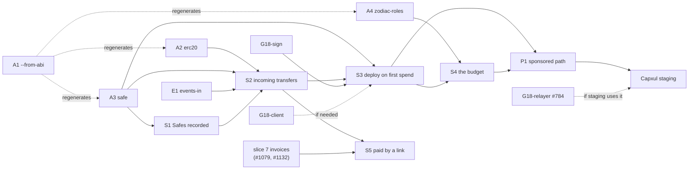

# CX-safe: the Safe, cut into slices Goal 16 can build

**Status: decided, 26 November 2026,** by Goal 16's 📐 designer thread, started by the money lane's 🧭 lead (issue
#1158), under AGENTS.md "Who decides". It cuts Goal 16's slice 2, "each person's and each company's Safe, acted on from
the CLI, MCP and an agent; a sales invoice with a pay link, paid from any wallet, settled by the chain, with the ledger
lines posted" (`design/goals/16-capxul.md:95`), into units that each land in about a day, names what Goal 16 claims for them, and
says where the new things go. The two questions for Aaron are at the end; the decision goes ahead on the
recommendation of each.

**Settled before this, and not reopened:** Capxul's on-chain account is a Safe and nothing else for now
(`CX-onchain-safe.md:17-22`); from `M7-capxul.md` section 4, two facts stand, that a person's account is an ordinary
Safe whose address is known before it is deployed, and that money can arrive there first (`M7-capxul.md:150-153,178-180`;
who owns it before a claim, and when it deploys, change here, under Supersedes); a Safe is someone else's contract behind the `safe` adapter,
and an organisation and its Safe are linked by an ordinary field (`K25-the-blueprint-on-chain.md:113-121`); payouts
are spent against an Org Budget, a Zodiac Roles 2.1.1 role the company's Safe grants, used by a member through
`execTransactionWithRole` from the member's own Safe, the owners can do anything directly, and over budget is refused
`PayoutOverBudget { remaining }` at prepare (CX-bridge-rails, #1149,
`design/decisions/CX-bridge-rails.md:169-204`); the Safe comes before Bridge (same file,
`:327-329,410-411`); staging runs on Base Sepolia with test USDC (the conductor, 26 November 2026).

**The prior art.** This thread cannot attach `Xelmar-tech/infrastructure` (the conductor's answer: it is not added).
The conductor read it from its own clone and answered the lead's questions on 26 November 2026; those answers are
cited here as `infrastructure:<path>:<lines>`, with `P/` for `packages/protocol/src/evm/`. Where a citation came
through CX-bridge-rails it is marked so. One fact still waits on the conductor and is marked **(conductor: confirm)**.

## In short

A Safe is a record Capxul keeps from the moment a person or a company has one. Its address is the one Safe's own
factory will give it, worked out before anything is on chain from a salt and its first owner, so money can be paid (Superseded by CX-safe-machines, 26 November 2026.)
there at once. A person's Safe starts owned by Capxul's bootstrap key, so its address needs nothing from the person;
when the person claims it, it is deployed and their key replaces the bootstrap key as its only owner. (Superseded by CX-safe-machines, 26 November 2026.) A company's Safe
is owned by its founders' and directors' personal Safes, never their keys, so a person can change their key without
any company's Safe moving. After deploy the chain is the truth for owners and threshold, read through the `safe`
adapter. Budgets come next, as a Zodiac Roles module the company's Safe switches on, and getting paid by a link comes
last, after the books have invoices. This is the earlier implementation's design (Aaron's own), lifted, with one
change: the salt is keyed by Capxul's id, not by an email. (Superseded by CX-safe-machines, 26 November 2026.)

The journeys run on Anvil, one per world, from the first slice that sends a transaction. No Safe stand-in is built:
Anvil per world, keys per world, the ABI codec, transaction tracking and the follower already work, so a fake chain
would be thrown away. The first slice sends nothing, so it needs no chain at all.

## 1. The things and their fields

Ids are new prefixes; amounts are base-unit digit strings, as everywhere in Capxul. Where each thing lives is section 5.

**`safe`: a Safe Capxul knows about** (`Blueprint.id("saf")`). One thing for both kinds (Superseded by CX-safe-machines, 26 November 2026.), because a person's Safe and a
company's are the same contract made by the same factory (`M7-capxul.md:178-179`) and differ only in who owns them.

| Field | Value | Why |
|---|---|---|
| `id` | `saf_…` | |
| `kind` | `personal` or `company` | who it belongs to decides who may act on it |
| `person` | `per_…`, set when `kind` is `personal` | whose Safe it is (`M7-capxul.md:150`) |
| `company` | `com_…`, set when `kind` is `company` | the company it is for; a company may have several, a Safe may have no company (`K25-the-blueprint-on-chain.md:117`) |
| `account` | `Blueprint.account()`, CAIP-10 | the address, worked out before deploy: `eip155:8453:0x…` on Base, `eip155:84532:0x…` in staging, `eip155:31337:0x…` in a world (`packages/orthograph/src/modules/values/service.ts:78`) |
| `firstOwner` | `Blueprint.account()` | the one owner given to `setup`: the environment's bootstrap key for a personal Safe; the founder's personal Safe for a company's (Superseded by CX-safe-machines, 26 November 2026.) |
| `owners` | a list of `Blueprint.account()` | today's owners: `[firstOwner]` until the chain says otherwise, then a read copy |
| `threshold` | a whole number, 1 to the number of owners | 1 at setup; a person's Safe stays 1 |
| `saltNonce` | a uint256 digit string | the CREATE2 salt's nonce (below), stored so the address can be checked again |

Its machine. A personal Safe: **`counterfactual`** (recorded, the address known, no code) → **`claimed`** (deployed, and
the person's key swapped in for the bootstrap key, both seen on chain). A company's Safe: **`counterfactual`** →
**`deployed`** (Superseded by CX-safe-machines, 26 November 2026.) (the factory's `ProxyCreation` for this address seen, confirmed by the tracker). A take-back that drops
the `ProxyCreation` (the follower's correction) moves `deployed` or `claimed` back to `counterfactual` (Superseded by CX-safe-machines, 26 November 2026.), as S2 undoes a
payment. After deploy, owners and
threshold change only on chain (`addOwnerWithThreshold`, `removeOwner`, `swapOwner`, `changeThreshold`), each an
owner-signed `safe-transaction`, and Capxul's row follows the adapter's reads. Refusals declared with the thing:
`ThresholdOutOfRange`, `OwnersNotUnique`, `SafeNotDeployed`, `NotClaimed` (a personal Safe pays nothing, and signs for
no company, until it is claimed), `AlreadyClaimed`, `NotAnOwner`. (Superseded by CX-safe-machines, 26 November 2026.)

**Where `safe` lives, beside K25's Safe.** Capxul's `safe` is a record in Capxul's own database (the project's default
store), not a thing that lives on chain: it exists before there is any contract to read. K25's `Safe`, "a thing living
in a source behind the `safe` adapter" (`K25-the-blueprint-on-chain.md:115-116,126`), is the adapter's own on-chain
view of a deployed Safe, and stays as K25 says; it is what A3 provides. They are two separate things, linked by the
account: Capxul's record points at the address, and every read of a deployed Safe goes through the adapter's `Safe`.
After deploy the chain owns owners and threshold: Capxul's `owners` and `threshold` are a read copy, refreshed from the
adapter on each confirmed owner change the follower hands on, and where they differ the chain wins. Before deploy,
Capxul's record is the only truth, because there is nothing on chain yet. So K25's words stand, and nothing of them is
superseded here.

**The bootstrap owner and the claim.** The implementation makes a person's Safe with one fixed owner,
`CAPXUL_BOOTSTRAP_OWNER` (`infrastructure:P/safe-contracts.ts:54`), so its address depends on the salt alone, before the
person has any signer; at claim, the person's signer replaces it by `swapOwner` (`infrastructure:P/safe-address.ts:143-174`).
Capxul lifts this. Each environment has its own bootstrap key (Superseded by CX-safe-machines, 26 November 2026.), held by the server (its custody declared `server`, M6.18;
a world key in a world); its address is part of every personal Safe's address in that environment. The bootstrap key
signs exactly one kind of transaction: the claim, submitted (section 3, "How transactions reach the chain") as the
factory's `createProxyWithNonce` followed by the Safe's `swapOwner(bootstrap → the person's key)`, signed by the bootstrap key. Nothing else Capxul
declares may use it; a journey proves the claim is the only operation that does. This keeps `M7-capxul.md`'s first
feature (money arrives before anything is deployed) and Aaron's "ordinary Safe owned by their key" once claimed; it
changes when the Safe is deployed (at the claim, not at its first pay-out) and who owns it before then (Supersedes).

**Keyed by Capxul's id, not an email.** The implementation's personal salt is
`BigInt(keccak256("<namespace>:<normalized email>"))`, with namespace `capxul:staging:email:v2`
(`infrastructure:P/safe-address.ts:56-63`, `P/safe-contracts.ts:33`), and a company's is namespaced by email and handle
(`infrastructure:P/organization-safe.ts:40-110`). Capxul keys it by its own id instead:
`saltNonce = uint256(keccak256("<namespace>:<id>"))`, the namespace `capxul:<environment>:safe:v1` and the id the
person's `per_…` or the company's `com_…`. Three reasons. An email changes; an id does not, and the address must not.
The salt nonce is an argument of the deploy call, so it is public on chain, and a hashed email is easily guessed back
from a list of addresses, which would put people's emails in public (AGENTS.md: keep people's details private). And a
person or a company has a Capxul id before they sign in or bring a key, which is all the address needs. The cost: a
Capxul address differs from the implementation's for the same person, which matters only for its staging Safes, and
no money in them is carried over.

**The address before deploy.** It is the address `SafeProxyFactory.createProxyWithNonce(singleton, initializer,
saltNonce)` will give, worked out the factory's way: CREATE2 from the factory's address, salt
`keccak256(encodePacked(keccak256(initializer), saltNonce))` (`infrastructure:P/safe-address.ts:205-206`), and the hash
of the factory's proxy creation code (pinned at `infrastructure:P/safe-contracts.ts:59-69`) followed by the singleton's
address. The initializer is the implementation's, byte for byte (Superseded by CX-safe-machines, 26 November 2026.): `setup([firstOwner], 1, …)` with the setup call that
enables the Safe 4337 module and that module as the fallback handler, and no payment
(`infrastructure:P/organization-safe.ts:44-71`); no Roles modifier or allowance is set up then (`:40-110`). So the
address depends only on the pinned contracts, the first owner and the salt, and adding a budget later never moves it.
The factory and singleton sit at the same addresses on every EVM chain, so the address is the same on Base, Base
Sepolia and in a world (CX-bridge-rails `:94`, its R9).

**`SafeDeployment`: the pinned contracts.** **Safe 1.4.1, the L2 singleton, with the Safe 4337 module**, as the
implementation pins on Base Sepolia (`infrastructure:P/safe-contracts.ts:3-16,82`): `SafeProxyFactory`
`0x4e1DCf7AD4e460CfD30791CCC4F9c8a4f820ec67`, `SafeL2` `0x29fcB43b46531BcA003ddC8FCB67FFE91900C762`, `SafeModuleSetup`
`0x2dd68b007B46fBe91B9A7c3EDa5A7a1063cB5b47`, `Safe4337Module` `0x75cf11467937ce3F2f357CE24ffc3DBF8fD5c226`, `MultiSend`
`0x38869bf66a61cF6bDB996A6aE40D5853Fd43B526`, `MultiSendCallOnly` `0x9641d764fc13c8b624c04430c7356c1c7c8102e2`. The
spike ran 1.5.0 (`spikes/safe-hats-module/versions.json:190-193`); 1.4.1 is taken because the implementation's Safes
and its 4337 path are on it, and the spike's findings Capxul uses (the SafeTx format and its order rules, module
enabling, a non-owner submitting, ERC-20 payouts) hold on both. The 4337 module is set up from the start because production sends through it:
the sponsored path (section 3, "How transactions reach the chain"). The addresses and
code hashes are read from `@safe-global/safe-deployments` at an exact version and checked against these, never typed by
hand in code. That package has no bytecode, so the bytecode (the proxy creation code, and the deployed code a world
sets with `anvil_setCode`) comes from the contract artifacts at the pinned versions: `@safe-global/safe-smart-account`
at 1.4.1 for the factory, the singleton, the proxy and MultiSend, and Safe's modules release that
`infrastructure:P/safe-contracts.ts` pins for `SafeModuleSetup` and `Safe4337Module`; each is checked against its
code hash. In the address formula the singleton's address follows the creation code padded to a uint256, as the
factory encodes it (`abi.encodePacked(proxyCreationCode, uint256(uint160(singleton)))`). `SafeL2` is the L2 build: it emits `SafeMultiSigTransaction`, which the follower reads.

**Which chain.** Base, 8453, in production, as the implementation and Bridge's `base` rail settle (CX-bridge-rails
`:92-94,415-416`); Base Sepolia, 84532, in staging; Anvil, 31337, in a world. Each environment names its chain in
`blueprint/environments/`; the `safe` thing never names one. This answers `CX-crypto-accounting.md:484`. In a world,
Anvil has none of these contracts, so the world puts the pinned deployed bytecode at the same addresses with
`anvil_setCode` before the first step; S2's check proves the world's predicted address is the factory's.

**`safe-transaction`: a transaction a Safe's owners are approving** (`Blueprint.id("stx")`), S3. Its fields are the
exact typed `SafeTx` (`to`, `value`, `data`, `operation`, the gas fields zero, `nonce`), its chain and Safe, and each
owner's approval so far. Its machine: `proposed` → `approved` (the threshold reached) → `submitted` → `executed` or
`failed` (the Safe's `ExecutionSuccess` or `ExecutionFailure` for its hash). The SafeTx's EIP-712 domain is the chain
id and the Safe's address (`verifyingContract`), and the nonce is a field of the `SafeTx` message, not of the domain;
the digest must equal the Safe's own `getTransactionHash` (`spikes/safe-hats-module/script/safe.ts:57-76`). How an
owner approves depends on what it is:

- **A key** (a claimed personal Safe's owner) signs the digest; signatures are packed in owner-address order, and the
  Safe refuses reversed order, a wrong recovery value and a replay (`ST3-budgets.md:169-177`,
  `spikes/safe-hats-module/README.md:34-38`).
- **A Safe** (a company's owners are personal Safes) cannot sign through ERC-1271 here, because these Safes' fallback
  handler is the 4337 module, not the compatibility handler that answers `isValidSignature`. So an owner Safe approves
  on chain: its own owner's key signs a SafeTx on the personal Safe that calls `approveHash(digest)` on the company's
  Safe, or, when it is the last approval, calls the company's `execTransaction` itself, where its approval counts
  because it is the sender. Each step is a transaction. **(conductor: confirm)** this is how the implementation
  executes a company's transaction (`infrastructure:P/organization-safe.ts`, `packages/backend/src/permissions/`). (Confirmed in CX-safe-machines, 26 November 2026: the founder Safe sends and calls `execTransaction` with a pre-validated signature.)

Each approval is an operation the owner calls; the call that reaches the threshold also submits. No workflow:
workflows are parked (K44), so collecting approvals is a thing's machine, not ST3.06's durable workflow.

**`org-budget`: an Org Budget** (`Blueprint.id("obg")`), S4. Fields: the company's `safe`, the member's own `safe` (the
Roles member is the member's personal Safe, CX-bridge-rails `:171-173`), the role key, the allowance key
(`orgBudgetAllowanceKey(roleKey, assetId)`), the token, the per-send limit, the allowance with its refill and period, in
USDC base units, and the recipients (`anyone` for a bank-payout budget, CX-bridge-rails `:206-215`). The chain is the
truth for the allowance's balance; Capxul's row is what was granted and a read copy of what remains. Its machine:
`granting` → `granted` → `revoked`, each move a company `safe-transaction`. As the implementation does it: the Roles
modifier is deployed through Zodiac's `ModuleProxyFactory` `0x000000000000addb49795b0f9ba5bc298cdda236`
(`infrastructure:P/organization-payments.ts:15`) with owner, avatar and target all the company's Safe
(`P/roles-module.ts:118-127`); a budget compiles to direct calls on the Roles modifier
(`buildOrgBudgetCallsWithEncoder`, `P/budget-permissions.ts:203-240`), scoped as `:117-155` says; the allowance is
`setAllowance(key, balance, maxRefill, refill, period, 0)`; and each is a company Safe transaction its owners approve
(`infrastructure:packages/backend/src/permissions/README.md`, `rules/encoding.ts`, `rules/stored-calls.ts`).

**Capxul's Payments contract, V3.** Leg 1 of every payout, and every Org Budget spend, is `CapxulPaymentsV3.send`
(CX-bridge-rails `:125-129,171-174`): `send(PaymentItem)` and `sendBatch`, with `PaymentItem { settlementId, recipient,
token, amount, kind, documentHash, jobNonce, executor }`, the event `PaymentSent(settlementId indexed, sender indexed,
recipient indexed, token, amount, kind, documentHash)`, and `settled[settlementId]` refusing a replay
(`infrastructure:packages/contracts/src/CapxulPaymentsV3.sol:13-35,63,68`). It is on Base Sepolia at
`0x46b28f455c8de7c1505e3185A3f8f87B07eaE1aE` from block 47942654 (`infrastructure:P/payments-v3.ts:7,219`); it is not
yet on Base. It is Capxul's own contract deployed outside the framework (K44 call 8), not generated by
`language-solidity`: its source is copied into Capxul at the implementation's commit, unchanged, with a line naming
that commit, and Forge builds it for worlds. This is the one exception to CX-bridge-rails's "Nothing is copied"
(`design/decisions/CX-bridge-rails.md:341-344`), whose reason is that the implementation is Convex and TypeScript and
Orthograph is Effect: that reason holds for code Orthograph runs, not for a Solidity contract that must be deployed
byte for byte as it already is on Base Sepolia, where a rewrite would be a different contract at a different address.
The copy is Aaron's own code, so licence and ownership allow it (`:343-344`). Under Supersedes.

**What is not a thing.** The Roles modifier and the Payments contract are reached through adapters (section 3). The
company does not gain a `safe` field: a company may have several Safes (`K25-the-blueprint-on-chain.md:117`), so the
`safe` thing points at the company, and Bridge's R1 reads "the company's Safe" as its one Safe of kind `company`
(CX-bridge-rails `:402`); a second is refused until a company needs one. This changes K25's "an organisation that wants a
Safe points at it" to a link either way (`K25-the-blueprint-on-chain.md:121`, under Supersedes).

## 2. How the journeys run

**On Anvil, one per world, from S2.** S1 sends nothing and needs no chain. Every slice after it runs its journeys
against a world with Anvil, its keys and Safe's contracts at their canonical addresses. No Safe stand-in.

What exists and works today, on `main`:

| Piece | Where | Today |
|---|---|---|
| Anvil per world, keys made by the world and never printed | `packages/chain-evm/src/modules/anvil` (M1.31) | works (`docs/canon/status.md:161`) |
| Keys, signing, simulation, a keystore | `packages/wallets` (M1.27 to M1.32) | works, its own checks only (`status.md:160`) |
| The ABI codec: calls, results, deploys, typed reverts | `packages/chain-evm/src/modules/abi` | built (its README still says empty; `service.ts:5-16`) |
| Transactions: prepare, sign, submit, track to `Confirmed`, replace, resume | `packages/chain-evm/src/modules/tx` | works |
| The follower: confirmed events once, corrections on a reorg | `packages/host-cloudflare/src/modules/follower` (M6.09) | works; check 11 is green on `main` (`e2e/on-chain/expected-failing/` lists no `11-`) |
| The on-chain suite runs on `main`, with Anvil | Goal 18's slice 9, #1104 | runs (`e2e/m1/48-g18-9-chain-basics.test.ts:3-5`) |
| `Blueprint.account()`, CAIP-10 | `packages/orthograph/src/modules/values/service.ts:78` | works |

What is missing, and whose it is (section 3):

| Gap | Status | Needed by |
|---|---|---|
| `ortho new adapter --from-abi` | provisional, #474 (`status.md:195`); the adapters are hand-written until it lands | S2 |
| the `erc20` adapter, typed `transfer` and `Transfer` | provisional, checks a draft #497 (`status.md:201`) | S2 |
| events in: an adapter's chain events, handed on by the follower, taken by `on:` | building, no goal running it (`status.md:191`) | S2 |
| a world with Safe's contracts at their canonical addresses | not built (M6.16's part) | S2 |
| the `safe` adapter: the prediction; owners, threshold, nonce, `execTransaction`, `approveHash`, `swapOwner`, the SafeTx typed data, `GS0xx` reverts typed | spiked (ST3.04, `status.md:170`) | S1 (the prediction), S3 |
| a Roles adapter and the Payments adapter | not on the board | S4 |
| the relayer, trusted | on `main`, marked experimental, four bugs in #784 (`status.md:164`; check 48 `:7-11`) | staging, if it uses the relayer; not the journeys |

`goal/capxul` does not yet hold Goal 18's chain-basics merge (#1104, a74aa622): S2's builder merges `main` into
`goal/capxul` first.

## 3. What Goal 16 claims, and what it builds on

**Goal 18 holds what its slice 9 built and runs in `e2e-on-chain` on `main`** (the conductor's answer, 26 November
2026): keys and wallets (`packages/wallets`), the chain adapter with its ABI codec, transactions and contract client
(`packages/chain-evm`), money, the follower and the relayer (`packages/host-cloudflare/src/modules/{follower,relayer}`).
Goal 16 builds on those and does not take them over. A change any of them needs is a Snag issue naming Goal 18, pinned
by its own check, and keeps `e2e-on-chain` green. Purely additive new files in chain-evm's `anvil` module and in the
world are Goal 16's under `lane:goal-16`, as long as `e2e-on-chain` stays green; a change to existing world or Anvil
code is a Snag naming Goal 18. Slice 9 itself only ran the suite on `main` and marked the relayer experimental (#1104);
it built none of the Safe, Hats, budget, `erc20` or events-in parts.

**Goal 16 claims** (the conductor's answers): `erc20-adapter` (ST2.02, #485), `events-in` (M5.03's chain part, #480),
the Safe and budget parts of `safe-hats-budgets` (ST3.04, #484), and `--from-abi` (#474). The three adapters are
separate packages, `packages/erc20/`, `packages/safe/` and `packages/zodiac-roles/`, built in parallel; the
`safe-hats-budgets` row's path (`packages/wallets`) moves to the two new packages. Each claim includes the small wiring
edits it needs in existing files: an export line in a package's `main.ts`, a dependency in a `package.json`, a project
in the Nx graph, and for events-in the few existing files of `modules/events` and `modules/plugins` it must extend. Any
edit beyond wiring in a Goal 18 path is a Snag. Hats is not built: the Org Budget is Zodiac Roles, so
`ST3-budgets.md`'s recommendation is not taken for Capxul.

**How transactions reach the chain.** In production, Capxul's transactions go as sponsored ERC-4337 UserOperations:
leg 1 of a payout through the CapxulPayments settlement contract (`design/decisions/CX-bridge-rails.md:125-126`), and
an owner Safe acting through its 4337 module (the conductor's reading of the implementation, on #1170). That stands as
CX-bridge-rails says; this decision does not change it. In worlds and journeys, a world key submits the same calls
directly through `packages/wallets`'s existing submit, as a stand-in for the sponsored path; the spike showed a
non-owner can submit a signed Safe transaction (`spikes/safe-hats-module/README.md:49-52`). The sponsored path is its
own unit, P1, and comes before Capxul's staging run. Who pays the gas is Aaron's (For Aaron, 1).

**Snags naming Goal 18, in Goal 18's milestone, each pinned by its own check:**

- **EIP-712 typed-data signing (M6.15).** `packages/wallets` on `main` has none, and S3 needs it to sign a SafeTx.
- **The contract client (M6.14),** if a Safe's `GS0xx` revert cannot be decoded through the existing `Abi.refusal`.
- **The relayer's four bugs (#784),** before Capxul's staging run if staging sends anything through the relayer, pinned against check 48: slice 9 kept #784 open
  "for the app that first pulls it" (`e2e/m1/48-g18-9-chain-basics.test.ts:9-10`), and a fix must change check 48's
  author first (`:21-22`). Capxul's journeys do not need the relayer ("How transactions reach the chain", above).
- **The follower's sink,** only if events-in needs a change to it.

**Taken from parked goals, credited, never merged.** Events-in takes what helps from `goal/superagent`'s slice 11
(adapter events carrying `id` and `actor`, `status.md:191`; Goal 17 is parked); `--from-abi` takes what helps from
parked Goal 12's draft checks, #497 on `goal-12/st2-02-check`. Each copies only what it needs and credits its source in
the commit and the file.

**What is lifted, and what is new.** Lifted from the implementation (Aaron's own, `infrastructure:packages/protocol/src/evm/`
and `packages/contracts/`): the Safe's version, addresses and initializer, the address formula, the bootstrap owner (Superseded by CX-safe-machines, 26 November 2026.)
and the claim, the company's Safe owned by personal Safes, CapxulPayments V3 unchanged, and the Org Budget's Roles
deployment, scoping and allowance calls. New in Capxul: the Orthograph things and their machines and refusals, the
salt keyed by Capxul's id, the journeys and checks, and the adapters' shape as Orthograph adapters (hand-written to the
shape `--from-abi` will generate, then regenerated by it).

**Not built here.** `@orthograph/budgets` (ST3.05) and `examples/budgets`, which CX-bridge-rails already sets aside
(`:221-224,358-359`); ST3.06's durable signature workflow.

## 4. The units, and the order they run in

Aaron's steer, through the conductor, 26 November 2026: the smallest independent units, each one check and build pair
that lands on its own in `goal/capxul` in about a day. A ✍️ author who is not the builder writes each unit's checks
first, red, and proves them fair (the `author` skill); a 🔨 builder makes them green; a 🔍 that wrote neither passes it.
A unit that changes Capxul's `generated/` lands as a G12 pair, `goal-16/<unit>-check` then `goal-16/<unit>-build`.
Framework units land in `main` too, as soon as they are green, and are merged into `goal/capxul` before a Capxul unit
uses them. Every unit's issue (its number beside its name) is a sub-issue of #1158, and the issue is the claim: an agent in any harness takes it by
commenting on it.

The table is grouped by kind, not in run order; the graph below is the order.

| Unit | What it builds | Owns | Needs | Done when | `generated/` |
|---|---|---|---|---|---|
| **A1 · `--from-abi`** (#1164) | `ortho new adapter --from-abi`: typed calls, events and reverts from an ABI, a stand-in contract deployed into a world | new files in `packages/cli/src/modules/new/` and its own module in `packages/generators`; in `packages/cli/src/main.ts`, `newAdapter` (`:263-280`) refuses without `--from-openapi`, so it gains a second flag and a choice between the two, a few lines rather than one | authoring now; the build after #1087 and #1153 land on `main` | a generated adapter's typed call, event and revert pass against its stand-in on Anvil | no |
| **A2 · erc20** (#1162) | `@orthograph/erc20`: `transfer`, `balanceOf`, `Transfer`, a test token for worlds | `packages/erc20/` | nothing | `transfer` and `Transfer` are typed, a revert decodes typed, against the test token on Anvil | no |
| **A3 · safe** (#1161) | `@orthograph/safe`: `SafeDeployment`, the address prediction, the world starter (`anvil_setCode` of the pinned bytecode), reads of owners, threshold and nonce, the SafeTx typed data, `execTransaction`, `approveHash`, `swapOwner`, `GS0xx` typed | `packages/safe/` | nothing | the prediction matches the implementation's formula on a fixed vector (Superseded by CX-safe-machines, 26 November 2026.) and the factory's address on Anvil; a SafeTx's digest equals `getTransactionHash`; a replay is `GS026`, typed | no |
| **A4 · zodiac-roles** (#1163) | `@orthograph/zodiac-roles`: the Roles modifier through `ModuleProxyFactory`, the Org Budget's calls, `setAllowance`, `execTransactionWithRole`, the allowance read | `packages/zodiac-roles/` | nothing | on Anvil, a role scoped to one call and an allowance passes a send within it and refuses one over it, read back typed | no |
| **E1 · events-in** (#1165) | `on:` for an adapter's confirmed chain events, once each by `${chainId}:${blockHash}:${logIndex}`, with corrections | new files in `packages/orthograph/src/modules/{events,plugins}/` and its wiring (Superseded by CX-safe-machines, 26 November 2026.) | nothing (the follower is built) | an event delivered twice settles once; a correction undoes it | no |
| **S1 · The Safes recorded** (#1168) | the `safe` thing; `safe.record` for a person and a company (Superseded by CX-safe-machines, 26 November 2026.); acted on from the CLI, MCP and an agent; no chain | `examples/capxul/blueprint/things/safe/`, its journeys | A3's prediction (build only) | as S1 below | yes, a pair |
| **S2 · Incoming transfers** (#1169) | an `on:` for the `erc20` `Transfer` to a recorded Safe, kept as a received payment | the received-payment thing and its journeys in `examples/capxul/` | S1, A2, A3's world starter, E1 | as S2 below | yes, a pair |
| **S3 · Deploy on first spend** (#1170) | `safe.claim`, `safe-transaction`, a company's Safe deployed on its first spend, a director added (Superseded by CX-safe-machines, 26 November 2026.) | `examples/capxul/blueprint/things/safe-transaction/`, `safe`'s new moves, journeys | S2, A3, Snag G18-sign, Snag G18-client (if needed) | as S3 below | yes, a pair |
| **S4 · The budget** (#1171) | the Payments contract copied and its adapter; `org-budget`; `payment.send` under the role; `PayoutOverBudget` | `examples/capxul/blueprint/things/org-budget/`, `examples/capxul/plugins/onchain-pay/`, journeys | S3, A4 (Superseded by CX-safe-machines, 26 November 2026.) | as S4 below | yes, a pair |
| **S5 · Getting paid by a link** (#1172) | a pay link on an invoice, settled only by S2's `Transfer`, its ledger lines posted | the invoice's pay link and its journeys | S2; slice 7's sales invoices, which wait on #1079 and #1132 | as S5 below | yes, a pair |
| **G18-sign** (Snag #1166) | EIP-712 typed-data signing in `packages/wallets` (M6.15) | Goal 18's | nothing | the signer signs a SafeTx's typed data and the digest matches | no |
| **G18-client** (Snag #1167) | a Safe's `GS0xx` reverts decoded typed through the contract client (M6.14), if `Abi.refusal` cannot | Goal 18's | nothing | a planted `GS026` reaches the caller as a typed refusal | no |
| **G18-relayer** (#784) | the relayer's four bugs, pinned against check 48 | Goal 18's | check 48's author first | as #784 says | no |
| **P1 · The sponsored path** (#1174) | production's path (CX-bridge-rails `:125-126`): Capxul's calls as sponsored ERC-4337 UserOperations through the Safe 4337 module, a bundler and a paymaster on Base Sepolia, an owner Safe acting through its module | new files in `packages/safe/` (a `user-operation` module), Capxul's environment for staging | S3, S4; who pays the gas (For Aaron, 1) (Superseded by CX-safe-machines, 26 November 2026.); a bundler and paymaster credential for staging, which is Aaron's | a claim, an owner-approved payment and a budget send each land on Base Sepolia as a sponsored UserOperation (Superseded by CX-safe-machines, 26 November 2026.) with the same journeys' results as in a world | no |

(For the Safe's units, this order is superseded by CX-safe-machines section 5's graph, 26 November 2026.)

**What runs at once.** Now: the authors of A1, A2, A3, A4, E1 and S1, and the two Snags' authors in Goal 18. The
builds of A2, A3, A4 and E1 at once, since none needs another; A1's build after #1087 and #1153; S1's build after A3.
Then S2, then S3, then S4, in that order; P1 after S3 and S4, before Capxul's staging run; S5 as soon as S2 and slice
7's invoices are in. A1 never blocks anything: the
adapters are hand-written to its shape and regenerated once it lands. Bridge's R1 waits on S1, R2 on S2, R3 on S4
(CX-bridge-rails `:410-411`).

### The Capxul units' checks

The lead's draft on #1158 had four slices. This cut adds **S2, incoming transfers**, before the Safe goes on chain:
getting paid to a Safe needs no deploy (`M7-capxul.md:169-178`), and Bridge's deposits need the same door
(CX-bridge-rails `:403,410`). It puts the claim in S3, since a person's Safe deploys when it is claimed. (Superseded by CX-safe-machines, 26 November 2026.)

- **S1 · The Safes recorded,** in `prove`: a person's Safe has the address of a vector worked out with the
  implementation's own formula for a fixed salt nonce and owner (Superseded by CX-safe-machines, 26 November 2026.); recording the same id twice gives one Safe; a
  company's Safe's address changes with its founder's Safe and nothing else; a company whose founder has no Safe is
  refused; a stranger cannot record a Safe for another person or company; an agent records one through MCP. It
  unblocks Bridge R1, the company's Safe address as a fact (CX-bridge-rails `:402`).
- **S2 · Incoming transfers,** on Anvil: USDC sent to a counterfactual Safe's address is recorded once on that Safe, (Superseded by CX-safe-machines, 26 November 2026.)
  typed; a second delivery of the same event changes nothing; an `anvil_reorg` that drops it gives a correction and
  the payment is undone; the address S1 worked out is the one the factory deploys at.
- **S3 · Deploy on first spend,** on Anvil: a person claims their Safe holding USDC, it reads `claimed` with their key
  its only owner, and they pay a supplier on their one signature (Superseded by CX-safe-machines, 26 November 2026.); a second claim is `AlreadyClaimed` (Superseded by CX-safe-machines, 26 November 2026.); an unclaimed
  Safe's payment is `NotClaimed`; the bootstrap key is used by the claim and by no other operation (Superseded by CX-safe-machines, 26 November 2026.); a company's Safe
  owned by its founder's Safe is deployed and pays on the founder's approval; with a director added at threshold 2, it
  pays after the second approval and not after the first; an approval from a non-owner is `NotAnOwner` before anything
  is sent; a replayed SafeTx is refused by the Safe as `GS026`, typed; an `anvil_reorg` that drops the deploy puts the
  Safe back to `counterfactual` (Superseded by CX-safe-machines, 26 November 2026.).
- **S4 · The budget,** on Anvil: a member's Safe sends within the budget, `PaymentSent` carries its `settlementId`,
  and the allowance falls by exactly that; a send over it is refused `PayoutOverBudget` with the right `remaining`
  before any transaction; a spent budget gives `remaining: 0`; a second `send` with the same `settlementId` is refused
  by the contract; an owner's direct send needs no budget; a revoked budget refuses; the role cannot send a token it
  was not scoped to.
- **S5 · Getting paid by a link:** `M7-capxul.md`'s journeys (section 4): paid by its link and settled; a second
  transfer for a settled invoice changes nothing; no call marks an invoice paid; a stranger reads an invoice by its
  link and nothing else; the ledger balances after each payment.

## 5. Where the new things go

A feature may import only features, never the app (the conductor's answer). So, per thing:

| Thing | Where | Why |
|---|---|---|
| `safe` | `examples/capxul/blueprint/things/safe/` | it links to Company and to a person, both still in the app |
| `safe-transaction` | `examples/capxul/blueprint/things/safe-transaction/` | it links to `safe` |
| `org-budget` | `examples/capxul/blueprint/things/org-budget/` | it links to two `safe`s |
| the Payments adapter, the contract's copied source and its ABI | `examples/capxul/plugins/onchain-pay/` | it needs nothing of the app, so it is in the feature from day one |
| `SafeDeployment`, the prediction, the Roles calls | `packages/safe/` (A3) and `packages/zodiac-roles/` (A4) | they are the framework's, for any app's Safes |
| the salt's namespace and the bootstrap key's address, per environment (Superseded by CX-safe-machines, 26 November 2026.) | `examples/capxul/blueprint/environments/`, the key itself a secret | they are Capxul's and differ per environment |

The three things move into `onchain-pay` after `company` and `people` have moved, as a move of its own; its row belongs
on CX-features's move list (#1157, `goal-16/features-rename`, not yet in `goal/capxul`; the features lead's file, so the
lead adds it). Its journeys go in
`examples/capxul/journeys/`, named `safe-…` as Bridge's are `bridge-…`; Capxul's CI job (`tools/ci/capxul-paths.sh`)
already runs `prove` over `examples/capxul`. A rule that lives on chain changing by a migration with money in it has no
word in the blueprint yet (`CX-composable-pieces.md:524-525`); S4 meets it first, and a Snag is logged then if it bites.

## For Aaron

1. **Who pays the gas on Base?** Capxul's transactions go as sponsored UserOperations, as your implementation does. I
   recommend Capxul sponsors them, for claims, deploys, Safe transactions and payouts (Superseded by CX-safe-machines, 26 November 2026.): a cost of Capxul's, small on
   Base. The other choice is each company paying for its own, which needs ETH in every Safe before it can spend. The
   conductor is bringing this to you; proceeding on Capxul paying.
2. **Is it all right that Capxul's bootstrap key owns a person's Safe until they claim it?** I recommend yes, as your
   earlier implementation does: it is what lets money arrive before a person has a key, and the key signs only the
   claim, which a journey proves. The other choice is to make each person's Safe only when they bring a key, so Capxul
   never holds one, but then nobody can be paid before they sign up. Proceeding on the bootstrap key. (Superseded by CX-safe-machines, 26 November 2026.)

## Supersedes

- design/decisions/K25-the-blueprint-on-chain.md: "An organisation that wants a Safe points at it with an ordinary field." → "An organisation and its Safe are linked by an ordinary field; in Capxul the Safe's record points at its company, since a company may have several (CX-safe)."
- design/decisions/M7-capxul.md: "Their personal account is an ordinary Safe owned by that key, at the address it will have once deployed." → "Their personal account is an ordinary Safe at the address it will have once deployed; until they claim it, its only owner is Capxul's bootstrap key, and claiming deploys it with their key in its place (CX-safe)."
- design/decisions/M7-capxul.md: "and the Safe is deployed on its first pay-out, in the second feature" → "and the Safe is deployed when it is claimed (CX-safe)"
- design/decisions/M7-capxul.md: "the `safe` adapter (ST3.04), which waits on the budgets decision (ST3.02) and so on Goals 7, 4 and 8" → "the `safe` adapter, which Goal 16 builds as its own unit, with no wait on the budgets decision or other goals"
- design/goals/16-capxul.md: "later with the chain (after 7, 10)" → "in units (CX-safe); only its pay link waits on 7"
- design/goals/16-capxul.md: "| 7, 10 |" → "| 7, for S5's pay link only |"
- design/goals/16-capxul.md: "The Safe and getting paid on chain, later with the chain (K44, section 3)" → "The Safe and getting paid on chain, in units (CX-safe)"
- design/decisions/CX-bridge-rails.md: "Nothing is copied" → "Nothing is copied, except CapxulPayments V3's Solidity source, copied unchanged so it deploys byte for byte (CX-safe)"

`ST3-budgets.md` is not decided (`ST3-budgets.md:3-7`), so no words of it are superseded; its Hats recommendation is
not taken for Capxul, and a note beside its title says so.
