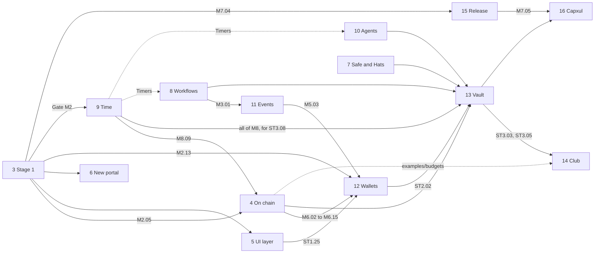

# The goal map

Every goal from here to 1.0 and Capxul, drawn by the 🎼 conductor on 21 November 2026 at Aaron's ask: "we need a map
of all of the goals … we want to make them as independent as possible … so we can parallelize these". Each goal runs
in any harness and coordinates through git and GitHub (K32; K33 in #301): one brief, one branch, one milestone, one done
check. The slices come from `design/milestones.md`; this page groups them into goals and says what each needs, and
K34 makes those needs, not milestone order, the rule for when a goal may build.

## How a goal stays independent

1. **It owns paths, and only its own.** A goal's brief lists the packages and folders it owns. Anything outside them
   is an Ask issue to the owner (K32; K33 in #301). The one exception is an integration branch, Goal 17's
   `goal/superagent` (K39): it builds the framework fixes its app needs there, announces each by an Ask issue, and the
   conductor merges them back.
2. **New work is a new package or a new module.** A goal that adds to the core (`orthograph`, the compiler, a host)
   adds new modules only, and proves that a blueprint not using them generates byte for byte what it did before (the
   rule K31 set for the app map).
3. **Every shared seam has one owner** (below). Another goal that needs the seam changed asks its owner.
4. **A goal may start before what it needs has landed** by writing its journeys and checks first, red, against the
   seam's agreed shape. Only its build slices wait.

## The shared seams and their owners

| Seam | Owner | Why it is shared |
|---|---|---|
| The engine: `orthograph` (the Blueprint API), `compiler` and its model, `generators`, `projections`, `language-effect` (apart from its `timers` and `clock` modules, Goal 9's) | Goal 3, on `goal/stage-1`. Goal 4 may change it on `goal/on-chain`, merges `goal/stage-1` in at every slice and resolves every conflict (K26, item 4, on `goal/stage-1`). Any other goal adds new modules and asks Goal 3 for anything else | every goal declares through it |
| `host-cloudflare` | Goal 3 until auth leaves the host (M2.05), then Goal 4 (the host plugin kind, its slice 1) | sign-in, chain hosts and workflows all run in it |
| `examples/plugged-in`, the product | Goal 3; each later goal adds its own feature folder (Goal 5 `src/web`, Goal 12 the wallet feature, Goal 13 `/@group`) | every stage is a feature of it |
| `Timers`, the world's clock and counted work (`language-effect`'s `timers` and `clock` modules) | Goal 9 | workflows, agents, the chain follower and moves made by time all wait through it |
| The workflow engine | Goal 8 | signatures (stage 3), notifications, the factory's manager |
| `chain-evm` (the client, relayer and follower), `language-solidity`, `examples/budgets` | Goal 4 | wallets (stage 2), the vault (stage 3) and the club's spike (stage 4) |
| `@orthograph/web` and the generated pieces | Goal 5 | every app screen and the new portal's forms |
| The portal client and the theme | Goal 6 | every face a feature adds |
| `prove`'s publish and the release path | Goal 15, except the npm preview (M1.51), which is Goal 3's | the preview and every release |

## The goals

Status: **done**, **running**, **ready** (brief written, branch cut), **planned** (on this map, brief to write).
"Needs" lists only what a goal's build slices read from another goal and is not yet there; everything else is its
own earlier slices. A new goal's branch is cut from `goal/stage-1`, so a slice marked ✅ there (all of M1 that the
later goals read, apart from M1.24 and M1.49, and M7.01) counts as landed. A slice's `needs` cell in `milestones.md` is the rule; K34 rewrote the cells that only said milestone order.

| Goal | What it delivers | Release | Status | Owns | Needs from other goals |
|---|---|---|---|---|---|
| 1 · The whole framework, locally | layers 1 and 2: blueprint to proof on one machine | — | done | — | — |
| 2 · Land and rename (M0) | Orthograph's name and the repository's shape | — | done | — | — |
| 3 · Stage 1 of Plugged In | the preview's last M1 slices and the npm preview (M1.51), all of M2 (people, roles, auth and organisations as plugins, secrets, `ortho new`, the handles plugin, M2.13), the stage 1 slices, staging up and destroy (M7.01, M7.03, M7.04) | Preview, Beta | running (Claude) | `goal/stage-1`, the engine and `host-cloudflare` (above), `examples/plugged-in`, M1, M2, ST1, M7.01, M7.03, M7.04 | — |
| 4 · On chain, end to end | all of M6 and its gate, M6.19: the chain store, Solidity output, Foundry and fuzz, the Safe host, the client, relayer, follower, signing, worlds with a chain, moves made by time in Solidity (M6.21) | 1.0 | running (Claude) | `goal/on-chain`, `language-solidity`, `chain-evm`, `examples/budgets` | its host slice: M2.05 (Goal 3); M6.21: M8.09 (Goal 9). M6.01 needs none (K26, item 1) |
| 5 · The UI layer | an action and a UI SDK piece per operation, `@orthograph/web`, Plugged In's three screens | Beta | ready once its brief lands (#285) | `goal/ui-layer`, `@orthograph/web`, `generated/actions`, `generated/web`, Plugged In's `src/web` | its sign-in screen: M2.05; the handle screens: the handles plugin (both Goal 3) |
| 6 · The new portal | the theme, the app map in the blueprint, the shell, `portal-next`, then one cutover | Beta | ready once its brief lands (#285) | `goal/portal`, `packages/portal-next`, the theme package, the map modules | the cutover: Goal 3's yes on a freeze |
| 7 · Safe, Hats and budgets | ST3.01, the spike stage 3 starts from: a Safe, Hats and a budgets module on Anvil | 1.0 | done (lands by #294) | `spikes/safe-hats-module` | — |
| 8 · Workflows | M3.01, M3.27, M3.28 (M3.02 and M3.03 are done): `Blueprint.workflow` on the Cloudflare engine the spike proved (#289), activities, waits on events, durable clocks through `Timers`, replay that skips finished steps | 1.0 | ready | a new `@orthograph/workflows`, its host module, `examples/workflows` | `Timers`' shape from Goal 9, agreed first; it builds beside it |
| 9 · Time | M8.02 to M8.18: the world holds the clock, `Timers` across processes, moves made by time, the on-time eval, `ortho dev`'s scaled clock | 1.0 | ready | `Timers`, the world's clock, M8's checks | M8.18 and so M8.11, M8.13 and M8.16: Gate M2 (Goal 3); M8.17: M6.09 (Goal 4) |
| 10 · Agents | M4.01 to M4.10, M4.16, M4.26: a durable agent run, model adapters and a stand-in model, tools from operations, `@orthograph/agents`, the portal's chat on it | 1.0 | ready | `@orthograph/agents`, `@orthograph/anthropic`, the stand-in model | M4.16: M1.24 (Goal 3); M4.26: M8.07 (Goal 9) |
| 11 · Events in and out | M5.01 to M5.04 and M3.16: where views live, `on:` for events, doors that verify signatures, `emits:`, the outbox | 1.0 | ready | the events and outbox modules, their host parts | M3.16: M3.01 (Goal 8) |
| 12 · Wallets: stage 2 | ST2.01 to ST2.06: the ABI adapters (ST2.02), create a wallet, link your own with SIWE, pay by handle, the browser signer in Chromium | 1.0 | ready | Plugged In's wallet feature, the ABI adapters, ST2's journeys | ST2.01: M6.02; ST2.03: ST1.25 (Goal 5) and M6.15; ST2.04: M2.13, M6.09 and M5.03 (Goals 3, 4 and 11). ST2.02 reads only M1.30 and M1.31, ✅ on `goal/stage-1`. Its gate, ST2.06, also needs the stage's milestone slices: M6.01, M6.02, M6.07, M6.09, M6.15, M6.18 (Goal 4), M5.01 and M5.03 (Goal 11), M2.13 (Goal 3) |
| 13 · The vault: stage 3 | ST3.02 to ST3.08: budgets as a feature, the `safe` and `hats` adapters, owners' signatures as a workflow, Plugged In's `/@group`, an agent spending under its hat | 1.0 | ready | `@orthograph/budgets`, Plugged In's `/@group`, ST3's journeys | ST3.02: ST3.01 (Goal 7, by #294), M6.01 (Goal 4) and M3.01 (Goal 8); ST3.04: ST2.02 (Goal 12); ST3.05 and ST3.06: M6.13, M6.15 (Goal 4) and M3.28 (Goal 8); ST3.07: M4.10, M4.16 (Goal 10) and M2.07 (Goal 3). Its gate, ST3.08, also needs the stage's milestone slices (`milestones.md`, the stage table): all of M8 (Goal 9), M6.10 to M6.17 and M6.21 (Goal 4), M3.01 to M3.03 (Goal 8), M4.01 to M4.10 and M4.16 (Goal 10) |
| 14 · The club: stage 4 | ST4.01 to ST4.08: Noir on Aztec, private budgets and ballots, `language-noir`, `chain-aztec` | 1.0 | ready | `language-noir`, `chain-aztec`, `@orthograph/ballots`, `spikes/aztec-club` | ST4.01 to ST4.04: none, ST4.01 reading the budgets declaration in `examples/budgets` (Goal 4); ST4.05, and so ST4.06 to ST4.08: the budgets journeys and feature, ST3.03 and ST3.05 (Goal 13, K35) |
| 15 · Release and the cloud | M7.13 (the release pass), M7.02, M7.05 to M7.09, M7.12, M7.14: npm, Homebrew and GitHub releases, signed verdicts from CI, monitors to the sink, an own CI runner if Aaron says yes | 1.0 | ready | the release tooling, `tools/ci`'s release jobs | M7.14: M1.49 (Goal 3); M7.05, M7.07 to M7.09: M7.04 (Goal 3); M7.12: every M7 slice, Goal 16's included. Each credential needs Aaron's written yes |
| 16 · Capxul on Orthograph | M7.10 and M7.11 and the Capxul calls of 20 November: which plugins exist, which are new, which are Capxul's own; then its first feature in its staging | 1.0 and after | ready | `decisions/M7-capxul.md`, Capxul's own repository | M7.11: M7.05 (Goal 15); its first feature, by the Capxul calls of 20 November rather than a needs cell: stage 3 (Goal 13) |
| 17 · The superagent | the superagent pattern on Orthograph and Pi Durable (K39): an always-on agent, stored as data, that anyone or any agent makes for a job from the services it connects; its framework fixes (K40) and adapters generated from each service's spec (M5.07) first, then its blueprint, its two durable agents (a cheap main agent, an executor per ticket) and its connections; proved by a coding agent (GitHub, Slack) and a triage agent made at runtime (PostHog); its plugins written in `examples/superagent/plugins/` and moved to `packages/` once they work (`@orthograph/superagent`, `intake`, `tickets`, `prompts`, `sandbox`; `github`, M4.25, `slack`, `posthog`, `webhook`) | — (off the 1.0 path) | ready | `goal/superagent`, an integration branch; `examples/superagent`, `e2e/superagent`; the framework fixes K40 designs, built there and merged back by the conductor | nothing: what it needs from Goals 3, 6, 10 and 11 it takes from `goal/stage-1` if landed, and builds there to their design if not; K40 is decided (#529) |

Off the 1.0 path, kept for later and not a goal yet: the factory and the work board (M3.04 to M3.15 and M3.17 to M3.26,
M3.08 among them), the builder's tools and workspaces (M4.11 to M4.15, M4.17 to M4.24; M4.25 is Goal 17's, K39), Stripe, Resend and the other
adapters (M5.05 to M5.15), and the Foreman (`design/foreman/`), which these build towards.

## What can run at once

- **Now, side by side:** Goals 3 and 4 (running); 5 and 6 once #285 lands; and every planned goal's first slices:
  8's decision (M3.01), 9 (M8.02 to M8.10), 10 (M4.01 to M4.10), 11 (M5.01 to M5.04), 12's ABI adapters (ST2.02), 14's first four (ST4.01 to ST4.04), 15's release pass (M7.13: M7.01 is ✅ on `goal/stage-1`, so it waits only on Aaron's yeses), 16's mapping (M7.10) and 17's own designs and its adapter checks (its slices 2 and 3), then its three lanes of checks (slices 6, 8 and 10). 8, 9 and 10 agree
  `Timers`' shape first.
- **As Goal 4 lands M6.01 to M6.15:** Goal 12's wallet slices and Goal 13's decision (with Goal 8's M3.01).
- **As Goals 8, 10 and 12 land:** the rest of Goal 13's slices, and Goal 14's private budgets after Goal 13's ST3.05; its gate also waits for all of Goal 9 and Goal 4's
  stage 3 slices. Then Goal 16's feature.

## Starting a goal

Goals 8 to 16 were briefed and their branches cut on 21 November 2026 (K35), so each is `ready`.

The conductor writes its brief in K33's shape (in #301: front matter, the plain goal card, its slices, its owned paths, its
done check, its one-line start), cuts and protects its branch, and the sync gives it a milestone, a goal issue and a
sub-issue per slice. Aaron then starts it in any harness: "You lead Goal <n>. Read `AGENTS.md` and
`design/goals/<nn>-<name>.md`, and run it."
